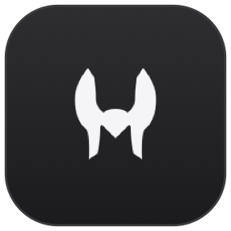
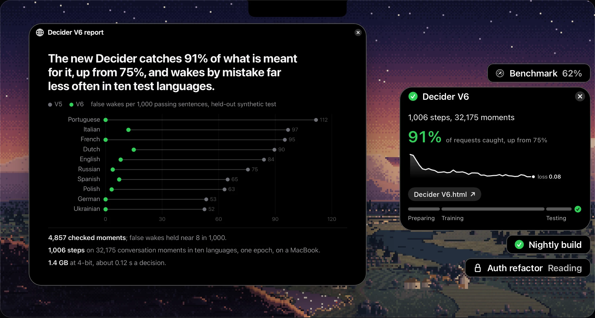

<p align="center">
  
</p>

<h1 align="center">Heimdall </h1>

<p align="center">Talk to your Mac. Every job you mention starts at once.</p>

<p align="center">
  <a href="#install-the-alpha"></a>
  &nbsp;
  <a href="https://tobynoskillson.com/heimdall"></a>
  &nbsp;
  <a href="https://tobynoskillson.com/#support"></a>
</p>

<p>
  
</p>

Say it out loud: "Remember the test we were doing? Let's continue that." Heimdall starts the job at once, gives it its
own island on your screen, and answers out loud when it is done.

- **No wake word.** It knows when you mean it. It asks only when it must.
- **It remembers what was said.** "What was that library Maya mentioned on Tuesday?" finds the line in Tuesday's call
  and answers it.
- **Audio never leaves your Mac.** Speech to text, who is speaking, the wake decision, its voice and memory search all
  run on the Mac.

> **Alpha (v0.1.0-alpha.2).** This is an early build of the developer's own daily assistant. Expect rough edges,
> features marked beta below, and changes without migration. 

## Install the alpha

With [Homebrew](https://brew.sh):

```sh
brew install --cask tobynoskillson/tap/heimdall-alpha
```

Or download `Heimdall-Alpha-0.1.0-alpha.2-arm64.zip` from the
[v0.1.0-alpha.2 release](https://github.com/TobyNoSkillSon/Heimdall/releases/tag/v0.1.0-alpha.2), unzip it and move
`Heimdall Alpha.app` to Applications. The app is ad-hoc signed, not notarised: open it once, then click **Open Anyway**
in System Settings → Privacy & Security, or run `xattr -dr com.apple.quarantine "/Applications/Heimdall Alpha.app"`
(Homebrew clears the download flag for you).

Setup walks you through the rest: your name, the agent provider, the macOS permissions and the model downloads (about
5.0 GB, each file checked against its pinned SHA-256). The full guide, also written for an agent setting Heimdall up
for you: [tobynoskillson.com/heimdall/docs](https://tobynoskillson.com/heimdall/docs/).

Updates: `brew upgrade --cask heimdall-alpha`, or download the newer zip. The in-app updater is off in this alpha.

To build it yourself instead, see [Build and install](#build-and-install).

## Privacy, read this first

Audio never leaves your Mac. The microphone and recordings, speech to text, who is speaking, the wake decision, its
voice, memory search and the archive all stay on it, in `<your home folder>/.heimdall`. The agent you connect never
gets audio: it gets your request and the conversation it needs as text, and the screenshots it needs. If the agent
runs on the Mac, nothing leaves at all.

Heimdall records. With listening and screen capture on, it transcribes everyone in the room and on your calls, keeps
voiceprints of the people it hears, and archives what is on your screen, messages included. Tell the people around
you, and check the recording laws where you live.

## Requirements

- A Mac with Apple silicon and macOS 14.4 or later; **macOS 26 recommended** (memory search was tested there). 32 GB of RAM
  recommended; the models use about 4 GB.
- About 6 GB of free disk for the models, plus about 25 GB for the Rust build.
- Xcode 26 or later (for Swift, Metal and the macOS SDK) with its Metal Toolchain, Rust (stable, via
  [rustup](https://rustup.rs)), and from [Homebrew](https://brew.sh) CMake, Python 3.11+ (build scripts only; nothing
  Python ships in the app) and ffmpeg. Exact steps: [docs/install.md](docs/install.md#before-the-first-build).
- Optional: an Apple Development signing certificate (free with any Apple Account in Xcode → Settings → Accounts).
  macOS ties microphone, screen and accessibility permissions to the signature, so a signed build keeps them across
  rebuilds.
- One agent provider: a Claude subscription through T3 Code, a ChatGPT or OpenCode Go subscription, an Anthropic API
  key, or any OpenAI- or Anthropic-compatible server, hosted (OpenRouter, for one) or on the Mac.

## Build and install

Once per Mac (details in [docs/install.md](docs/install.md#before-the-first-build)):

```sh
sudo xcode-select -s /Applications/Xcode.app/Contents/Developer   # again after installing Homebrew
sudo xcodebuild -license accept
xcodebuild -downloadComponent MetalToolchain                      # about 840 MB
brew install cmake python ffmpeg
```

Then:

```sh
git clone https://github.com/TobyNoSkillSon/Heimdall.git
cd Heimdall

# 1. Models (about 4.5 GB, checked against pinned SHA-256 hashes; see "Models" below)
scripts/fetch_models.sh

# 2. The decider engine (MLX), then commit the locks this Mac's build rewrote
scripts/build_decider_v5.sh --lock
git commit -am "Locks for this build"

# 3. Build the app, ad-hoc signed: dist/public/Heimdall Alpha.app
scripts/bundle.sh --adhoc
```

The decider and memory-search helper build at low priority with two jobs (`HEIMDALL_JOBS=8` gives them more); the
app's cargo build uses every core (`CARGO_BUILD_JOBS=4` limits it).

With a certificate, `git config heimdall.signingIdentity <SHA-1>` and run `scripts/bundle.sh` instead
(`security find-identity -v -p codesigning` lists the SHA-1). macOS ties the microphone, screen and accessibility
permissions to the signature, so an ad-hoc build may need them granted again after each rebuild; Heimdall asks for the
microphone again at launch and shows a red pill for any other grant it lost.

A build made on this Mac carries no download flag, so no Open Anyway step is needed.

Copy `dist/public/Heimdall Alpha.app` to `/Applications` and open it. The setup wizard asks for a home folder (Heimdall
keeps its own files in `<home>/.heimdall`), walks through the microphone, screen recording and accessibility
permissions, and connects an agent provider. It starts blank: no profile, no voices, no history.

To check a clone compiles and passes its tests without models or a certificate:

```sh
cargo build --workspace --features app/public
cargo test --workspace --features app/public
```

`scripts/check.sh --tests` runs the full suite the way the project does (needs `cargo-nextest`). `scripts/bundle.sh
--test-fixture` builds an ad-hoc-signed public app with no models, for UI checks only.

## Models

Nothing here ships model weights in git. `scripts/fetch_models.sh` downloads each one from its source at a pinned
revision into `models/`, and `scripts/bundle.sh` copies them into the app.

| Part | Model | Size | Licence |
|---|---|---|---|
| Wake decision | Decider V6, 4-bit by default ([Toby-NoSkillSon/heimdall-d1-v6](https://huggingface.co/Toby-NoSkillSon/heimdall-d1-v6), fine-tuned from LiquidAI d1-2B) | 1.37 GB | LFM Open License 1.0 |
| Speech to text | Parakeet Ultra, Core ML (FluidInference/parakeet-ultra-coreml) | 0.6 GB | CC BY 4.0 |
| Memory search | EmbeddingGemma 2 (google/embeddinggemma-2) | 1.5 GB | Apache-2.0, Gemma prohibited-use policy |
| Memory search reranking | Qwen3-Reranker-0.6B (Qwen/Qwen3-Reranker-0.6B), downloaded at first run | 1.2 GB | Apache-2.0 |
| Speaker naming | Nemotron 3 Diarization, ReDimNet2 B6 | 0.15 GB | OpenMDW-1.1, MIT |
| Voice | Phonon S (gradium/phonon-31m-en) | 0.07 GB | Apache-2.0 |
| Voice activity, end of turn | Silero VAD, Smart Turn v3.2 | small | MIT, BSD-2-Clause |
| Voice separation | MossFormer2 (ipsilondev/MossFormer2-SS-16K-ONNX) | small | Apache-2.0 |

The Decider's licence allows commercial use only below USD 10 million in annual revenue. Full texts are in
`licenses/`; `NOTICE` and `THIRD_PARTY_NOTICES.md` list every bundled component.

## Alpha: what works and what is beta

Works:

- **Listening and transcription** of the microphone and system audio, live.
- **Suggestions**: one card offered from the last ten minutes of conversation.
- **Drawing and pointing** on your screen, and drawing for it.
- **Fast reading** and the **MCP tools** the agent uses to act on the Mac.
- **Vella** sharing Heimdall's speech model, if you use it.

Beta, expect failures:

- **Speaker naming**: tells voices apart and asks who a new one is. New code; labels can be wrong.
- **Wake decision** (no wake word): it sometimes wakes when you were not talking to it, or misses you.
- **Screen recording and memory search**: capture can pause after an archive lock; memory search was tested on macOS 26 only.
- **Archive clips**: turns a past window of screen and audio into a movie. Lightly tested.
- **Voice**: English only, one small built-in voice, no instant acknowledgements. Replies held during a call can be
  dropped.
- **Barge-in**: talking over Heimdall stops it. Echo cancellation ships off, so use headphones.
- **Floating cards and plan lists** (islands): the card agent sometimes needs a repair turn.
- **T3 Code delegation**: needs T3 Code 0.0.46 or newer with Orchestrator V2; tested only against nightlies.
- **Agent providers**: Sign in with ChatGPT can fail with HTTP 400 on some models.
- **Settings menu** and **setup wizard**: new, lightly tested on clean machines.
- **Bug notes**: the agent can file notes about its own failures.

Not in this release: in-app updates (off until a release feed exists; `HEIMDALL_UPDATE=1`
turns them on), approval grants, the night pass and a few personal-only parts of the developer's own build.

## Layout

`crates/` holds the Rust workspace (`app` is the binary; see `ARCHITECTURE.md`), `islands/` the floating-card app,
`skills/` the agent's skills, `docs/` the design notes, `scripts/` the build. Each crate has its own README.

## Feedback

Send a bug, complaint or idea to [tobynoskillson.com/feedback](https://tobynoskillson.com/feedback), or have your agent post it:

```sh
curl -d "heimdall: what happened, what you expected, steps to reproduce" https://tobynoskillson.com/api/feedback
curl -F "message=heimdall: the window goes blank" -F file=@shot.png https://tobynoskillson.com/api/feedback   # with a screenshot or log
```

Any text works; JSON or form fields such as `version`, `kind` (`bug`, `feedback`, `idea`), `details` and `contact` (only if you want a reply) are optional. Up to four files of 5 MB each (PNG, JPEG, WebP, GIF, HEIC or plain-text logs). Five reports a minute per address; `curl https://tobynoskillson.com/api/feedback` prints the full usage. [GitHub Issues](https://github.com/TobyNoSkillSon/Heimdall/issues) work too, and fixes are welcome as pull requests.

## License

Apache-2.0, see `LICENSE`. Third-party code and models keep their own licences: `NOTICE`, `THIRD_PARTY_NOTICES.md` and
`licenses/`.
