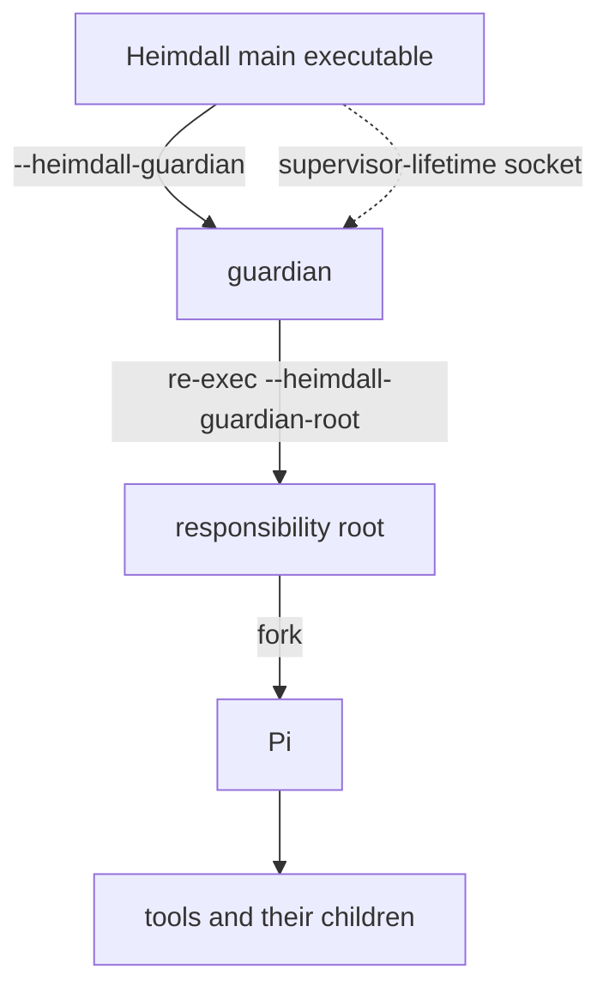

# agent: the built-in Pi agent harness

This crate runs Heimdall's agent: one supervised Pi RPC process, one logical conversation, the durable delivery ledger
that feeds it speech, typed messages and notices, the MCP host with the tool contract, the API providers, and the
ownership and cleanup of every process Pi starts.

Read this when: you want to change how wakes, notices or typed messages reach the agent, how a start, Stop, reload or
compaction behaves, how Pi is pinned, built and launched, how Pi's child processes are cleaned up, or add a provider
sign-in; or you need to find the file that owns a harness behaviour.
Code: `crates/agent/src/`, `crates/agent/runtime/` (the Pi extension and wrappers that ship in the app),
`crates/agent/prompt/`. App glue: [crates/app/src/bridge/README.md](../app/src/bridge/README.md). T3 control lives in
[crates/t3/README.md](../t3/README.md).

## Files

| File | Owns |
|---|---|
| `lib.rs` | `Bridge`: the observation spool, wakes, steering, queueing, rejoin, start context, catch-up, review records (`REVIEW_ROWS`) |
| `harness.rs` | `Harness`, `Pi`, `PiConfig`: spawning Pi, its arguments and environment, the prompt file, inactivity limits, `rejoin`, compaction commands |
| `protocol.rs` | Pi RPC framing (LF-delimited JSON, frames bounded at 64 MiB), observation ids, wake images |
| `delivery.rs` | `DeliveryGate`, `DeliveryPermit`: the one stop intent every provider and tool path checks; `COMPACTION_WAIT`, `WRITE_WAIT` |
| `notice.rs` | what a message that is not the user's may do (context or wake), pacing and ages, the text of every start |
| `actions.rs` | `Actions`: durable action receipts, the delivery outbox, `ask` questions (`QUESTION_LIFETIME_MS`) |
| `wakes.rs` | scheduled wakes and the delivery heartbeat (`agent/wakes.sqlite`) |
| `maintenance.rs` | idle compaction and the cache-refresh ping (`QUIET_MS`, `PING_AFTER_MS`, `PING_STOP_MS`) |
| `session.rs` | offline session rotation (`ROTATE_BYTES`, 32 MiB) after Pi exits |
| `history.rs` | images the provider would refuse (`sniff`), the start-time history repair |
| `supervision.rs` | `RestartBudget` (3 in 10 min) and the engine readiness probe |
| `process_owner.rs` | process ownership: owner tokens, kernel-birth-checked signals, cleanup, retirement receipts |
| `runtime.rs` | the pinned Node and Pi, the bundled runtime receipt, the files shipped from `runtime/`, the local engine's `MODEL` and `BASE_URL` |
| `bin/heimdall-agent-runtime.rs` | build-time tool that assembles the bundled runtime (called by `scripts/bundle.sh`); also hosts the guardian in debug test runs |
| `mcp.rs` | stateless Streamable HTTP MCP, loopback only, bearer authenticated; `ToolHost` |
| `mcp_contract.rs` | the immutable tool catalog and its schema validator (no coercion) |
| `plain.rs` | every tool result as short plain lines |
| `tool_log.rs` | one line per tool call in `<data>/logs/tools.log`, secrets masked |
| `view.rs` | Pi events and session files to Agent window entries |
| `reply.rs` | the reply path: what a settled turn says |
| `provider.rs` | API providers: catalog, added models, selection, credentials, `Limits` (`COMPACT_AT_PERCENT`) |
| `console.rs` | the OpenCode Console device sign-in |
| `chatgpt.rs` | Sign in with ChatGPT ([docs/chatgpt.md](../../docs/chatgpt.md)) |
| `accounts.rs` | subscription accounts and their quota (`Board`, `earliest_reset_first`, `FALLBACK_TTL`) |
| `routing.rs` | which T3 account the relay runs on |
| `emergency.rs`, `limits.rs` | emergency mode's detector and harness error replies; spent limits read from T3 |
| `relay_prompt.rs`, `skill_index.rs` | the relay's composed prompt and the skills index |
| `skills.rs` | Heimdall's own skill folder for Pi |
| `identity.rs` | the configured assistant and user names in the prompts |
| `clock.rs` | the harness's one clock (virtual in the simulator) |
| `taste.rs` | the taste ledger |
| `sim/` | the harness simulator (tests only) |

Entry points: `agent::Bridge<H: harness::Harness>`, `harness::{Pi, PiConfig}`, `delivery::{DeliveryGate,
DeliveryPermit}`, `mcp::ToolHost`, `provider::*`, `runtime::*`, `view::*`, `actions::Actions`, `guardian_mode`.

Runtime files (`runtime/`): `heimdall.ts` (the Pi extension and MCP bridge), `loop-guard.mjs` and `loop-guard.json`,
`provider-retry.mjs`, `thinking-policy.mjs`, `history-repair.mjs`, `service-tier.mjs`, `quota.mjs`,
`compaction-fallback.mjs`, `arsenal.mjs`, `tool-owner.cjs`, `tool-guardian.c` (the process guardian, linked into the
main executable by `build.rs`), and the pins `package.json`, `package-lock.json`, `node-lock.json`.

## Tests

- `cargo nextest run -p agent`: fake Pi processes and local fake providers; no test over 5 s.
- `cargo test -p agent --lib sim::`: the harness simulator runs the real `Bridge` on a virtual clock against an
  in-process Pi (about 5 s): the scenarios, the replay gate `s64_…`, 1,000 seeded random interleavings checked against
  the global properties (no utterance reaches the model twice or is lost without a recorded reason; no tool side effect
  happens twice; no turn says two final replies), and the coverage map. `HEIMDALL_SIM_CASES=<n>` runs a longer sweep.
  Scenario files: `night_scenarios` (talk-over at every phase of a turn), `recovery_scenarios` (where a start's
  catch-up begins), `delivery_scenarios` (one wake per utterance), `result_scenarios`, `reply_scenarios`,
  `cache_scenarios`, `emergency_scenarios`.
- `cd crates/agent/runtime && node --test`: the runtime wrappers' own tests (`*.test.mjs`).
- `HEIMDALL_WRITE_RELAY_PROMPT=1 cargo test -p agent relay_prompt` regenerates `prompt/relay.generated.md`; without the
  variable the test checks it.
- Ignored lab tests use the real pinned Pi or real keys: `tests/anthropic_lab.rs`, `tests/opencode_lab.rs`,
  `tests/chatgpt_lab.rs` (variables in each file). The app's end check is
  `bridge::live_pi_smoke::real_pinned_pi_splash_mcp_reload_and_automatic_recovery`: real pinned Pi, a ready local
  engine, isolated data, one prompt, one MCP call, one reload and one owned Pi kill recovered by the supervisor.

## Delivery: how input reaches the agent

- Each voice wake carries the labelled transcript and the pipeline's images. Lines read `[17:52:38 Mic · Name] words`
  under `Transcript:`; event ids stay outside model text. The envelope's `observation_ids` name exactly the rows
  supplied, across batching and retries, and a settled delivery settles only those.
- One wake per utterance: the same labelled words within `notice::HEARD_TWICE_MS` (3 s) are one utterance; the second
  copy is settled with its reason.
- A voice batch uses at most half the context window in text (8 MiB ceiling); the rest stays queued with a backlog
  note. A pending line older than `notice::CONTEXT_WINDOW_MS` (30 min) stays in the archive.
- Typed messages and notices are direct inputs. SQLite queues input only when it cannot be admitted: engine down,
  Pi's own compaction, a pending reload, rate limiting.
- **Rejoin**: while a turn has neither acted (no tool call) nor replied, and has not started writing either, the user's
  new words restart it (`Harness::rejoin`): Pi aborts the request in flight and one answer takes both. At most
  `MAX_RESTARTS` (2) times a turn; a wake for someone else's line never restarts it. Once the turn has acted, voice
  wakes, typed input and late screenshots go in with `streamingBehavior: "steer"`.
- **Notices never steer** (`Bridge::notice`): question answers, T3 questions and approvals, and task results wait for
  the turn to settle, coalesce into one message (answers first), and at most one notice-only turn runs per
  `NOTICE_GAP_MS` (30 s). A notice older than 30 min becomes context. Task results (`terminal:` ids) and scheduled
  wakes start a turn even right after a start and do not age. Fast-read results, worker progress, unheard speech and T3
  connection state are context only (`heimdall_context`, no turn). The same words within `REPEAT_WINDOW_MS` (24 h) are
  delivered once.
- Outbox notices fit the agent's live message limit (`Actions::set_message_limit`, `notice_budget`); a notice still
  too long goes as its producer's short form and never blocks those behind it.
- Scheduled wakes (`schedule_wake`, `list_wakes`, `cancel_wake`, `Heimdall --schedule-wake`) share
  `agent/wakes.sqlite`; the heartbeat fires due wakes as `selfwake:<id>` notices and retries undelivered outbox notices
  every `TICK_MS` (30 s). See [docs/mcp.md](../../docs/mcp.md).

## Starts and the one conversation

- Every start (Agent on, a model switch, a reload, crash recovery, a relaunch or reinstall) resumes the session file
  named by `agent/active-session.json`; only Edit and resend forks it into a new file. A start passes
  `--provider/--model` and requires Pi's `get_state` to report them.
- Every start calls `Bridge::begin_start`. Queued wakes, typed text and notices from before are cancelled, except open
  T3 questions and the user's own wake or typed text queued within `notice::START_RESUME_MS` (5 min), which go out after
  the start context.
- Before any wake, one context-only `heimdall_context` message is added: the catch-up (speech the model never read,
  all speakers with clock times, newest `CATCHUP_BYTES` (128 KB)), a reload's reason, and last the restart message. The
  catch-up begins at the later of the session's newest message and the start of the last finished compaction
  (`Bridge::catchup_since`), never more than 30 min back. If it would pass the compaction threshold, Heimdall compacts
  first.
- Until the user addresses Heimdall after a start, no notice wakes the agent except task results and scheduled wakes.
- A delivery interrupted before any tool ran is resent once inside one process (within `RESEND_WINDOW_MS`, 2 min),
  never across a start.

## Stop, reload and the reply

- Stop (the Agent window's or the island's) is handled by the harness, never asked of the model: speech stops, waiting
  notices become context, wakes queued before it are not delivered, Pi aborts, and the turn settles without a resend.
  The aborted request reads "Turn stopped", never an error.
- Reload is a process restart on the active session after settlement; the reason ("Reloaded: …") goes into the
  replacement's start context, and the reload with its `reload_me` receipts completes only when that context is taken.
  Window-side contract: [docs/agent-window.md](../../docs/agent-window.md).
- Reply path (`reply.rs`): a settled turn's final text is what the user hears (Speaking on) or reads on the island,
  through the `speak` path; sentences already said in the run are not said again. `NO_REPLY` or an empty reply is a
  silent turn. Each finished reply is reported at its own `turn_end`, so a question added while the first answer
  streams gets its own reply.
- Provider refusals a resend cannot fix fail the turn once with a plain island line (`notice::provider_rejection`).
- Each transport prompt carries `[Heimdall delivery: <ledger id>]` and the local time (`clock::now_line`); the window
  strips both. Tool execution events mark possible effects before completion; missing or failed receipts require
  review, and an uncertain tool-bearing wake is never replayed blindly.

## Compaction and the prompt cache

- Heimdall's own compactions (`Bridge::maintain`) start only while the agent is idle and nobody has spoken or been
  answered for `maintenance::QUIET_MS` (30 s), at `provider::COMPACT_AT_PERCENT` (85%) of the request budget, or when
  the hour cache has gone cold on a history past the break-even size (`harness::cold_cache_break_even`). Each passes
  `prompt/compaction.md` as Pi's `customInstructions`. Budgets and Pi's own threshold: [docs/models.md](../../docs/models.md).
- Nothing cancels a running compaction: wakes, typed messages, clicks and notices queue until it ends, Stop sends no
  `abort`, a model switch waits (journal event `agent_restart_wait`), and Agent off shows `Stopping` until it ends.
- A compaction that dies with its Pi holds Heimdall's own compactions 10 min, then 20, then until a compaction
  completes or Heimdall relaunches (`crates/app/src/bridge/compaction_hold.rs`).
- On a provider with the hour cache, once the last request is `PING_AFTER_MS` (55 min) old and the agent is idle,
  `Bridge::keep_cache_warm` sends one cache-refresh message (`maintenance::PING_TEXT`); the agent answers with a quick
  check or `NO_REPLY`. Pings stop `PING_STOP_MS` (3 h) after the last real request, never go out with Agent off, and a
  ping that fails is dropped.
- Session rotation: at `session::ROTATE_BYTES` (32 MiB) the supervisor compacts, stops Pi, archives the whole original,
  then keeps the checkpoint and recent branch. An unsafe or missing checkpoint never permits pruning, and old tool
  results are never edited in place.

## Recovery

- The supervisor reads the app engine manager's readiness; without one, isolated runs probe the engine's `/ready`
  every 10 s. Engine downtime does not spend the restart budget, and this crate never starts or downloads a model.
- A process exit, invalid frame, broken pipe or active-turn inactivity restarts Pi with durable backoff:
  `supervision::RestartBudget` (3 in 10 min), then a red health pill. An idle Pi is never a hang. Inactivity limits
  (`PiConfig`): 180 s in a turn, 600 s while a tool runs, `delivery::COMPACTION_WAIT` (15 min) while compacting. Why:
  Pi writes nothing while the model summarises.
- A refused history is repaired, never left dead (`runtime/history-repair.mjs`, `history.rs`): every image is labelled
  with the type its bytes are; a 400 naming a history block relabels or replaces the offending images and continues
  once; with nothing repairable or a second refusal the history restarts from a summary followed by the request itself;
  a third refusal fails the turn. Every start runs the same image repair on the session file first (one
  `.repair-backup` copy). Each step is a `heimdall_history_repair` entry, a log line and an island notice.
- Stop epochs are saved in both the stop intent and the settings, so a valid queued notice survives relaunch while Agent
  off and on still cancels older notices.

## The bundled runtime and Pi's environment

- `runtime/package.json` pins Pi (`@earendil-works/pi-coding-agent` 1.4.0); `package-lock.json` pins every npm
  dependency with SHA-512; `node-lock.json` pins the Apple Silicon Node archive (26.8.1) and its SHA-256. There is no
  second version constant and no global Node or Pi lookup.
- The runtime ships read-only in `Contents/Resources/agent-runtime`; nothing is downloaded or repaired at launch.
  `heimdall-agent-runtime build` verifies the Node archive, keeps only the `node` executable, runs `npm ci --omit=dev
  --ignore-scripts --no-bin-links`, keeps only packages something loads (it fails if an import would not ship) and adds
  Heimdall's runtime files. The bundle script signs `node` and seals a receipt of every file's SHA-256. Pre-flight and
  launch check the receipt and versions; a damaged runtime says "Reinstall Heimdall".
  `scripts/verify_release_candidate.py` repeats the check.
- Development and test binaries use `HEIMDALL_AGENT_RUNTIME`, else `target/agent-runtime/current`; the app ignores the
  variable.
- Upgrading Pi or Node: change the pin, regenerate the lock, then repeat the protocol checks and the live smoke before
  adopting it.
- Pi runs with `PI_CODING_AGENT_DIR=<data>/agent/config`, an explicit session file, `--offline`, `--no-approve`,
  `--no-context-files`, `--no-prompt-templates`, and `--no-skills` plus `--skill` for Heimdall's own skill folder
  ([docs/skills.md](../../docs/skills.md)). Its working folder is the user's home folder for Heimdall
  ([docs/home.md](../../docs/home.md)). Telemetry, version checks and catalog refresh are off.
- `prompt/heimdall.md` is the one general system-prompt source, the same in both editions, written to
  `APPEND_SYSTEM.md` at each start with the user's private layer under it (`environment`,
  [docs/skills.md](../../docs/skills.md)); the installed app uses the copy compiled into its build. The relay gets the same
  prompt inline, composed with `prompt/relay.md` and the skills index (`relay_prompt`).
- Pi's child environment carries no inherited provider credentials, proxies or global agent options. Keys reach Pi only
  through a per-request token command (`heimdall --provider-token <provider> --data <dir>`, the same signed binary)
  in the installed app; the MCP bearer travels on a pipe (`HEIMDALL_MCP_TOKEN_FD`) the extension reads and closes.
  `installed_pi_child_has_no_provider_key_or_mcp_token_in_env_or_argv` checks this.

## MCP bridge

`runtime/heimdall.ts` uses Pi's pinned `pi-mcp` library as a small generic bridge: it negotiates exactly `2025-06-18`,
discovers every tool, registers schemas and annotations, forwards text and image results, and sends
`_meta.heimdallActionId` (Pi's tool-call id) on every call. It has no hard-coded tool list and retries no mutation.
The tool list and how to add a tool: [docs/mcp.md](../../docs/mcp.md).

## Providers

Which providers exist, model limits, budgets and thinking levels are in [docs/models.md](../../docs/models.md); Sign in
with ChatGPT is in [docs/chatgpt.md](../../docs/chatgpt.md). Facts owned here:

- **OpenCode Console sign-in** (`console.rs`): OpenCode's undocumented device login with its public CLI client id
  (`opencode-cli`), so it can break when OpenCode changes it. Connect posts `/console/auth/device/code`, shows the
  code, opens the approval page and polls `/auth/device/token` (honouring `slow_down`) for up to 10 min, then reads
  `/api/orgs` and `/api/v2/config`. The session is kept in the Keychain (service `Heimdall API provider: OpenCode Go`,
  account `opencode-go-console`) and refreshed within 5 min of expiry; `invalid_grant` or a Console 401 means "sign in
  again". The token command stays inside Pi's 10 s limit and saves a rotated token before printing it. Use API Key…
  is the fallback (account `opencode-go`); one connection per provider.
- **Anthropic workspace keys**: a key not scoped to a workspace is refused with "must include the
  anthropic-workspace-id header"; the key check lists the organisation's workspaces, picks the only active one or the
  Default one, and keeps its id beside the key (account `anthropic-workspace`). It goes as `anthropic-workspace-id` on
  every request, compaction summaries included.
- **Waiting for a provider**: until the selected API model's key works the agent waits (`WaitingProvider`) and
  messages queue; a missing or rejected key waits for Connect, an unreachable provider is retried once a minute.
- **OpenCode Go retries** (`runtime/provider-retry.mjs`): a 429 with a stated reset up to 15 min waits and resends the
  same request (tool turns are not replayed); a longer or unstated reset fails the turn once with "usage limit
  reached". A 401 or 403 is final (the wrapper rewrites "upstream request failed" so Pi does not retry it). Each
  attempt must start answering within two minutes; a started stream is never cut.

## Process ownership

Every process Pi starts, however it detaches, is found and stopped when its generation ends.

- Heimdall launches the pinned Pi through its own signed main executable in `--heimdall-guardian` mode, dispatched as
  the first thing in `main`, before any app, UI, audio or model setup; the guardian calls no AppKit APIs. Debug test
  harnesses, which bypass the app's `main`, use the `heimdall-agent-runtime` executable for the same guardian; workspace
  tests build it, and package-only runs need it built first (`cargo build -p agent --bins`).
- When available, the guardian becomes its own macOS process-responsibility root by re-executing the main executable
  with `--heimdall-guardian-root`. It forks Pi and holds it until Heimdall has persisted the guardian's PID and kernel
  birth time. It closes its copies of Pi's stdio, so Pi's EOF stays observable, and waits in kqueue for Pi's exit or EOF
  on a private supervisor-lifetime socket that neither Pi nor tools inherit. When Heimdall dies, the guardian runs the
  cleanup itself, commits retirement and exits.
- Each generation has a random `HEIMDALL_AGENT_OWNER` token, which Pi's preload (`runtime/tool-owner.cjs`) puts back
  into explicit child environments. Cleanup enumerates only the current user's processes, matches the exact token
  through `KERN_PROCARGS2`, follows the parent tree, and includes processes whose macOS responsibility belongs to the
  guardian. Why responsibility: macOS hides protected Apple executables' environments from inspection, though they
  still inherit them.
- Every STOP and KILL rechecks the kernel PID and start time; no process-group number is kept or signalled. Cleanup
  freezes owners, kills descendants, verifies none remain, then retires the guardian. A new launch cleans persisted
  earlier generations before releasing any tool execution.
- If the guardian dies before its retirement receipt exists, cleanup reports that ownership cannot be verified and
  blocks replacement. Exception: a receipt from an earlier boot (`kern.bootsessionuuid`, or a guardian born before
  `kern.boottime`) counts as retired.
- The responsibility functions are Apple-private and resolved dynamically. If they are missing or fail, cleanup falls
  back to the owner token, parent tree and birth-checked signals and never refuses to run the agent: the guardian
  writes `responsibility.status`, the owner receipt records `cleanup_limited`, each generation writes an
  `agent_process_ownership` event to the journal, and the island shows "Agent cleanup is limited" once per process.
- The guardian is the app's own main executable, so its responsibility root has Heimdall's code identity and keeps
  Heimdall's privacy grants (whether macOS reuses each grant has not been tested live).
- Out of scope: a process that both disclaims responsibility and removes the token after reparenting, apps started
  with `open` (their own launch tree; never killed), privileged user changes and processes of other users. Cleanup
  never infers ownership from a command line.

## See also

- [docs/agent-window.md](../../docs/agent-window.md): the Agent window and island card contract
- [docs/models.md](../../docs/models.md): providers, budgets, limits and thinking
- [docs/mcp.md](../../docs/mcp.md): Heimdall's MCP server and tools
- [docs/resilience.md](../../docs/resilience.md): failures, recovery and logs
- [docs/claude-relay.md](../../docs/claude-relay.md): the relay that covers when this agent cannot answer
- [docs/skills.md](../../docs/skills.md): the prompt and skills
