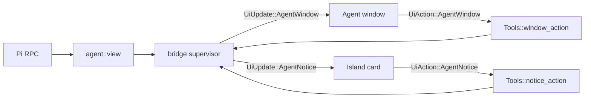

# Agent window

The Agent window shows the agent's live conversation (thinking, replies, tool calls and results) and lets the user
type, stop, reload, edit and resend, and review a wake whose outcome is uncertain. This page is the contract between
the agent runtime and that window, and the island cards (questions, Connect T3) that ride the same channel.

Read this when: you want to change what the Agent window shows or sends, add a field to its updates, change how Stop,
Reload or Edit and resend behave, render the island's question or Connect T3 card, or find out why an action was
refused.
Code: `crates/ui/src/model.rs` (`AgentWindowUpdate`, `AgentWindowAction`, `AgentLiveEntry`), `crates/ui/src/mac/agent.rs`
(the window), `crates/ui/src/agent_view.rs` (rows), `crates/ui/src/island/agent_notice.rs` (island cards),
`crates/app/src/bridge/` (the app side), `crates/agent/src/view.rs` (Pi events to entries).

## Updates the window receives

`UiUpdate::AgentWindow(AgentWindowUpdate)`:

- `State(AgentWindowState)`: the run state, `can_send`, `can_stop`, `can_reload`, a user-facing `problem`, the
  `unresolved` delivery ids, the `queued` wake count, `reviews` and `reload`.
- `History(Vec<AgentLiveEntry>)`: replaces the visible history with the active Pi branch. Sent at startup and after
  settlement, with real `session_entry_id` values. Entries of abandoned branches are not shown as active or editable;
  the archive keeps them.
- `Entries(Vec<AgentLiveEntry>)`: insert or replace by stable `id`. Streaming thinking, replies and tool results replace
  their earlier entry instead of appending one per token; `finished` tells live from final.
- `Session(AgentSessionStats)`: the session totals and the selected model's budget, sent when the feed opens.

### Run states

`AgentRunState`: `Off`, `Starting`, `Ready`, `Working`, `Compacting`, `WaitingEngine`, `WaitingProvider` (the selected
API model cannot run yet; `problem` says why), `ReloadPending`, `Restarting`, `NeedsReview`, `Failed`, and
`Stopping { compaction }` (Agent off waits for a compaction or a state write; the caption is `ui::stopping_line`).

- `Off` disables the composer. `WaitingEngine` allows durable queuing.
- `NeedsReview` shows the interrupted wake and explicit review actions. `Failed` keeps Reload.
- Raw protocol text and errors never reach the island.

### Delivery reviews

`AgentWindowState.reviews` holds durable `AgentDeliveryReview` records for `NeedsReview`: `id`, `text`,
`timestamp_ms: Option<u64>` (`None` for old rows without a time), `attachments`, `text_truncated`,
`attachments_truncated`.

- Show the record whose `id` matches `unresolved.first()`; never find a live row or parse `[Heimdall delivery: id]`.
  The delivery spool is the source, even after a crash before Pi wrote history.
- Each state carries at most the oldest `agent::REVIEW_ROWS` (32) records, `REVIEW_TEXT_BYTES` (32 KiB) of text and
  `REVIEW_ATTACHMENTS` (32) image references per record, with the truncation flags shown. `unresolved` stays complete;
  resolving earlier records brings the next batch. No base64 reaches the UI.
- Tool-call, result and reply rows in history supplement a review; the record never invents tool evidence.

`AgentWindowState.reload: Option<AgentReloadPending>` carries `reason` and `receipt_ids` while a reload is pending:
show it at once in the pending state. Several `reload_me` requests keep all their receipt ids; a user reload or
storage maintenance has none.

### Entries

`AgentLiveEntry` carries `id`, `session_entry_id`, `timestamp_ms` (Unix ms), `kind`, `text`, `tool_name`,
`attachments` (MIME type and archive id), `finished`, `editable`, `error`, `sent`, `queued`, `user_text` (the user's
own typed text, apart from the assembled prompt) and `usage` (one model request's tokens and timing).

- `AgentLiveKind`: `Prompt`, `Thinking`, `Reply`, `ToolCall`, `ToolResult`, `Compaction`, `Failure`, `Reload`,
  `Repair` (Heimdall repaired a conversation the model refused).
- Prompt text includes the labelled transcript and the notes Heimdall supplied. An image reference names an existing
  archive object; fetch its bytes through the archive, never as base64 in a label.
- Editing needs a persisted `session_entry_id`; streaming entries get theirs after settlement. Quoted capture data is
  never editable.
- An aborted request (the user's Stop, or Heimdall's abort when new words restart a turn) is a `Failure` entry with
  text "Turn stopped" and `error: false`, drawn as one calm "Stopped" row. Only real provider errors set `error`.
- A Reload entry shows its timestamped reason; internal bridge health commands are hidden.
- A new process is not a new conversation. `AgentSession`'s `can_open` is always false: there is no terminal,
  sign-in, model selector or harness selector in this window.

## Actions the window sends

`UiAction::AgentWindow(AgentWindowAction)` goes to `Tools::window_action`, which queues it for the supervisor off the
UI thread:

- `Send { text, steer }`: a typed message, spooled as its own input. Its bubble shows at once as "· queued" under the
  delivery id the bridge then uses, so the delivered row replaces it; a refused send shows "· not sent". Every typed
  message is delivered at once (`agent::Bridge::send_text_with_images`): it starts a turn, or goes into the running
  one, which Pi takes after its current tool cycle (`"streamingBehavior":"steer"`, `harness.rs`); `steer: true`
  sends it with priority `now` instead of `next`. It waits only while nothing can be delivered
  (`Bridge::queue_reason`: the agent starting or blocked, input held) or behind an earlier undelivered message, and
  then shows "· queued". Empty text, text over 1 MiB (`bridge::delivery::validate_message`) or text over the model's
  request budget is refused. Agent off cannot queue a live message. Captured speech is never silently attached to a typed message.
- `Stop`: stop speech, clear both Pi steering and follow-up queues, then abort the turn. Why: Pi's `abort` alone can
  carry on with its follow-ups. A tool action already done is not undone; uncertain effects go to `NeedsReview` and
  are never repeated.
- `EditAndResend { session_entry_id, text }`: only for a persisted typed message on the active branch, while idle. Pi's
  `get_fork_messages` validates the id, then `fork` starts a new session file before that message; the app saves
  `<data>/agent/active-session.json` before sending the replacement. The old branch is kept, and real-world actions
  from it are not undone: say so where the user resends. A stale id explains why editing is unavailable.
- `Reload { reason, abort }`: wait for Pi to settle, then restart on the same session. `abort: true` clears the queues
  and aborts first. Reload rereads the extension, settings, MCP tool set and system prompt; the agent gets one short
  timestamped reason as context, with no turn of its own. Queued wakes resume after it.
- `ResolveDelivery { id, completed }`: the user's review of one uncertain wake. Completed advances its transcript
  cursor; abandoned marks it failed. Neither replays it, and one wake's success never clears another's uncertainty.

## Notices, reloads and permits

- `AgentRuntime::start` attaches its command sender to `Tools` before returning. MCP callbacks use
  `Tools::notice(id, text, permit)` and `Tools::reload(reason, permit)` (for `reload_me`); a user action uses
  `AgentRuntime::notice` and `AgentRuntime::reload(reason)`.
- Notice callbacks run on background threads. A notice keeps its original `DeliveryPermit`, rechecks it on receipt
  and at transport, and stores its stop generation in the spool. Its acknowledgement returns only after its stable id
  is in SQLite; a duplicate id never queues another Pi follow-up. With the engine down, acknowledged means durably
  queued. Never take a fresh permit for an older callback.
- Agent off and on again cancels the old queued epoch. The generation is saved with the settings and stop intent, so a
  relaunch keeps a valid queued notice.
- `reload_me` commits its receipt before calling `Tools::reload` and returns its tool result at once; the supervisor
  holds the reload until that result and the whole turn settle. Why: waiting for the reload inside the tool would
  deadlock. A stop in between cancels the pending reload.
- The Pi extension sends `params._meta.heimdallActionId` (Pi's tool-call id) on every MCP call; RPC request ids are not
  durable action identity. See [crates/agent/README.md](../crates/agent/README.md).

## Island cards

`UiUpdate::AgentNotice(AgentNotice)` is rendered by stable `id`: a second notice with the same id replaces the first.
It carries the full `text`, a `kind` (`Info`, `Success`, `Warning`, `Error`, `Looking`, `Working`), an optional
`action`, an optional typed `outcome`, `expires_ms` and an optional pull-down `detail`. A plain notice is an island
line; worker results, questions and approvals also reach the agent through its outbox, and the Agent window keeps
the full text. The card layout is in [crates/ui/src/island/README.md](../crates/ui/src/island/README.md).

### Questions

`NoticeAction::Ask { request_id, questions, expires_ms, countdown }` is a card of one to four questions, each with two
to four options (from the agent's `ask` tool; see [mcp.md](mcp.md)).

- The card sends `AgentNoticeAction::Answer { request_id, answers, by_hand }` when complete, `Pick` when one question
  changes on an unfinished card, and `Dismiss` for the close button or Esc. The supervisor answers with the original
  request's permit; a duplicate click never answers twice.
- Silence, a timeout, an expired request or a missing UI never mean yes. A question lives
  `agent::actions::QUESTION_LIFETIME_MS` (24 h); this is retention, not consent.
- A failed answer comes back as `NoticeOutcome::QuestionUnavailable` ("Question unavailable; ask again") for that
  request id only.
- `ui::agent_notice::ACTIONS_RENDERED` is true because the card draws real answer buttons; a UI without them sets it
  false and `ask` returns `UI_UNAVAILABLE`.
- Render each request by its own id; never attach an answer to whichever card is newest.
- Spoken answers are handled in `crates/app/src/bridge/questions.rs`; guarded T3 confirmations stay click-only.

### Connect T3

`NoticeAction::ConnectT3` draws a Connect T3 button. Only its click sends `AgentNoticeAction::ConnectT3Notice { id }`
(the older `ConnectT3` is still accepted). The supervisor calls `t3::Client::authorize`, which pairs through T3's CLI
and opens the browser approval only as the fallback; nothing opens a browser on startup, a 401 or expiry. The outcome
goes to that card's id: `T3Connected`, `T3ConnectionFailed`, or `T3NeedsAgent` ("Turn Agent on to connect T3").
`AgentNotice.expires_ms` is the T3 credential's expiry for the expiry notice (`None`: none known); never parse it from
the text. See [t3-orchestration.md](t3-orchestration.md#connection).

### Clearing cards

- `UiUpdate::DismissAgentNotice(id)` removes only that card.
- `UiUpdate::ClearAgentNotices` removes every actionable card. It arrives on a new stop epoch, a Pi or MCP reload and
  shutdown; a reload retires the old permit, so an open question must be asked again.
- Never rebuild clickable cards from old history or receipt rows. The backend also refuses a revoked permit if a stale
  card survives.

## Repeating tool loops

After `identicalResults` (5) consecutive identical tool, arguments and result triples, the next matching call is
blocked with an explanatory tool error; `blockedAttempts` (3) blocked calls in one user turn stop the turn. The window
shows one finished `Failure` entry with the `notice` text ("Agent stopped a repeating loop") and the island one
notice. The process and session stay; it is not a restart. Results compare content (images included), structured
output and error status, not transport metadata. Changed results or another tool in between break the streak;
counters reset at settlement, reload and Agent off. Thresholds and text: `crates/agent/runtime/loop-guard.json`.

## Waiting and recovery

- `WaitingEngine` means the app's engine manager is not ready (or, without one, the engine's `/ready` probe is false,
  polled every 10 s), its metadata is unavailable, the queue is full or a provider failed without possible tool
  effects. This runtime never starts, picks or downloads a model.
- Startup and process recovery have deadlines and a restart budget of three in ten minutes
  (`agent::supervision::RestartBudget`). A quiet session is not a hang.
- Agent off revokes transport at once, including partial writes, speech and MCP results; the stop intent survives a
  watchdog relaunch.
- Session maintenance archives the original before keeping a compaction checkpoint and the recent branch; a missing or
  unsafe checkpoint never justifies deletion. Disk and ledger writes fail visibly.
- The first frame shows `Off`, waiting or `NeedsReview` and the supplied history before the user interacts.

## Check it

1. `cargo test -p ui agent` runs the row and notice tests.
2. `cargo run -p ui --features lab --bin heimdall-ui-demo -- --agent <dir>` renders the Agent window and question card offscreen into
   `<dir>` and presses the answer buttons in-process.
3. `cargo nextest run -p app -E 'test(/^bridge::/)'` runs the app side against a fake Pi.

## See also

- [crates/agent/README.md](../crates/agent/README.md): the Pi harness, delivery ledger and recovery
- [crates/app/src/bridge/README.md](../crates/app/src/bridge/README.md): the app-side files
- [t3-orchestration.md](t3-orchestration.md): T3 tasks, confirmations and Connect T3
- [resilience.md](resilience.md): failures, recovery and logs
- [mcp.md](mcp.md): the agent's tools, including `ask` and `reload_me`
