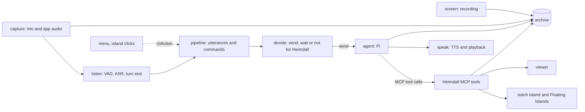
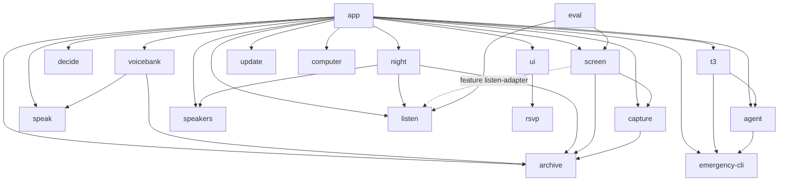

# Heimdall architecture

Heimdall is a macOS menu-bar assistant written in Rust. It listens to the user's microphone and chosen apps,
transcribes on the Mac, decides on the Mac when speech is meant for it, hands those turns to an agent (Pi, on an API
model or the local engine), and answers by speaking, through the notch island and Floating Islands, and through the
agent's tools. Everything it hears, sees and says goes into one local archive.

Read this when: you are new to the code, you want to know which crate owns a behaviour, you want to follow audio from
the microphone to a spoken reply, you are deciding where new code goes.
Code: `Cargo.toml`, `crates/`, `crates/app/src/main.rs`, `crates/app/src/live_loop.rs`, `crates/app/src/pipeline/`.

## The picture

One app binary, `heimdall` (`crates/app`), with native AppKit UI through objc2 (no web views, no Swift). Helper
processes it starts and owns: the Pi agent runtime (`crates/agent`), the speaker-identity worker
(`heimdall-speakers-worker`), the local inference engine (`heimdall-splash`), and the Floating Islands helper app
(`FloatingIslands.app`, `crates/islands`). The app talks to Pi over RPC; Pi calls Heimdall back through Heimdall's
own MCP server.

## The live path

1. `crates/capture` delivers microphone and app-audio packets (`CaptureEvent::Audio`) to the live loop
   (`crates/app/src/live_loop.rs`), which feeds `Pipeline::capture_event` and writes raw audio to the archive.
2. The listen worker (`crates/listen`) runs voice activity detection, speech recognition and turn-end detection and
   returns `listen::WorkerEvent`s to `Pipeline::worker_event`. Speaker identity comes from `crates/speakers`.
3. The pipeline (`crates/app/src/pipeline/`) builds utterances, catches spoken commands, and at a turn end asks the
   decider (`crates/decide`, `pipeline/send_worker.rs`) whether to send it. See [decision-chain.md](decision-chain.md).
4. A sent turn goes to the agent supervisor (`crates/app/src/bridge/`) as a wake; `crates/agent` owns the one Pi
   process, its durable delivery ledger and the MCP host. Every payload is archived before it is sent.
5. Pi's tool calls arrive at Heimdall's MCP server ([mcp.md](mcp.md)): island notes and questions, Floating Islands,
   the viewer, timeline search, screenshots, speech, T3 workers ([t3-orchestration.md](t3-orchestration.md)).
6. Replies are spoken by `crates/speak` ([voices.md](voices.md)) and shown by `crates/ui` through `ui::Ui::send`.
   Clicks and menu choices come back as `ui::UiAction` to `Pipeline::action` (`pipeline/actions.rs`).

When the agent cannot answer, emergency mode hands turns to a cover thread ([emergency.md](emergency.md),
[claude-relay.md](claude-relay.md)).

## Crate map

Each crate below is a workspace member (`Cargo.toml`). The personal edition adds crates of its own, which the public
export leaves out.

| Folder | Package | What it is | Workspace | Behaviour lives in |
|---|---|---|---|---|
| `crates/agent` | `agent` | Pi process and its ownership, delivery ledger, runtime pins, MCP host and tool contract, providers | member | [crates/agent/README.md](../crates/agent/README.md), [mcp.md](mcp.md) |
| `crates/app` | `app` | the `heimdall` binary: CLI, live loop, pipeline, agent glue, settings, background jobs | member | [crates/app/README.md](../crates/app/README.md) |
| `crates/archive` | `heimdall-archive` | the single archive store, timeline chunks, compaction, `heimdall-clip` | member | [archive.md](archive.md), [archive-clip.md](archive-clip.md) |
| `crates/capture` | `capture` | microphone and app-audio taps, host clock, raw archive writes | member | [capture.md](capture.md) |
| `crates/computer` | `heimdall-computer` | the agent's `computer` tool: acting on other apps through Accessibility | member | [mcp.md](mcp.md) |
| `crates/decide` | `decide` | the native decider model: send, wait, not for Heimdall, command verdicts | member | [decision-chain.md](decision-chain.md) |
| `crates/emergency-cli` | `heimdall-emergency` | the `heimdall-emergency` CLI and its scoped MCP server; approval and grant checks | member | [emergency.md](emergency.md) |
| `crates/eval` | `heimdall-eval` | offline evaluation binary | member | [crates/eval/README.md](../crates/eval/README.md) |
| `crates/home` | `heimdall-home` | the home folder: the agent's working folder and `<home>/.heimdall` | member | [home.md](home.md) |
| `crates/islands` | `islands` | `FloatingIslands.app` helper and `islands` CLI | member | [islands-capabilities.md](islands-capabilities.md), [islands/README.md](../islands/README.md) |
| `crates/listen` | `listen` | VAD, speech recognition, turn end, vocabulary biasing | member | [crates/listen/README.md](../crates/listen/README.md), [listen-vocabulary.md](listen-vocabulary.md) |
| `crates/night` | `heimdall-night` | night-time audio jobs and the `heimdall-night` CLI | member | [crates/night/README.md](../crates/night/README.md) |
| `crates/rsvp` | `rsvp` | fast-reading planner: chunking and per-unit timing for the island's reader | member | [crates/rsvp/README.md](../crates/rsvp/README.md) |
| `crates/screen` | `screen` | screen recording and spoken screen commands | member | [screen.md](screen.md) |
| `crates/speak` | `speak` | text to speech and playback | member | [voices.md](voices.md) |
| `crates/speakers` | `speakers` | diarization and voice identity (`heimdall-speakers-worker`) | member | [speakers.md](speakers.md) |
| `crates/splash` | `splash` | `heimdall-splash`, the local inference engine's server | member | [inference-engine.md](inference-engine.md) |
| `crates/t3` | `t3` | T3 Code control: pairing, worker threads, orchestrator pass-through, wakes | member | [t3-orchestration.md](t3-orchestration.md) |
| `crates/ui` | `ui` | menu bar, menu, windows, the notch island, offscreen renders (`heimdall-ui-demo`) | member | [crates/ui/README.md](../crates/ui/README.md), [agent-window.md](agent-window.md) |
| `crates/update` | `heimdall-update` | the in-app updater and its signed checksum file | member | [updates.md](updates.md) |
| `crates/voicebank` | `voicebank` | pre-generated voice lines and the clip store | member | [crates/voicebank/README.md](../crates/voicebank/README.md) |

Crate dependencies (`path` dependencies in each `Cargo.toml`; arrows point at the dependency). Most crates also
depend on `heimdall-home`, left out here. `app` starts `islands` and `splash` as separate processes; neither is a
Cargo dependency.

## Repository layout

- `crates/`: shipping source, one crate per domain where the boundary is clean.
- `islands/`: the Floating Islands file protocol ([islands/README.md](../islands/README.md)) and its rules
  (`islands/docs/`); the app is `crates/islands`.
- `skills/`: skills bundled into the app, in four sets (`heimdall`, `public`, `shared`, `workers`); see
  [skills.md](skills.md).
- `scripts/`: build, check and release (`bundle.sh`, `check.sh`, `affected_crates.py`, `verify_release_candidate.py`,
  `bundle_models.py`, `check_public_bundle.py`) and their tests. How to use them: [contributing.md](contributing.md).
- `docs/`: current reference, indexed by [README.md](README.md).
- `lab/`: experiments, renders, measurement scripts and evidence. Nothing in `lab/` is built or shipped.
- `packaging/`, `assets/`, `licenses/`: packaging, shared assets, third-party licences.
- `models/`, `target/`, `dist/` (ignored): pinned model files, build output, signed candidates.

## Where data lives

The user picks a home folder; Heimdall's own files live in `<home>/.heimdall`. Paths, layout and moving it:
[home.md](home.md). The archive's store and retention: [archive.md](archive.md).

## Editions

One source tree builds two editions: public (the default build of `scripts/bundle.sh`, Cargo feature `app/public`)
and personal (plain `cargo build`). What differs and how each is built: [editions.md](editions.md).

## See also

- [contributing.md](contributing.md): build, test, where code goes, the docs standard
- [README.md](README.md): every doc, by task
- [crates/app/src/pipeline/README.md](../crates/app/src/pipeline/README.md): the conductor, file by file
- [resilience.md](resilience.md): failures, recovery and logs
