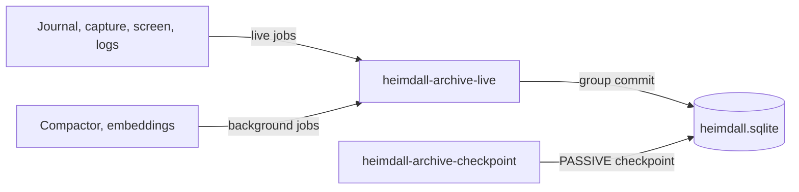

# Archive store

The archive is one store, an SQLite index plus content packs, that keeps every captured audio source, model output,
transcript line, screenshot and screen frame. It holds content hot for a day, then compacts it to a cold tier, and it
never deletes content for age.

Read this when: you add a writer or reader of archived data, you change the schema or a pack, you debug a slow or
stuck archive writer or a growing WAL, you change cold codecs or compaction, you migrate old per-launch folders, you
export a dataset.
Code: `crates/archive/src/` (`store.rs`, `live.rs`, `compact.rs`, `chunks.rs`, `records.rs`, `audio.rs`,
`snapshot.rs`, `export.rs`, `migrate.rs`), `crates/app/src/archive.rs`. Code map:
[crates/archive/README.md](../crates/archive/README.md).

Every source is kept, including sources nobody listens to and Heimdall's own voice. No speech detector removes audio,
and no setting deletes content for age. Old settings files that still hold `retention_days` or `archive_format` load,
and those keys are dropped on the next save.

## Layout on disk

The store root is `<data>/archive/`: `<data>` is `heimdall_home::data_dir()`, normally `<home>/.heimdall`
([home.md](home.md)). Lab runs pass the app an isolated `--data-dir`. Open Archive Folder in the menu reveals the root.

```text
heimdall.sqlite        the index (store::INDEX): every row and catalogue
packs/hot.sqlite       hot content (store::HOT): native PCM objects, original screenshots, screen samples
packs/YYYY-MM.sqlite   cold content of that UTC month: FLAC/Opus/zstd audio, cold screenshots, HAC3 chunks, logs
.compact.lock          lifetime lock: readers take it shared, blob deletion exclusive
.compact.owner         one compactor per store across processes; readers never take it
```

- A pack is an SQLite file with one table, `blobs(key, added_ns, data)`. Keys say the kind: `a/<id>` audio object,
  `i/<id>.<ext>` image, `v/<sha256>` screen sample, `c/<sha256>` HAC3 chunk, `l/<sha256>` log.
- Content keys are content hashes, so identical audio, images, payloads and vectors are stored once across sessions.
- A session (one app launch) is a row in `sessions`. Code names it `<archive>/session-<ms>-<uuid>`
  (`app::archive::session_dir`), a path that is never created on disk; `store::locate` splits it into root and name.
  A capture segment (one capture timeline) is a row in `segments` under its session.
- Per-launch working files that are not archive content (agent dry-run log and spool, temporary screenshot PNGs, the
  decide sink) live in `<data>/run/<session-name>/` (`app::archive::run_dir`). A clean finish stores those files in
  the session's `logs` and removes the folder (`retire_run`); the next launch does the same for a crashed one
  (`retire_stale_runs`).
- Why packs: the index stays small enough to query and back up, and bulk bytes live in a few large files. Hot content
  has its own pack so its daily churn never moves pages in the index or a finished month.

## Copy or inspect the store safely

The index and packs run in WAL mode, so a live `.sqlite` file alone is not a consistent copy.

1. Read through a connection that includes the WAL: `store::read_index` (query-only), or `sqlite3` on the file in place.
2. To copy, use SQLite's online backup (`store::sqlite_bytes` does this for one file).
3. Ad-hoc SQL on `heimdall.sqlite` sees live rows only. For a whole session, packed rows included, use
   `View::session` (see [Read archived data](#read-archived-data)).
4. Check: the copy opens and `PRAGMA quick_check` returns `ok`.

## Schema

`store.rs` (`SCHEMA`) holds the core tables; `video.rs`, `timeline.rs` and `screen_timeline.rs` add their own.

| Tables | What they hold |
|---|---|
| `sessions`, `segments` | One row per launch; one per capture timeline (wall anchor, host origin, codec). |
| `sources`, `gaps`, `blocks` | Capture sources, gaps, and one row per capture callback: native rate, channels and frames, `host_ns`, `wall_ns`, `object_id`, `offset_frames` (native frames), `gain`. Rows never carry PCM. |
| `audio_objects`, `audio_spans`, `packed_audio_refs` | Audio object catalogue (decoded rate, channels, frames, codec, pack, `stored_sha256`); cold signal fingerprints for deduplication; objects referenced from packed rows. |
| `evidence`, `payloads`, `packed_payloads`, `vectors` | Model and pipeline records (kind, source, utterance IDs, `host_ns`, `wall_ns`, payload ID); their hash-keyed JSON bodies; bodies that moved into a chunk; vectors. |
| `utterances`, `transcript_events`, `audio_activity` | The transcript index; transcript events; VAD speech runs per source (discarded once that audio is cold). |
| `images` | Screenshot and image catalogue (MIME, pack, `stored_sha256`, `cold_checked`). |
| `cold_chunks`, `cold_sources` | HAC3 chunks of packed rows, and the source time spans each chunk covers. |
| `logs`, `clips` | Archived log files (zstd 9); synthesized voice clips with text, voice, generator and settings, never deleted. |
| `gc_blobs`, `migrations`, `store_meta`, `video_tier_failures` | Blob deletion queue; migration receipts; store counters (`collections`, `sweep_wall`); video epochs that failed tiering. |
| `video_segments`, `video_samples`, `video_gaps` | Screen recording; see [screen.md](screen.md). |
| `timeline_chunks`, `chunk_*`, `timeline_*`, `cold_capture_*` | The search projection; see [chunk-index.md](chunk-index.md). It is separate from `cold_chunks`. |

- Clocks: `host_ns` is capture's monotonic host clock, not Unix time. Blocks and evidence also carry Unix `wall_ns`.
  Tier age uses a block's end (`wall_ns` plus its duration), never a file time.
- Hot audio objects use `f32-zstd-planar-v1`: channels and the four float-byte planes are separated, then zstd level 1.
  It is a bit permutation, never quantization. Old `f32-zstd` objects stay readable.
- Exact `+0.0` silence has no object: capture writes a `zero` block that holds only a frame count, at most one hour
  per block (how capture writes blocks: [capture.md](capture.md)).
- The frozen zstd dictionary is `records::DICTIONARY` (version 1). It must stay to decode old payloads and chunks; a
  new dictionary needs new codec and version IDs.

## Durability rules

- Content first, catalogue second. A blob commits to its pack (`synchronous=FULL`, `F_FULLFSYNC`) before the index
  transaction that references it, and that transaction re-checks the blob under the index write lock
  (`store::ensure_blob`). A crash leaves at most an unreferenced blob.
- Catalogue removal first, content second. Removing content only queues `(pack, key)` in `gc_blobs`. `store::collect`
  deletes a queued blob only under the exclusive lifetime lock and the index write lock, and only when no catalogue
  row references it. A key of an unknown kind is never deleted.
- `store::sweep` removes unreferenced blobs older than `store::ORPHAN_GRACE_NS` (one hour), at most once an hour and
  `store::COLLECT_KEYS` (256) per job.
- Each collection bumps `store_meta.collections` in the same transaction. A publisher that read the count before
  writing its blobs and finds it unchanged under the lock skips re-reading the pack (`audio::publish_put`); one that
  finds its blob gone writes it again.
- Opening the index or a pack writes nothing (`store::tune`): `auto_vacuum=INCREMENTAL` and `journal_mode=WAL` are
  set only when they differ (a new file). Why: a PRAGMA that writes on every open waits for the write lock and a full
  sync, and froze the live loop (`tests/open_no_write.rs`).
- Every connection sets `synchronous=FULL`, `fullfsync=ON`, `checkpoint_fullfsync=ON` and
  `journal_size_limit` = 64 MB (`live::WAL_CAP`). Connections wait `store::BUSY` (5 s) for another process.

## The writer

Every index write in a process goes through one writer thread per store, `heimdall-archive-live` (`live::Queue`), at
user-initiated QoS, in the order the writes were handed over. How to hand a write to it:
[crates/archive/README.md](../crates/archive/README.md).



- Live jobs commit in groups: up to `BATCH_JOBS` (256) jobs, `BATCH_BEHIND` (2,048) while a backlog drains, or
  `BATCH_TIME` (200 ms) of work, each job a savepoint. Notes nobody waits on gather for `NOTE_GROUP` (250 ms) first;
  a waiting `write` or `call` commits at once. After a full group the lock stays free for `YIELD` (120 ms) so another
  process's writer gets in.
- Background jobs (compaction publish steps, collection, embeddings) are one bounded transaction each. They run when
  no live job waits, or once per `BACKGROUND_EVERY` (250 ms) between live groups.
- The writer's connection uses `temp_store=MEMORY` so savepoint journals never go to a temp file.
- A held lock, a full disk or an I/O error never reaches a caller: the writer keeps every live job and retries. A job's
  own error drops that job alone. A job that keeps failing alone with an I/O error is dropped after `STRIKES` (8)
  tries. Past `MAX_PENDING` (262,144) queued live jobs, new ones are dropped and counted (`live::dropped_writes`).
- Waits on a live path stay short: `write` waits for its commit at most `COMMIT_WAIT` (1 s) and only while the writer
  keeps up; `enqueue` and `Journal::note` never wait; capture's committer and the voice clip writer wait for their own
  commit (`call`); `store::archive_log` waits at most 1 s.
- `call_within` past its wait returns `live::Busy` ("the archive is busy"). It is not a failure: the job commits later
  and `Busy::settled()` turns true once the writer ran it.
- The listen evidence writer (`records::Writer`) queues at most `records::WRITER_BACKLOG` (65,536) notes behind a held
  lock; past that it counts them in a `diagnostic_drops` record.

## Checkpoints and the WAL

- `heimdall-archive-checkpoint` runs a PASSIVE checkpoint on its own thread once the WAL holds `CHECKPOINT_PAGES`
  (1,000) pages.
- The WAL shrinks back to `WAL_CAP` only when a checkpoint has copied every frame and the next write restarts it. A
  reader holding an old snapshot or one large transaction stops that.
- Past `RESTART_AT` (half the cap), once the checkpointer copied every frame it saw, the writer runs one small PASSIVE
  checkpoint between two groups (at most every `RESTART_EVERY`, 5 s) so its next write restarts the WAL. It copies at
  most `RESTART_COPY` (2,048) frames; a larger backlog stays with the checkpointer, and after `RESTART_SKIPS` (3)
  skips in a row the writer copies it anyway.
- Long timeline scans run in slices of `timeline::SLICE` (512) chunks, one statement each (`timeline::by_slices`), so
  no read snapshot outlives a slice and pins the WAL.

## Read the writer's log lines

Use these when the archive is slow or the WAL grows. Every writer step carries the code location that handed it over
(`#[track_caller]`).

| Line | Meaning |
|---|---|
| `Archive writer held 12.3 s by … from <file:line>` | One step took `SLOW_STEP` (2 s) or more; the site names who. |
| `Archive writer busy N s so far with …; M writes waiting` | A step still running at `HELD_REPORT` (10 s), logged once. |
| `Archive live writes caught up: …` | A backlog drained; names the longest step. Logged when 5 s or more or after another process held the lock; shorter ones at most every 10 min, counted into the next line. |
| `Archive WAL at N MB, past its 64 MB cap: <why>` | Past the cap; says whether a reader cut the checkpoint short, names the read transactions open here a second or more (or the other processes holding the index), and the writer sites that wrote the most pages. Logged once per doubling. |
| `Archive WAL crossed its 64 MB cap N times in M min` | Repeated crossings, at most every 10 min (`WAL_REPEAT`). |
| `Archive WAL back under its cap` | After 10 min under it (`WAL_SETTLE`). |
| `Archive checkpoint took N s` | A checkpoint of 2 s or more. |
| `Archive read snapshot held N s so far by <thread> on a connection opened at <file:line> (<sql>)` | A read transaction open `readers::LONG_READ` (60 s); `… released after N s` when it ends. |

`live::Queue::holder` gives the step running now; `compact::readers_held` names the threads holding the reader lock.
Logs and the wider failure ladder: [resilience.md](resilience.md).

## Locks

- Readers (export, views, clips, MCP frames) take `.compact.lock` shared (`compact::reader_lock`), so nothing they see
  is deleted. A reader waits at most one collection job, never for compaction.
- Blob deletion and replacing a video epoch's samples take `.compact.lock` exclusively without waiting, one bounded
  writer job at a time, and skip while any reader holds it.
- A compaction pass holds `.compact.owner` for the whole pass (the app's compactor or `heimdall-archive compact`). A
  second compactor finds it taken and does nothing.

## When compaction runs

The app starts one `compact::Compactor` per launch (`crates/app/src/pipeline/mod.rs`), thread `heimdall-cold-archive`
at background QoS. It prepares (reads, encodes, verifies, writes the cold blob) on that thread; every reference move is
one bounded background job on the writer.

- Gate (`app::archive::compaction_allowed`): the Mac is on AC power and idle for `heimdall_night::gate::IDLE_SECONDS`
  (300 s), or free disk is within `COMPACT_DISK_MARGIN` (2 GiB) of the free-space floor. Unknown power or idle counts
  as no. The floor is `free_space_floor_bytes` ([settings.md](settings.md)); capture stops at it.
- Video tiering and timeline catch-up need idle on AC; the low-disk branch never opens them.
- The gate is asked before each pass, every `GATE_RECHECK` (1 s) inside a pass, and every `GATE_WAIT` (30 s) while
  closed. A closed gate ends the pass after the group or chunk in progress.
- Next pass: 250 ms after a pass that did work, 60 s after errors, 300 s when idle.

A pass, in order (`compact::compact_pass`):

1. Migrate at most one legacy folder ([Migration from per-launch folders](#migration-from-per-launch-folders)).
2. Collect queued blobs; run the orphan sweep if an hour has passed.
3. Publish up to `PASS_AUDIO_GROUPS` (32) audio groups, oldest first, store-wide.
4. Tier up to `video::PASS_EPOCHS` (16) screen epochs ([screen.md](screen.md)).
5. Pack up to `PASS_CHUNKS` (16) timeline chunks and 16 evidence chunks.
6. Move day-old payload bodies (recompressed `PAYLOAD_STEP`, 64, per job) and screenshots to their month pack.
7. After the pass, up to 256 timeline backfill steps ([chunk-index.md](chunk-index.md)).

- A segment whose audio group fails is skipped for the rest of the pass, so it cannot hold up other audio. Failures
  keep originals readable and retryable. Error lines repeat at most once a minute, and the app's component status
  shows "Archive compaction delayed".
- Quit calls `compact::preempt_all`: the preparation's running statement is interrupted (SQLite code 9), and a writer
  job in flight finishes or rolls back. That logs `archive compaction stopped for Quit…` and sets no status.

## Cold audio

Hot audio is eligible once its block ended more than 24 hours ago (`DAY_NS`). A group holds at most `GROUP_NS` (10 s)
of one source, split where VAD coverage changes between speech and non-speech; a row that changed while its group
was encoded fails the group.

Codec policy (`compact::encode_cold`). Non-speech is a run fully covered by VAD probability below 0.1, shrunk by a
250 ms guard at both ends (`records::non_speech_ranges_in`). Speech and missing coverage count as speech.

| Source | Speech | Non-speech |
|---|---|---|
| Voice: microphones, calls, Heimdall's own voice | FLAC 16-bit (`flac16`) at the capture rate; mono when every frame's channels are equal, else up to two channels | Opus AUDIO mode, mono, 32 kb/s (`VOICE_NON_SPEECH_BITRATE`), 20 ms packets, at the capture rate or 48 kHz when Opus does not take it (`opus-har2`) |
| Other (apps, media) | FLAC 16-bit, mono 16 kHz | Opus AUDIO mode, mono 16 kHz, 12 kb/s (`opus-har1`) |

- Opus runs at complexity 10 without DTX. Nothing is removed.
- Values outside [−1, 1] are never clipped: such a group stays float, zstd 19 (`f32-zstd`), in the geometry the policy
  chose.
- Why the capture rate for voice: 16 kHz keeps what recognition needs but drops everything above 8 kHz.
  Recognition, the decider and speaker models get their own 16 kHz feed from capture, not from the archive.
- Why FLAC for speech: every lossy setting tried changed recognized words or moved speaker-embedding similarity
  beyond repeat noise; FLAC 16-bit did not.
- Each object's rate and channels are in `audio_objects`, so one source can hold 16 kHz objects from before the
  policy and capture-rate objects after it. A voice source never takes over a lower-rate or fewer-channel copy, and
  speech never takes over another source's non-speech Opus copy.
- Publication: the new object commits to its month pack, is read back and decoded independently, then one writer job
  re-checks the blob, moves every block to `cold-ref` with offset and gain, and queues objects nothing references any
  more. An original goes only when no block, packed reference or voice clip references it.

## Deduplication

- Hot objects are keyed by rate, channels and float bits (`audio::native_id`), so simultaneous paths with the same
  samples share one blob.
- Cold groups are fingerprinted after mono 16 kHz normalization. Two groups share one signal only when their host
  intervals match within 62.5 µs, the fingerprints match, correlation is at least 0.99999 over at least 8,000 samples,
  the gain is within 0.05–20 and the residual is within 1/16384 (`compact::same_signal`). Each reference keeps its own
  gain. The kept copy prefers direct process capture, then the higher native rate.
- Distinct words, timing, phase, echoes or room colour are never merged. This is not echo cancellation.

## Packed rows (HAC3 chunks)

Old rows of one segment (`blocks`) or one session (`evidence`) are packed into `cold_chunks` by `chunks.rs`:
dictionary zstd 19 table streams with column names, raw length and SHA-256, stored as `c/<sha256>` in the month pack.
The publishing transaction removes the rows it packed.

- A new chunk holds at most `chunks::PACK_ROWS` (1,024) rows; decode accepts `CHUNK_ROWS` (8,192) and 128 MiB. A batch
  over `PAYLOAD_BUDGET` (16 MiB) of raw payload packs one record alone.
- A payload body that moved into a chunk keeps a `packed_payloads` row, so a later record repeating it reads it there.
- Screenshots go cold as lossless WebP only when that is smaller and decodes to the same pixels; otherwise the original
  bytes move. Cold images keep pixels, not the original PNG encoding: use the MIME in `images`.
- Per writer job: collection removes `store::COLLECT_KEYS` (256) blobs, reclamation frees `store::RECLAIM_PAGES` (512)
  pages, VAD activity discards `compact::ACTIVITY_ROWS` (512) rows.

## What the journal records

Records go through `Journal` (`records.rs`): `append`, `event` (waits up to 1 s for its commit) and `note` (never
waits). Listening off is a gap, not missing data: each open source gets a `gap` record (reason `heimdall off`) and the
session gets `heimdall_off` (payload `reason`: `setting` or `launched off`), later `heimdall_on`.

| Kinds | Owner page |
|---|---|
| Raw ASR decodes (partials and finals, before reconciliation), VAD and turn probabilities, `listen_event` | [capture.md](capture.md) (the listen feed) |
| `gap`, `source_removed`, `source_readded`, `obsolete_worker_event`, `obsolete_capture_event` | [capture.md](capture.md) |
| Speaker revisions, embeddings, `speaker_segments_finalized`, naming and labels | [speakers.md](speakers.md) |
| `command_decision`, `command_action`, `barge_in`, decider inputs and outputs | [decision-chain.md](decision-chain.md) |
| `suggest_decision` | [suggester.md](suggester.md) |
| `agent_context_routing`, `agent_wake`, `agent_send`, `agent_reply`, `agent_transport_send`, `agent_transport_sent`, `agent_transport_reply`, `agent_transport_cancelled` | [crates/agent/README.md](../crates/agent/README.md) |
| Screen commands and their captures (action, clocks, image IDs) | [screen.md](screen.md) |
| `diagnostic_drops`, `utterance_binding` | this page |

- Records are kept even when the UI coalesces one away; the final transcript projection never overwrites raw decodes.
- Audio inputs are source plus host-interval references, never WAV copies. Images inside payloads are image IDs; to
  rebuild a wire payload, restore the bytes and base64 them.
- `listen:<source>:<utterance-start-ns>` names an utterance before its app ID exists; `utterance_binding` links it to
  the final `session:id`.
- A final whose waveform is missing keeps `decision.status: unavailable_audio` with `audio_error`; no other PCM stands
  in.
- A cancelled partial agent envelope (`agent_transport_cancelled`, with written bytes and whether delivery is
  uncertain) is never completed or retried automatically.
- Permission denial, overflows, unsupported geometry and unavailable models become gaps or errors, never invented
  outputs.
- Logs: the agent's dry-run log rotates at 1 MiB into `dry-run-<sha256>.jsonl`; Pi sessions are stored as
  `pi-session-<sha256>.jsonl` and agent payloads as `agent-payload-<sha256>.json`, all through `store::archive_log`
  (zstd 9, decode-checked before publication). A clean finish drains workers and evidence before
  `store::mark_complete`.

## Read archived data

- One session: `View::session(<archive>/<session-name>)` gives the per-session tables (`blocks`, `sources`, `gaps`,
  `evidence`, `payloads`, `utterances`) as TEMP tables holding live and packed rows. `Journal::open_read_only` and
  `capture::Archive::open_read_only` take the same address.
- Audio: `audio::read_block` and `audio::read_object` decode any codec above.
- Images: `records::image_bytes`.
- Logs: `store::read_log`, `store::logs`.
- Decoded events for agents: `heimdall-archive timeline [--since HH:MM] [--until HH:MM] [--kinds a,b] [--problems]
  [--archive ROOT]` (`event_timeline.rs`, read-only handles).
- Agents read through MCP: `timeline_search` ([chunk-index.md](chunk-index.md)), `screen_frames`
  ([screen.md](screen.md)), `archive_clip` ([archive-clip.md](archive-clip.md)). The tool contract is in
  `crates/agent/src/mcp_contract.rs` ([mcp.md](mcp.md)).

## Export a dataset

1. Build: `CARGO_TARGET_DIR=target/archive cargo build --release -p heimdall-archive --bins`.
2. Run: `heimdall-export ARCHIVE_ROOT NEW_DATASET_DIR [NIGHT_OUTPUT_DIR]`. It refuses an existing destination and one
   inside the archive. It uses no capture, model, provider or network.
3. Check: `NEW_DATASET_DIR/dataset.json` exists and states the utterance count.

The dataset holds `manifest.jsonl` (final utterances), `evidence.jsonl`, `vectors.jsonl`, `sources.jsonl`,
`blocks.jsonl`, `audio.jsonl`, `images.jsonl`, `images/`, `audio/` (float32 WAVs, one per unique object) and
`dataset.json`.

- Manifest audio is clipped to each utterance with `offset_samples`, `samples`, `rate`, `channels`, `gain`, `tier` and
  native geometry. A loader slices `offset_samples .. offset_samples + samples`, multiplies by `gain`, and aligns word
  times to the utterance's `start_ns`. Hot WAVs can be stereo.
- Missing audio is explicit (`audio_missing`, `audio_gaps`, `audio_complete`). Export never fills gaps or guesses
  speakers.

## Migration from per-launch folders

Profiles from before the store have `archive/session-*/` folders and `archive/voice-bank/`. The running app's
compactor migrates one per pass; to do it all at once:

1. Quit any pre-store app: a folder without `COMPLETE` that was written in the last two minutes is refused.
2. Run `heimdall-archive migrate ARCHIVE_ROOT [--keep]`. It prints one JSON report per folder, then a summary.
3. Check: the summary shows `"failed":0` and the command exits zero.

For each folder, under the store's locks:

1. Read every legacy container (sealed `.sqlite.zst`, HAC1/HAC2 chunks, WAL, schema-1 inline PCM, `quick_check`).
2. Write it into the store: one segment per capture database; PCM becomes hot objects, cold files and screenshots
   month-pack blobs; rows already cold and older than a day go straight into HAC3 chunks; logs, spool and unknown files
   become `logs` entries. Pending legacy GC is honoured.
3. Verify through the session view: per-table counts and an order-independent SHA-256 digest over every row equal the
   legacy side's; every audio object and screenshot is read back and matched.
4. Record counts, bytes and digest in `migrations`, then delete the folder unless `--keep`.

- A failed folder stays untouched, its partial rows are removed, and the run continues and exits non-zero. Reruns are
  idempotent.
- The compactor retries a failed folder after an hour, and migrates a folder only with its size plus 10 GiB free
  (`migrate::RESERVE`).
- An edited voice-bank `lines.json` moves beside the archive as `voice-bank-lines.json`. If that file already exists
  with different bytes, the migration of that folder fails and both stay.

## Storage cost

- Hot: native float PCM, zstd 1, for 24 hours. Derived for one 48 kHz mono microphone and two 48 kHz stereo app
  streams at 10 h a day each: about 20 GB per day.
- Cold audio, derived from twelve sampled 5-minute windows of one real day scaled to 24 h: about 1.1 GB per day under
  the current policy, against about 0.54 GB under the earlier all-16 kHz policy. Microphone and call speech take most
  of it.
- Measure a window on your own store with `heimdall-archive audio-cost ARCHIVE_ROOT FROM_WALL_NS TO_WALL_NS`
  (encodes hot audio in memory under both policies, writes nothing). `heimdall-archive-size` builds size fixtures from
  WAVs in a new folder.

## Test

`cargo test -p heimdall-archive` (the full check runs it under `cargo nextest`). Tests use temp stores only and request
no permissions. Test files and the opt-in lab tests: [crates/archive/README.md](../crates/archive/README.md).

## See also

- [capture.md](capture.md): how capture writes PCM blocks into the store
- [screen.md](screen.md): screen recording, video epochs and their tiering
- [archive-clip.md](archive-clip.md): a time window as one movie
- [chunk-index.md](chunk-index.md): the timeline index, search and reranker
- [home.md](home.md): where the data folder lives
- [settings.md](settings.md): `free_space_floor_bytes` and every other setting
- [resilience.md](resilience.md): failures, logs and recovery
- [crates/archive/README.md](../crates/archive/README.md): code map, writer rules, tests
