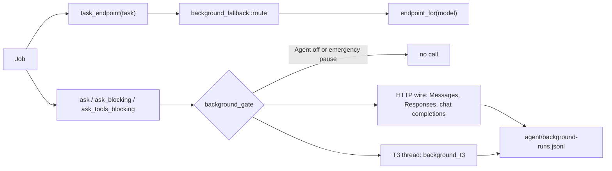

# Background calls

Every background job (the island agent, plan lists, Goals, voice names, the day timeline, suggestions) asks a model
through one shared path, `app::background_call`. This page covers that path: the jobs, the backends, a task's own
model, the fallback when a backend runs out, calls on T3, the rolling session and how to add a job.

Read this when: you want to add a background job, change which model a job runs, debug a job that stopped calling or
moved to another backend, read a line in `agent/background-runs.jsonl`, or change how background calls run on T3.
Code: `crates/app/src/background_call.rs`, `background_model.rs`, `background_fallback.rs`, `background_gate.rs`,
`background_t3.rs`, `background_wire.rs` (all in `crates/app/src/`).

## The jobs

Each job is its own short, stateless call that carries its whole input; no job keeps a session except Goals (see
[A rolling session](#a-rolling-session-goals-only)). Each job has a row in Background Tasks (`ui::BackgroundTask`), its
own on/off switch (`settings.json` `background_off`) and a log and ledger label (the `JOB` constant in its file).

| Task row | Code | Label | Wakes on | Writes |
|---|---|---|---|---|
| Island Agent | `island_agent.rs` | `island agent` | code signals of one bound job island: a stage change, a run end, a new picture, a finished helper, a new eval, training loss (`LOSS_POINTS` new points, at most once per `LOSS_EVERY`, 10 min), a heartbeat every `HEARTBEAT` (30 min) when anything changed; per island at least `MIN_GAP` (120 s) between calls and `COALESCE` (90 s) after the first signal, one call in flight | the island's now line, graphic parts, icon, title, helper names, open target and its `sent` line |
| Plan Lists | `plan_refresher.rs` | `plan refresher` | the user's words or `refresh_plan` (`PERIOD`, 5 min after the last pass); other changes wait `SLOW_LANES` gaps, `QUIET_LANES` gaps after `QUIET_AFTER` (1 h) of silence | proposals for Scheduled, job islands without a thread |
| Goals | `goals/` | `goals` | see [goals.md](goals.md) | ops on `goals.json` |
| Voice Names | `voice_namer.rs` | `voice namer` | its own clock | voice name proposals |
| Day Timeline | `day_timeline.rs` | `day timeline` | every `PERIOD` (15 min) | the timeline island |
| Suggestions | `suggester.rs` | `suggester` | the suggest key | the suggestion card ([suggester.md](suggester.md)) |

A thread-bound job island is code-driven: after every T3 pass the binding (`crates/app/src/islands/binding.rs`, `crates/app/src/islands/stages.rs`)
writes its stage, clock, progress and band with no model. The island agent only makes the island richer; it never
writes state, stage or the band.

## How a call runs

1. Right before each call the job resolves its endpoint: `background_model::task_endpoint(task)` reads the task's
   model and passes it to `background_fallback::route`, which returns the pick's endpoint or a fallback's. A call that
   started on a backend finishes or fails there.
2. `background_call::ask` (async), `ask_blocking` (from a plain thread) or `ask_tools_blocking` (a tool loop) sends
   the call. Every call first passes `background_gate::check`: with Agent off or during emergency mode's pause
   (`background_gate::emergency_pause`) it stops quietly. Setup's agent check (`setup_ready::AGENT_CHECK_JOB`) is the
   one call that skips the Agent-off check.
3. Each run is one line in `agent/background-runs.jsonl` (`api_providers::Hub::record_background`) with usage, cost
   and outcome; a T3 run's model reads `t3:<instance>/<model>`.

Callers that are not tasks (`Heimdall --background-probe`, tests, lab runs) use `background_model::endpoint` or
`tool_endpoint`: the shared model on its own provider, with no fallback and no Background Tasks sign.

## Backends

Background Tasks ▸ Model sets `settings.json` `background_model` (provider, id). No job knows which backend ran.

| Provider id | Request | Billing |
|---|---|---|
| `anthropic` (API key) | Messages, one-hour prompt cache, structured output | Anthropic prices; `LIMIT_USD` ($0.50) a run |
| `openai` (Sign in with ChatGPT) | Responses | counted at $0 |
| `opencode-go`, `openrouter`, Custom, Own Engine | Messages, Responses or chat completions, as the model's catalog entry says | counted at $0 |
| `local` (the built-in engine) | chat completions on the engine's local server (`agent::runtime::BASE_URL`) | counted at $0 |
| `t3:<instance>` (a harness instance in T3) | one short-lived T3 thread per call | one ledger line at $0 |

- `background_model::endpoint_for` resolves a model to an endpoint. A provider without its credential gets an endpoint
  with no key, and no call is made.
- `t3:` alone names `ui::T3_DEFAULT_INSTANCE`.
- The personal edition's default `background_model` is `ui::BACKGROUND_DEFAULT` (Claude Haiku 5.5 on Anthropic); the
  public edition starts with none, and no job calls until one is chosen.

Limits on a priced (Anthropic) run, from `background_call.rs`:

- `max_tokens` is the model's maximum (`MODELS`), lowered only where `LIMIT_USD` needs it. The worst case is priced
  before the call (every cached stretch as a cold one-hour write, input estimated at 2.5 bytes a token); when not even
  `MIN_OUTPUT` (4,096) tokens fit, the run is skipped (`OverLimit`). A model missing from `MODELS` is priced as the
  dearest one.
- Every request has a whole-request deadline of `TIMEOUT` (600 s).
- A paid run that gave no usable answer (refused, cut off, empty, timed out) ends in `Stopped` with its usage: the job
  treats that input as seen and calls again only on something new.
- Other providers run unpriced, with `max_rounds` as a tool loop's limit.

## Give a task its own model

A task may run its own model instead of the shared one: `settings.json` `task_models` (task, provider, id), set from
Background Tasks ▸ a task's Model (`UiAction::SetTaskModel`; an empty provider puts the task back on the shared model).

- Every task reads its own model (`background_model::reads_own_model`); a task without an entry runs the shared model.
- Suggestions is a tool loop (`background_model::tool_task`), so a T3 pick for it is refused
  (`background_model::task_accepts`, in the menu action and the settings tool).
- Defaults (`background_model::default_task_models`): the public edition has none; the personal edition gives the
  island agent and Goals `ui::ISLANDS_DEFAULT`.
- The `settings` tool sets it as `background_model` with the task as item (`shared` goes back); see
  [settings.md](settings.md).

## Thinking level per model

Background Tasks ▸ Model has a level picker per model (`settings.json` `background_efforts`: provider, id, level;
`UiAction::SetBackgroundEffort`; an empty level removes the entry).

- A model with a level runs every job at it; a model without one runs each job's own default
  (`background_call::with_effort`).
- The level goes to each format's own field: Messages `output_config.effort`, Responses `reasoning.effort`, chat
  completions `reasoning_effort` (mapped to the nearest level the model lists), T3 `modelSelection.options.effort` or
  `reasoningEffort` (as T3's catalog names it; a level the model does not list falls back to its default).
- The menu's "off" is each format's least: `low` on Messages and T3, `minimal` on the OpenAI formats
  (`background_call::effort_name`).
- Suggestions never runs above its own effort (`LIVE_JOBS`, `capped_effort`), because the user waits on it.
- The prompt hash includes the effort, so each level keeps its own prompt cache.

## When a backend runs out: the fallback

When a call fails because the backend's quota ran out or the backend is unavailable, the task's next call goes to the
next backend in `background_fallback::chain`, and the task returns to its pick at the first call after the pick is
usable again.

The chain, after the pick itself:

1. The same Claude model on another Claude Code account (T3's Claude instances; with quota known, the one whose quota
   renews soonest first, `agent::accounts::earliest_reset_first`; an account the reading shows spent is skipped).
   Skipped for a tool loop.
2. Codex through the ChatGPT sign-in (Responses): the shared model when it is a Codex model, else
   `background_fallback::CODEX_DEFAULT`. Never a Codex T3 instance.
3. OpenCode Go (the shared model when it lists it, else its default).
4. The built-in engine, when it is on.
5. The Anthropic API key, only when `settings.json` `background_fallback_paid` is true (false by default;
   `UiAction::SetBackgroundFallbackPaid`, no menu row; the `settings` tool sets it as `background_model` with item
   `paid_fallback`). It costs money, so the agent asks the user before turning it on.

A pick that is not a Claude model takes Claude Haiku 5.5 on the Claude steps and the API key.

Rules:

- Only a pick on a cloud subscription or API falls back (a T3 instance, the ChatGPT sign-in, OpenCode Go, Anthropic:
  `background_fallback::falls_back`). The built-in engine, Custom and Own Engine never do. Why: they may run on this
  Mac or a private network, and a local choice must never send a plan or a transcript to the cloud.
- A step that is not configured (no credential, T3 not connected) is skipped; with nothing usable there is no call. A
  pick that was never connected (no key, signed out) makes no call and does not fall back; only T3 not connected counts
  as unavailable.
- One classification for every wire, `background_gate::fault`: **spent** is a 429, a usage or plan limit or spent
  credit; **down** is overloaded or a 5xx, no connection, T3 not running (episode `background_gate::T3_ALL`) or a lost
  sign-in (401, "please run /login"). A job's own failure (a 400, a prompt too long, a malformed answer, a refused T3
  launch) marks nothing.
- A marked backend is skipped until its stated reset, else until a probe is due: `FIRST_PROBE_MS` (10 min) after it
  failed, doubling with each failed probe up to `MAX_PROBE_MS` (1 h). It is read between calls only.
- Down counts for routing only: a down pick with nowhere else to go is still tried. Only a spent pick refuses calls
  ("… usage is spent").
- A call that fails on its backend's own fault goes once more, at once, on the new route
  (`background_fallback::once_more`, `once_more_blocking`; used by the island agent and the day timeline). Never more
  than once.
- Each move and each return is logged once ("Background tasks · Island Agent: … its calls run on … until it is
  back"). `UiUpdate::BackgroundRoutes` lists the tasks off their pick (an empty list when all are back), shown as
  Background Tasks' small sign. A route clears without waiting for the task's next call when the task is turned off,
  its pick changes or its pick answers again (`background_fallback::refresh_routes`). There is no card and no failure
  notice.
- Emergency mode's pause still stops every background job.

The accounts' quota comes from `agent::accounts` (`Board`), read only when it could change the choice
(`background_fallback::quota_matters`), at most every `accounts::FALLBACK_TTL` (20 min), on its own thread; no call
waits for it. The relay reads the same board (`background_fallback::quota_board`). The personal edition supplies the
quota reader; the public edition has none, so its Claude accounts are tried in T3's order.

## A call on T3

`background_call::ask` sends a call whose provider is `t3:<instance>` to `background_t3::ask` (module path
`background_call::t3`). One call is one short-lived thread:

1. The thread lives in the T3 project `PROJECT_TITLE` ("Heimdall background"), an empty folder `PROJECT_DIR`
   (`background-t3`) in Heimdall's data folder, found by its folder or made once. If T3 refuses to make it, the
   threads go to the project that holds Heimdall's home folder.
2. `t3_thread_launch`: title `[heimdall-bg] <job> <tag>` (`background_t3::TITLE`; the tag is the start of the launch's
   `clientRequestId`, so a launch whose answer was lost is found by its title, interrupted and archived),
   `modelSelection {instanceId, model, options}`, runtime mode `approval-required` (T3's most restrictive), workspace
   root. The one message holds the instruction to use no tools and answer with only the JSON, then the job's system
   prompt, the JSON schema and the prompt, stable parts first.
3. `t3_thread_wait` in 15 s slices (`Limits::slice`), reading the activity between slices. A tool item, or a wait on an
   approval or a question, interrupts the run and fails the call (`Stopped`). T3's own `system_notice` and `error`
   items are the run's failure, not tools: a "Claude usage limit reached" notice marks the instance spent until its
   reset (`agent::limits`), so the task falls back.
4. The last assistant message is read in full; the JSON is cut out of it and checked against the schema's top-level
   shape (type, required keys, each present property's type).
5. The thread is archived whatever happened (T3 has no thread delete).

Limits (`background_t3::Limits`): the work gets `TIMEOUT` less 30 s; the interrupt and the archive get 10 s each of
their own, so the whole call stays within `TIMEOUT`. A T3 call whose own deadline runs out never drops the app's
shared T3 connection; only a transport or protocol failure reconnects. A launch message over `LAUNCH_MAX_CHARS`
(120,000 UTF-16 units, as T3 counts) is not sent, and a launch T3 refuses for its arguments
(`background_t3::rejected_arguments`) is `Stopped`, so no job resends the same input. On the HTTP wires a 413 or
"prompt is too long" is `Stopped` the same way.

Nothing waits for the user: Heimdall's permission hook declines a prompt in a background thread (launches are recorded
in `approvals/launched-background`, see [harness-autonomy.md](harness-autonomy.md)), and the T3 observer never follows
a `[heimdall-bg]` thread, so no call wakes the agent. When the relay finds an account spent, background calls on it
move off too (`emergency::Side::account_spent`).

A periodic sweep (from `background_t3::set_client`: first after 60 s, then every 10 min) interrupts and archives any
`[heimdall-bg]` thread still active `STALE_AFTER` (`TIMEOUT` + 120 s) after its last change, at most five a sweep,
never one a call holds.

Outcomes: an answer, or `Stopped` for a tool request, no text, no JSON, the wrong shape or the deadline. A harness
error reply (`agent::emergency::harness_error_reply`) or a failed run is a plain error, retried next pass; a usage-limit
reply marks `t3:<instance>` spent with the reset Claude states, any other harness error marks it down, and T3 not
answering marks every instance down. The next answer ends the episode.

Tool loops (`ask_tools_blocking`, the suggester) never run on T3: their tools run inside Heimdall and a T3 thread
cannot call them, so the call fails with `NoToolsOnT3`. Point such a job at an API or local model.

### Which T3 instances are offered

`UiUpdate::T3Instances` comes from T3's live `orchestrator_capabilities` (`background_t3::publish_catalog`), sent
when the relay's model list is (`Msg::RelayModels`, when the menu opens): every enabled instance that can run a thread
in `approval-required` and lists models, with each model's effort values and default. The personal edition lists only
Claude-driver instances; the public edition lists every usable one. A choice is checked against the last list
(`background_t3::choice_ok`).

## A rolling session (Goals only)

Goals keeps one rolling, cached conversation instead of stateless calls, so the provider's prefix cache serves all but
the newest turn. Every other job leaves both fields empty and sends the same bytes as before
(`a_job_without_history_sends_the_same_bytes_as_before_rolling_sessions` pins this).

- A `Call` carries `history: Vec<Turn>` (earlier turns, oldest first: the message as sent and the answer's text) and
  `session: Option<String>` (the segment's key, `goals-<segment id>`). The job appends each answered turn and starts a
  new key when it compacts.
- Messages: each turn's user blocks and answer, then the new message. Breakpoints on the system, the end of the last
  earlier answer and the new message's last stable stretch (three of the API's four, one-hour TTL). The history is
  priced as cached prefix; `LIMIT_USD` still holds.
- Responses and chat completions: the same turns as input items or messages; Responses' `prompt_cache_key` (and the
  `session_id` and `x-client-request-id` headers) is `heimdall-<session>`.
- T3: one thread per session key. The first call launches it (title `[heimdall-bg] <job> <session> <tag>`) with the
  whole history; each later call sends only the new input (`t3_thread_send`, mode `auto`) and reads only that turn's
  items. The thread stays open after an answer; anything else (a tool, no JSON, a failed run, the deadline) interrupts
  and archives it. A remembered thread that has not answered exactly `history.len()` turns on the same instance, model,
  effort, prompt and project, or that refuses the send, is archived and relaunched with the whole history. A new
  session key archives the old thread; `background_call::t3::end_session(key)` does so on the job's word.
- The session map is in memory only. Before each session launch the job's session threads no session holds are
  archived: at most five a sweep (`SWEEP_MAX`), within one 10 s cleanup deadline.
- A call that falls back sends the whole history to the other backend (a cold cache once).

## Add a background job

1. Add a variant to `ui::BackgroundTask` (with `ALL`, `title`, `key`, `icon`), and decide it in
   `background_model::reads_own_model` and `tool_task` (both match without a wildcard, so the compiler asks).
2. In the job, read `background_model::enabled(task)` and `task_endpoint(task)` right before each call, and build a
   `background_call::Call` with the whole input: stable parts first (`Prompt::stable`), the volatile rest last.
3. Give it a `JOB` label constant and its own trigger. It never reads what another job owns and never keeps a growing
   shared session.
4. Check: `cargo test -p app background_model` and `cargo test -p app background_gate` (Agent off and emergency mode
   stop it), then the job's own tests.

## Checks

- `cargo test -p app background_` runs the call path, the fallback, the gate and the T3 path.
- `cargo test -p app background_t3` runs the T3 path against a scripted T3: launch, wait, JSON, archive, rolling
  sessions, harness errors and quota, tool requests and approval waits, the deadline, malformed answers, efforts, tool
  loops, Agent off, emergency mode and the instance list from a captured catalog
  (`background_t3_capabilities.json`).
- Opt-in live checks (`-- --ignored`): `background_t3::tests::live_one_tiny_haiku_call_on_claude_code_2` runs one tiny
  Haiku call through T3 with a T3 session of its own and a temporary project it deletes.
- `Heimdall --background-probe` makes one small real call on Background Tasks ▸ Model and prints the provider, model,
  format and outcome.

## See also

- [goals.md](goals.md): the Goals shadow that uses the rolling session
- [suggester.md](suggester.md): the suggestion cards, the one tool-loop job
- [models.md](models.md): the agent's own models and providers
- [settings.md](settings.md): every settings key, including the `settings` tool
- [claude-relay.md](claude-relay.md): the relay, which reads the same quota board
- [t3-orchestration.md](t3-orchestration.md): how Heimdall connects to T3
