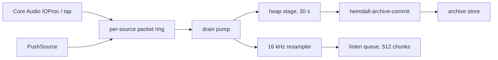

# Audio capture

`crates/capture` records the chosen microphones and the chosen apps' audio on one host clock, archives the raw samples
losslessly and feeds 16 kHz mono chunks to listen.

Read this when: you change how microphones or app audio are opened, you debug a silent or missing source, you work on
the System Audio Recording permission, you touch the echo guard, you run the capture probe.
Code: `crates/capture/src/`, `crates/app/src/live_loop.rs`, `crates/app/src/pipeline/sources.rs`. Code map:
[crates/capture/README.md](../crates/capture/README.md).

Nothing in compilation, synthetic tests, `Capture::discover_only` or `Capture::idle` creates a tap, starts a device,
checks screen or Accessibility access, requests a permission or plays a probe. Live capture runs only in the signed app
after the user's grant in Setup.

## The pipeline



- Callbacks only copy and convert into a preallocated ring: `PACKETS` (256) packets of up to `MAX_SAMPLES` (8,192)
  samples per source (8 MiB; 2.73 s at 512 frames / 48 kHz). No allocation, logging, compression, SQLite or HAL polls
  in a callback. Reentrant callbacks are refused.
- The drain pump moves packets into a heap stage of at most `STAGE_SECONDS` (30 s) per source, capped at
  `STAGE_MAX_SAMPLES` (4 Mi samples, 16 MiB) for many-channel devices, so the archive's once-a-second commit can wait behind another
  writer without losing audio.
- The intake thread resamples for listen and only queues archive work. Its own thread (`heimdall-archive-commit`,
  `crates/capture/src/commit.rs`) commits, so listen keeps hearing every source while a commit waits on the index lock.
- Ring overflow and invalid native buffers become explicit archive gaps; native stop or destroy errors become gap
  events.
- Listen's queue holds at most 512 chunks across all sources. A slow listener gets a gap and a discontinuity; the
  archive continues. A held archive lock is not a failure: audio stays buffered in order, the log says
  `Capture's archive waits for the lock` and later `caught up`. Any other archive error stops capture rather than
  record unarchived audio.

## Stream contract (for the app and listen)

```rust,ignore
let (capture, events) = capture::Capture::start(config, capture::CaptureConsent::after_setup(mic, system_audio))?;
// CaptureEvent::Audio chunks feed listen, keyed by chunk.source_id.0.
// SourceAdded/SourceRemoved bound each source's model state.
// Gap or chunk.discontinuity resets that source's VAD/ASR accumulators.
```

- `CaptureReceiver::{recv, recv_timeout, try_recv}` is a channel. `AudioChunk` is mono f32 at exactly 16 kHz, normally
  320 samples (20 ms); a final chunk may be shorter.
- `host_ns` is the first output sample's time on Core Audio's machine-wide `mach_absolute_time` clock, in ns. It is not
  wall time and not a per-source origin. Join by session plus host time: host time alone crosses boots, and it pauses
  during sleep (sleep and wake make new generations and explicit breaks, never invented samples).
- The resampler's delay is removed by dropping its delayed head. Output is stamped from the latest native callback
  anchor plus the resampler position, so device clock drift does not accumulate. A fresh source's first chunk is not
  a gap. Clock regressions, dropped frames and listen overflow mark a discontinuity and reset the resampler. The
  archive keeps the original native host time.
- `SourceAdded` means armed, not sounding. Digital zeros (a paused app) are normal audio: no alarm, no gap. Silence
  never proves a permission or route failure.

## Source identity

- IDs carry the device UID, or PID plus process birth time, and a capture generation: `mic:<uid>:<generation>`,
  `process:<pid>:<birth>:<generation>`. Generations count across every capture run in the process, so a new run's
  sources never share an id with a stopped one's.
- A source back within `READDED_MS` (5 s) of its removal under a new generation is a route change: the app journals
  `source_readded` and logs `capture: source_readded (…)`. It strips only the generation to match the device, so
  `screen:1` and `screen:2` stay two devices (`crates/app/src/pipeline/sources.rs`).
- Each capture health line names the microphones open then (`Microphone OK` with `input: <names>`, or
  `input: none open`; `crates/app/src/pipeline/resilience.rs`), so the log alone says which input is live.
- Each process / output-device / output-stream route has its own stream. A process with no output device in its HAL
  membership gets an include-only process mixdown tap, not an invented default device.
- Labels carry hardware name and UID, or process name, bundle ID and PID. Metadata keeps owning app, route, native PCM
  encoding, channels and rate. Electron and Chromium helpers resolve to the outer `.app` and its Info.plist bundle ID
  and name.
- Heimdall's own process is always captured, whatever App Audio says. Downstream code may refuse its speech as a wake
  trigger; capture never removes it from the archive.

## Microphones

- One primary input: the user's chosen device when connected, else the built-in mic (found by Core Audio's built-in
  transport type, not by name). First run chooses built-in. With neither, no mic opens.
- Extra mics open only when switched on in the menu; they start off. No other input is ever opened or used as a
  fallback, so an unchosen AirPods mic never forces AirPods into Bluetooth headset mode.
- A mic's IOProc reads input only: its output streams are switched off (`kAudioDevicePropertyIOProcStreamUsage`).
  Why: a duplex USB mic would otherwise make Heimdall look like a call and pull AirPods away from the user's iPhone.
- `CaptureConfig.microphone` (primary UID, `None` = built-in) and `extra_microphones` seed the HAL owner;
  `Capture::set_microphones` changes them live. `CaptureConfig.microphones` receives a `MicrophoneState` (every input,
  the choices, the primary in use, the mics opened) on change; discovery-only mode reports it too.
- Selection is recomputed on every HAL pass: a chosen mic disconnecting switches to built-in, reconnecting switches
  back. Each switch is a removal (reason `microphone switched off (primary: …)`) and a new source with a new
  generation, so listen resets and the archive records the boundary as for a hotplug.
- Saved in `settings.json` as `microphone` and `extra_microphones` ([settings.md](settings.md)).

## App Audio: only chosen apps are recorded

No app is recorded by default.

- `CaptureConfig.recorded_apps` lists app keys; `Capture::set_recorded_apps` changes them live. The filter runs at
  discovery, before any tap: an unrecorded app gets no tap, no queue, no aggregate device and nothing archived.
- The key is `capture::app_identity`: the outer `.app`'s bundle ID, else its path, else the process's own HAL bundle ID
  (an XPC service such as `com.apple.WebKit.GPU`, which plays Safari's audio), else the executable path. No PID or
  generation, so a choice holds across relaunches and new helpers.
- Checking an app taps its current processes at once; unchecking ends them as removals with reason
  `app audio switched off`.
- `CaptureConfig.playing_apps` receives the sorted apps producing output now (Heimdall excluded) whenever the set
  changes, in capture and discovery-only mode, from HAL listeners with no tap.
- The app keeps the session's heard apps (`settings::merge_heard`, at most `HEARD_APPS_KEPT` = 24 neither recorded nor
  playing) and saves choices as `recorded_apps` ([settings.md](settings.md)). The old PID-keyed `disabled_sources` is
  read and ignored.
- Onset: processes of recorded apps and Heimdall get an include-only, auto-start-gated tap as soon as HAL publishes
  the process, before its first output. Why: waiting for `IsRunningOutput` lost about 0.8 s of each new player (measured
  with `afplay`); arming at publication lost none. `kAudioAggregateDeviceTapAutoStartKey` stays on.
- Gotcha: HAL never notifies `kAudioProcessPropertyIsRunningOutput` changes. `kAudioProcessPropertyIsRunning` fires
  about 50 ms after IO starts and when it stops (up to about 2 s after a player goes quiet). Discovery watches both
  and reads the output flag at that event.

## System audio permission: microphones never wait

macOS asks for System Audio Recording when a process starts audio through its first process tap, and that call blocks
until the prompt is answered (minutes, if nobody answers). So the ask runs apart from the microphones
(`crates/capture/src/tap_gate.rs`):

- `TapGate::access` sends the ask once per process on its own thread (`heimdall-system-audio-ask`) and returns at once.
  The ask (`macos::tap::ask_system_audio`) makes a private global tap in a private aggregate device and starts and
  stops its IOProc: starting audio through a tap is what shows the prompt; making a tap alone shows nothing.
- The app sends it at Setup's Allow All and from the Allow page's System Audio Recording button
  (`capture::ask_system_audio`, non-blocking). Capture's consent to taps starts only at Allow All, so no launch asks
  before the Allow page.
- Each HAL pass opens the selected microphones at once and makes per-process taps only once the ask came back
  (`tap_gate::opens`). The ask coming back wakes the HAL thread; taps join on that pass and the open microphones are
  not stopped or reopened (`tap_gate::stops`: only sleep, a route change, a wake, or a source no longer wanted stop
  one).
- States (`TapAccess`): `Open` (taps are made), `Waiting` (the ask is out), `Off(why)` (no taps until a new grant:
  `refresh_permissions`, the menu's or Setup's Allow). `Off` logs "System audio off: …; the microphone runs without
  it". Still `Waiting` after `NOTE_AFTER` (15 s): "System audio waits for its permission; …".
  `capture::system_audio()` reports the state for the app's Getting ready note.
- macOS reports a denial only as silent taps; there is no public status call (`TCCAccessPreflight` with
  `kTCCServiceAudioCapture` is private and not used). The app reads it from the audio (`live_loop::tap_playing`,
  `LivePermissions::audio_permission_transition`): a tap of a recorded app that is playing, or Heimdall's own tap while
  Heimdall speaks, delivering only zeros for 10 s is a denial. Then the log says "System audio off: not allowed (…);
  the microphone runs without it", the island shows a notice, and Getting ready shows a grey System audio row with
  Allow… (System Settings ▸ Privacy & Security ▸ Screen & System Audio Recording). Any sound from a tap grants it.

## Recovery and device lifecycle

- Read-only discovery uses HAL device-list, process-list, default-route and service-restart listeners, plus device
  alive / rate / format and process output-activity / IO-running / device-membership listeners.
- Native owners share one control thread; callbacks only wake the drain pump. No intake sleeps, activity polls or
  per-stream watchdogs.
- Taps stay armed across pauses and are destroyed on process exit, route or format change, sleep, consent revocation or
  shutdown. A route or format event restarts only the sources it concerns (`hal::source_objects`: a mic's device and
  input streams, a tap's process and its output devices and streams). The default output moving, a possibly overflowed
  event queue or a `ROUTE` event that names no object restarts every source. Sleep stops streams; wake reconciles
  fresh sources and formats.
- One shared 3 s health timer runs only while sources are active. It retries a source without callbacks after 2, 4, 8,
  16, 32 s, then every 60 s (`retry_delay_s`). A microphone stops after four failures and is skipped (built-in stands
  in for a primary) until a HAL event for it or a new choice in the menu. A process tap is never given up: it keeps
  retrying until it delivers or its process exits. A source that delivered for `HEALTHY_RUN_NS` (60 s) before it
  stalled starts its count again. An exited process is never retried; a dormant process without callbacks is not a
  stall.
- A capture stop waits at most `CLOSE_WAIT` (2 s) for the archive thread's last commit, then hands it off;
  `capture::settle_stopped_archives` lets Quit wait for the rest. The live loop never waits for a stop: a restart or
  Listening off stops the old run on its own thread (`CaptureRun::retire`, `crates/app/src/live_loop.rs`), and Quit
  waits up to 4 s for those (`settle_retired`). A restart's old run still forwards its last events.

## Pushed sources

A source that is not a HAL device can be pushed into the running pipeline by the app. No device is opened, chosen or
switched for it.

- `Capture::push_input()` hands out a `PushInput` (a clone of the running pipeline's command sender, its drain pump's
  wake and its alive flag). `PushInput::open(info)` adds a `PushSource` beside the HAL's microphones with the same raw
  queue, staged drain, archive sink, clock check, 16 kHz resampler and `CaptureEvent`s (`SourceAdded`, `Audio`,
  `SourceRemoved`).
- `PushSource::push(host_ns, samples)` writes into a lock-free ring; `mark_loss(frames)` archives a gap and makes the
  next chunk a listen discontinuity; dropping or `close(reason)` is an archived removal after every sample pushed
  before.
- A discovery-only capture has no input. A stopped pipeline's input is dead (`PushInput::alive` is false) and opens
  nothing: its sources ended with it, so the app opens them again on the new capture under a new generation.
- `PushOnly::start(archive)` runs such a pipeline with no HAL at all (tests, labs).
- The HAL owner never sees a pushed source: its candidates, microphone state, stall clocks and permission reads stay
  the Mac's devices'.
- The personal edition pushes a source of its own; its `SourceKind` variant is in `crates/capture/src/source.rs`.

## What capture archives

Each capture run is one segment of the app's session in the archive store (`capture::Archive`,
`crates/capture/src/archive.rs`). Raw blocks are archived before downmix, resampling and any speech detector; no VAD
output removes audio.

- PCM is normalised f32 at the native rate and channel count, zstd level 1. Float32 and signed integer PCM up to 24
  bits are exact; signed 32-bit and float64 round to float32. Endian and high-aligned integer layouts are supported.
  No gain, denoise, clipping, channel mixing or rate conversion before archiving.
- Non-PCM formats, mixed stream encodings or rates, more than 32 channels (`NativeFormat::validate`) and unreadable
  properties report a gap, never an assumed 48 kHz stereo.
- Exactly +0 runs are frame counts; −0 and every nonzero bit stay PCM, so quiet speech a detector missed survives.
- Callback rows commit about once a second (hot blobs first, then one index transaction); a crash loses at most the
  uncommitted second.
- `Archive::read_blocks` reconstructs samples in capture order with zero runs and discontinuity flags;
  `Archive::open_read_only` reopens a session for the same. The store itself: [archive.md](archive.md).

## Echo guard on speakers (ships off)

Through built-in speakers the mic hears Heimdall's replies. While the app asks (`set_echo_cancellation(true)`:
Heimdall speaking on speakers or an ack waiting to play, plus a short tail), an input-only Apple voice-processing unit
(`macos/vpio.rs`) runs on the primary mic's device on its own worker thread (1–3 s cold; a release during creation
wins). The app asks only when the setting `echo_cancel_off` is false; it ships true ([settings.md](settings.md)). Not
yet checked live.

- The mic's own IOProc keeps running and hands listen the cleaned mono audio frame for frame (`echo.rs`: SPSC ring,
  10 ms prefill and crossfades, raw on underrun, skip ahead past 100 ms), with its own timestamps and source, so the
  clock mapper and listen see no restart.
- The archive always keeps the raw samples; each mic packet carries the cleaned copy beside them
  (`pipeline::Packet::clean`).
- Refused (each a logged `echo cancellation:` diagnostic) unless the default output is speakers (not Bluetooth, the
  headphone jack, a USB device with inputs, AirPlay or virtual), the default input, alert output and mic are not
  Bluetooth, no Bluetooth headset is connected, and the mic is not built-in (`CLEAN_BUILT_IN_MIC = false`). Checked
  before the unit exists, after Create, Initialize and Start, and every tick.
- Torn down on release, a mic source change, a route change off speakers, 1 s without processed input (`STALL`), or
  `MAX_SESSION` (120 s). Ducking is Min (about −8 dB).
- Every unit closes in reverse, then the system is compared with a snapshot (default devices, nominal rates) and put
  back. `MAX_FAILURES` (2) failed starts, or any change found, switch echo cancellation off until Heimdall restarts.
  Why: failed starts once left every app's output silent on AirPods.
- `hal::snapshot` skips the unit's `VPAUAggregateAudioDevice` and built-in speakers shown as an input.
- `echo_cancellation()` reads `EchoCancel::{Off, Starting, Active, Refused, Failed}`; `echo_control()` gives a
  `Clone + Send + Sync` handle for another thread, inert after drop.

## Keep permissions across rebuilds

TCC grants follow the app's designated requirement. `scripts/bundle.sh` signs with the identity in
`HEIMDALL_SIGN_IDENTITY` or git config `heimdall.signingIdentity` (a certificate SHA-1), never falls back to ad-hoc
signing, and refuses to replace an installed bundle whose designated requirement differs. The public edition may use its own
certificate (`HEIMDALL_PUBLIC_SIGN_IDENTITY` or `heimdall.publicSigningIdentity`, else the same one). Changing the
identity resets the grants. Build and install: [install.md](install.md).

## Run the capture probe

1. Before any grant only the idle probe may run (no streams):

   ```sh
   CARGO_TARGET_DIR=target/capture nice -n 19 cargo build --release -p capture -j 2
   ./target/capture/release/heimdall-capture-probe --idle-seconds 30 --archive-dir target/capture-idle-measurement
   ```

2. Live mode needs the probe as the signed app's main executable, launched through LaunchServices (never the nested
   binary from Terminal):

   ```sh
   ./scripts/bundle.sh --probe
   open -n --stdout "$PWD/target/capture-live-probe.log" --stderr "$PWD/target/capture-live-probe.err" "$PWD/dist/Heimdall.app" --args --after-permission-grant --live-seconds 60 --archive-dir "$PWD/target/capture-live-probe"
   ```

   The probe refuses live mode without `--after-permission-grant`.
3. Check: each source prints its metadata and a PCM receipt (chunks, samples, nonzero count, peak, first and last host
   time), so a created-but-silent tap shows.
4. Rebuild the normal bundle afterwards (`scripts/bundle.sh` with your usual `--edition`): `--probe` replaced the
   app's main executable.

## Tests

- `cargo test -p capture`: synthetic sources, no device. `tests/hardening.rs` commits once a second while a real
  throttled compactor moves old audio to cold.
- Ignored lab tests need the existing grant, an empty lab directory and short windows; they never replace or relaunch
  the installed app: `tests/tap_onset.rs` (a fresh `afplay` of a 48 kHz PCM16 WAV: waveform match, fresh-stream
  discontinuities, capture CPU) and `tests/app_audio.rs` (unrecorded app untapped, recorded app tapped, unchecked
  again). Run with `HEIMDALL_TAP_LAB_DIR` (an empty dir) and `HEIMDALL_TAP_LAB_WAV`, then `-- --ignored`.
- Not yet driven live: physical hotplug, PID reuse, Bluetooth and default-route changes, sleep and wake, an active
  source losing callbacks, a rebuild preserving TCC access. No ScreenCaptureKit fallback exists for audio.
- Measured process CPU on a busy M5 Max (not watts): idle discovery with no streams 0.0016 % of one core; 30 armed
  dormant taps added about 0.0006 points; one active digital-silence stream 0.25 %.

## See also

- [archive.md](archive.md): the store the samples go into
- [screen.md](screen.md): screen recording on the same host clock
- [speakers.md](speakers.md): who is speaking on each source
- [settings.md](settings.md): `microphone`, `extra_microphones`, `recorded_apps`, `echo_cancel_off`
- [resilience.md](resilience.md): capture stalls and recovery seen from the app
