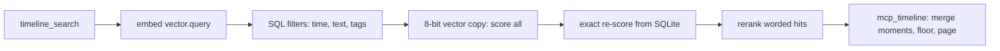

# Timeline search and the reranker

The archive's search index cuts the shared capture clock into searchable chunks (speech, sound, screen states,
45-second moments), embeds them, and answers `timeline_search` by words, time, tags or meaning, with an optional
reranker that reorders the best worded hits.

Read this when: you want to change how chunks are cut or tagged, debug a memory search that finds the wrong thing,
read the search log, change the vector copy or the reranker, run a chunk backfill or search from the command line.
Code: `crates/archive/src/timeline.rs` (schema, projection, search), `crates/archive/src/screen_timeline.rs`
(`timeline::recording`, screen states), `crates/archive/src/embedding.rs` (the embedding helper),
`crates/archive/src/vector_index.rs` (the in-memory vector copy), `crates/archive/src/rerank.rs`,
`crates/app/src/index.rs` (`ArchiveSearch`, `rerank`, `search_log`), `crates/app/src/embeddings.rs` (indexing jobs),
`crates/app/src/mcp_timeline.rs` (the tool's pages).

The tool's arguments, output and error codes belong to [mcp.md](mcp.md); the store the index sits in belongs to
[archive.md](archive.md); the models themselves belong to [models.md](models.md).

## How a search runs



1. `ArchiveSearch::timeline` (`crates/app/src/index.rs`) turns a `vector` query into a `timeline::Search`. With
   `vector.query` and reranking on, it fetches `rerank::fetch_for(n, 100)` rows (`n + n/4`, clamped to
   100..`timeline::VECTOR_LIMIT`) so that about `n` have words; otherwise 100.
2. The app embeds `vector.query` with the same provider that indexed the archive (`embedding::Service::query`; text
   at most 8,192 bytes).
3. `timeline::search_with_stats` ranks from the vector copy and re-scores exactly (below), under the same
   time, kind, tag and text filters.
4. `index::rerank` reorders the worded hits (below). Raw caller vectors are never reranked (no query text).
5. `mcp_timeline::search` merges rows of one moment, applies the similarity floor and builds the page
   ([mcp.md](mcp.md)).

## Search API (Rust and CLI)

`timeline::search` and `heimdall-archive chunk-search ARCHIVE_ROOT SEARCH_JSON` take a `timeline::Search`
(unknown fields rejected):

| Field | Meaning |
|---|---|
| `text` | Literal, case-insensitive substring (`instr(lower(text), lower(?))`: SQLite's ASCII case folding, not Unicode). At most 8,192 bytes. |
| `start_wall_ns`, `end_wall_ns` | Unix wall time; a chunk matches when its capture interval overlaps, not when its evidence arrived. |
| `session` | One archive session. |
| `kinds` | Any of `text`, `speech_audio`, `other_audio`, `moment`, `screen`. |
| `tags` | `[{key, value}]`, exact and conjunctive. |
| `limit` | Default 20; 1..100, or 1..`VECTOR_LIMIT` (500) with `vector`. |
| `vector` | `{model_id, model_version, values}`; the app also accepts `{query}` and embeds it. |

- A vector search ranks by exact cosine, ties by id, and adds top-level `similarity` (and `rerank` when reranked)
  without changing `details`. Only rows whose current `content_hash` and model id, version and dimensions match take
  part. A wrong model identity, a zero or non-finite vector, or no embeddings for the model fail; it never falls back
  to literal search.
- `timeline_search` with `vector.query` does fall back, when meaning search is paused for memory (the worker refused
  to load below `embedding::ADMISSION_GIB` free, exit 75, or paused a request): the page is `literal_fallback`, its
  `notice` says meaning search is paused for low memory, and its hits are the rows holding words of the question,
  most words first, newest first (`mcp_timeline::literal_ranked`, `index::literal_fallback`). Any other embedding
  failure is still an error.
- Results carry complete tags, links, clocks, quotes and details.
- The app's search uses the delivery permit, a SQLite interrupt and a progress hook, so Agent Off cancels a search in
  flight (`index::install_search_cancellation`).
- `heimdall-archive embedding-search ARCHIVE_ROOT MODEL_ROOT SEARCH_JSON` runs the same search with `vector.query`
  embedded by a helper it starts itself.

## Chunks

Every chunk is a row of `timeline_chunks` with a `kind` and a `role`. Capture never runs a model; projection
stores text, details and references only, never waveforms, images or video.

| Kind / role | One chunk is |
|---|---|
| `text/utterance`, `speech_audio/utterance` | One final transcript row, as a pair with identical source and clock intervals. The quote comes from timed words, without the app's bracketed action notes. Partials never become chunks. |
| `text/turn`, `speech_audio/turn` | The complete final plus the previous utterance's last sentence, when that ended at most `TURN_OVERLAP_MAX_GAP_NS` (30 s) before. `details.boundary` is `smart_turn`, `forced` or `legacy_final`. |
| `text/command` | One `command_decision` evidence record, keeping its phase (candidate, chain, merged, abandoned). |
| `speech_audio/speaker_turn` | One diarization segment, keyed by source, generation origin and segment index. Revisions replace it; confirmed names follow the track. |
| `other_audio/sound` | App sound in `SOUND_NS` (20 s) capture-clock buckets, partial at start and stop, minus known speech (`details.sound_ranges_ns`). Exact digital-zero blocks make none; a bucket fully covered by speech is skipped by search and embedding. |
| `screen/state` | One visual state of one display, at most `SCREEN_MAX_NS` (45 s) (see "Screen states"). |
| `moment/window` | A fixed `MOMENT_NS` (45 s) wall-clock window, linked to the chunks, quotes, sources, speakers and apps inside it. |

Rules that stop wrong changes:

- A turn's overlap never crosses a recorded discontinuity, source closure or Listening Off, and never joins
  Heimdall's own voice on a microphone (speaker `timeline::HEIMDALL_SPEAKER`) with someone else's words.
- Late labels or quotes rebuild the next turn's overlap.
- No window title or frontmost app is invented when the archive did not record one.
- Chunk ids are deterministic within a session. A host timestamp alone never identifies time across sessions; capture
  segments give the wall anchor (old finals without one use arrival wall time minus the interval's length).

## Tags and links

`chunk_tags(chunk_id, key, value)`: exact, indexed, possibly several values per key. Keys (a `CHECK` in the schema):

- `speaker`: from the naming pipeline ([speakers.md](speakers.md)); `unknown speaker N` for an anonymous track,
  `unknown speaker` without a track.
- `source`, `app` (the owning bundle ahead of a helper bundle), `window_title`.
- `language`: from the pipeline's evidence; `unknown` for old rows without it.
- `command_kind`, `agent`, `listening`: `unknown` before the first recorded state; a span crossing a change carries
  both values.

`chunk_links(chunk_id, relation, target)` names utterance ids, evidence ids, member and overlapping chunks,
`video_segment` and `video_frame` references, and `source_span` audio references (JSON `session`, `source`,
`start_ns`, `end_ns`). `timeline::audio_refs` resolves a span against live and packed callbacks at read time, keeping
native geometry, gain, offset, clipping and gaps; audio is read through `audio::read_block`, and nothing fills a
capture gap.

## Tables

- `timeline_chunks`, `chunk_tags`, `chunk_links`: the projection. `timeline_ingestion` orders chunks for page
  watermarks.
- `chunk_embeddings(chunk_id, model_id, model_version, dimensions, vector_id, content_hash, created_wall_ns)`:
  `vector_id` points into the archive's float32 `vectors` store. A changed quote, label, span, context or
  representative frame changes `content_hash` and so invalidates the embedding.
- `chunk_embedding_changes`: a trigger-fed log of embedding writes and deletes (feeds the vector copy).
  `chunk_embedding_errors`: failures with a retry time.
- `timeline_state`, `timeline_finals`, `timeline_speakers`: small state, boundary and name projections.
- Checkpoints: `timeline_backfill` (evidence, utterance and block ids per session), `timeline_audio_backfill` (per
  source and bucket), `timeline_video_backfill`, `timeline_screen_detector`, `cold_capture_spans` and
  `cold_capture_indexed`. Projection and checkpoint commit together. Schema changes are additive.
- These chunks are not the archive's `cold_chunks` storage containers ([archive.md](archive.md)).

## When chunks are written

- Finals: inside the transcript transaction (`crates/app/src/index.rs`, `Index::record` and `Index::relabel`).
- Commands, state, language and speaker updates: inside their evidence transaction.
- Audio spans: once per capture flush, not per callback.
- Screen: `video::Writer::append_screen` and `extend_screen` publish the recording and its projection in one
  transaction ([screen.md](screen.md) owns the recorder).
- Catch-up: the background compactor runs `timeline::backfill` (via `compact::backfill_chunks_while`) under its AC
  and idle gate. Each call reads at most `chunks::CHUNK_ROWS` (8,192) ids of evidence or capture, commits `BATCH` (32)
  records per transaction, stops when the store's writer has live work waiting, and resumes from checkpoints. It reads
  only the overlapping cold containers. Old capture containers first get a source and time catalogue
  (`chunks::backfill_capture_spans`) so a waveform read never reconstructs a whole session.

## Screen states

`timeline::recording` (`screen_timeline.rs`) samples the recorder's existing RGB frame once per second (`SAMPLE_NS`).
No model runs.

- Signal: a 32 × 18 colour grid, four point samples per cell. A new state starts when at least 15% of cells differ
  from the last accepted state's grid by a summed RGB difference of 72 (24 levels per channel on average), when the
  frontmost app changes, or when the window id or title changes. Comparing against the state, not the previous frame,
  catches slow scrolling; carets, cursors and codec noise do not split a state. Changes shorter than a second or
  smaller than the area threshold can be missed.
- A state ends at `SCREEN_MAX_NS` (45 s), at a recording gap, or at a timestamp jump over half the frame period.
  Idle coverage extends it without a new image.
- The representative is a `video_frame` link and `details.representative` `{segment, host_ns}` of a covered sample,
  plus a `video_segment` link; no pixels are copied. Frontmost bundle and window title become `app` and
  `window_title` tags.
- Boundaries go to `video_screen_events`. Unchanged coverage projects at most every `FLUSH_NS` (5 s); boundaries and
  stop flush at once with the recorder's own commit.
- Backfill (`recording::backfill`) takes one closed video segment per call, decodes its committed HEVC samples and
  computes the same signal at 1 Hz. The 256-record background budget counts analysed frames, not codec reference
  frames. Why: counting every reference frame exhausted the budget before one epoch finished. Old recordings without
  frontmost or window metadata stay untagged; nothing is inferred from pixels.

## Embedding

`embedding::MlxEmbedder` runs the native helper `native/heimdall-embedding-worker` from the EmbeddingGemma 2 model
folder (source `crates/archive/embedding/native`), as an offline resident process; nothing downloads at run time.
Identity: `embedding::MODEL_ID`, `MODEL_VERSION`, `DIMENSIONS` (768, stored as float32). Model choice and precision:
[models.md](models.md).

- Inputs: text and command chunks as text; speech and app sound decoded from native callback geometry (gain, offset,
  clipping, stereo mix) and resampled once per continuous interval, with gaps and format changes kept as separate
  parts and labelled speech left out of app sound; screen states as their representative frame and title; moments as
  their quotes, speech, sound and frames.
- Long legacy finals: host PCM parts are bounded to 120 s, and long inputs are packed into bounded windows whose
  normalised vectors are averaged by token weight and normalised again. Nothing is truncated.
- Requests group same-kind chunks: `BATCH_TEXT` 8, `BATCH_SCREEN` 4, one per request for audio and moments
  (`MAX_BATCH` 8).
- Representative frames decode through `video::Frames`, one decoder per job running forward in time; decoding, not
  the model, is most of the indexing cost.
- Jobs (`crates/app/src/embeddings.rs`): `timeline::embed_live` embeds chunks overlapping the last hour without
  admission; `timeline::embed_batch` takes the older backlog only when `BackfillGate` allows it (on AC and at least
  300 s idle; unknown power or idle fails closed). Both re-check before inference and before publication; a closed
  gate or changed content hash discards the result. Inference holds the archive's reader lock but no SQLite write
  transaction.
- Failures are recorded in `chunk_embedding_errors` with a 300 s retry (`RETRY_AFTER_NS`) keyed by content hash; one
  bad chunk never blocks the queue. Non-finite vectors and wrong dimensions fail.
- With no indexing work for `IDLE_TRIM` (120 s) the helper frees its MLX scratch. A worker that refuses for memory
  shows on the setup row ([setup.md](setup.md)).

## The vector copy

Search ranks over a separate, memory-mapped copy of the vectors (`vector_index.rs`); SQLite stays the source of
truth. Why: reading every compressed vector from SQLite per search took tens of seconds and a busy core.

- File: `vector-cache/<hash>.hvx` beside the index (the hash covers the model key and the index path, so archives
  sharing a folder never share a copy). `HEIMDALL_VECTOR_CACHE` names another folder, or `off` for RAM only (use it
  for lab runs against a real archive). Writes go through a temp file and a rename.
- Form: each vector normalised to 8-bit integers with one float32 scale, sorted by chunk id. Mapped pages are clean:
  the OS can drop them under pressure and they never swap.
- Query: an int8 dot product per entry on up to four threads; the best `RESCORE_POOL` (400, at least four per
  requested row) are re-scored exactly from SQLite's float32 vectors and checked against every filter and the current
  content hash. Further pools follow until the limit-th exact score clears the pool's last 8-bit score plus twice the
  largest 8-bit error seen, up to `RESCORE_MAX` (4,000). Results and similarities equal a full scan's. Kind and session
  filter in memory; time, text and tag filters select ids in SQL first.
- Staying current: each search applies `chunk_embedding_changes` rows newer than the copy to an in-RAM delta. Past
  `REBUILD_DELTA` (20,000) delta rows or `REBUILD_AGE` (three days), a background thread rebuilds the copy while
  searches use the old one; a failed rebuild waits `REBUILD_RETRY` (10 minutes). A database whose change sequence
  went backwards is loaded afresh.
- Start: the app loads the copy on a background thread 20 s after launch (`vector_index::warm`); a search that
  arrives first waits for the load. A missing or damaged file is rebuilt from SQLite and written.
- Fallback: a database without a file path, or any failure of the copy other than cancellation, scans every row and
  says why in the search log.

## Reranking

Qwen3-Reranker-0.6B (`rerank::MODEL_ID`, folder `rerank::MODEL_DIR` in the models folder) runs in the embedding
helper's `--rerank` mode (`Rerank.swift`). Which editions ship its weights: [models.md](models.md). Without them,
search keeps embedding order.

- Setting: `memory_rerank` (default `rerank::DEFAULT_CANDIDATES` 100, at most `MAX_CANDIDATES` 400, 0 off), applied
  at each search ([settings.md](settings.md)).
- Which hits: only a `vector.query` search. `rerank::plan` takes the first `memory_rerank` hits whose text has words;
  each sends at most `DOC_CHARS` (1,500) characters. The helper scores them in length-sorted batches of 32
  (`Rerank.defaultBatch`). Scored hits are reordered among their own places by score (ties keep embedding order);
  hits without words (screen, app sound) and worded hits past the count keep their places.
- The page floor: reranked lists no longer fall in similarity, so `mcp_timeline` takes the floor from the best
  similarity of any showable row and skips a row under it instead of ending the page.
- Lifetime: the helper starts on the first search that needs it and stops after `IDLE_UNLOAD` (60 s) without one,
  so at rest it holds nothing. Its MLX cache is capped at 256 MB. A compute-yield request
  (`speak::compute_flag::yield_asked`) stops it (`rerank::unload_all`) and skips reranking.
- Fallback, always to embedding order with the reason in the search log: a missing helper or model file, a memory
  refusal ("rerank paused"), a crash, a bad reply, or no reply within `TIMEOUT` (30 s, plus 60 s `STARTUP` for the
  request that started the helper). After a failure or refusal the reranker is skipped for `RETRY_AFTER` (5 minutes).

## Search log

Each vector search writes one stderr line (`index::search_log` and `index::rerank`) to the app log
([resilience.md](resilience.md)):

```text
memory search: 125 candidates by memory (402337 vectors scored in 5.2 ms, 400 re-scored exactly in 19.8 ms, copy ready in 0.1 ms: 3 changed); reranked 100 worded of 125 in 410 ms (model loaded in 0.38 s), model peak 2.05 GB
```

- `by scan in N ms; vector copy unavailable, scanned instead: <why>`: the copy failed; search is slow but correct.
- `rerank off (memory_rerank 0)`, `rerank skipped: no reranker installed; embedding order`, `rerank skipped: ... asked
  for room`, `rerank skipped: no hit has words`, `rerank fallback, embedding order: <why>`.
- At start: `memory search: vector search copy ready ...`, or `vector copy not loaded ahead (...)`.
- `memory search: reranker unloaded after 60s idle`.

## Run a backfill or measure cost

These commands write to the archive they are given: run them on a consistent private copy, never on the live
archive and never on a live index copied without its committed WAL.

1. Copy the archive under this worktree's `target/` (the embedding commands refuse any other path, `lab_archive`).
2. `heimdall-archive chunk-backfill LAB_ARCHIVE_ROOT` drains the bounded catch-up and prints CPU, size and counts. It
   stops at nine minutes; run it again to resume from checkpoints.
3. `heimdall-archive embedding-index LAB_ARCHIVE_ROOT MODEL_ROOT` embeds the backlog of that copy.
4. `heimdall-archive chunk-live-cost LAB_ARCHIVE_ROOT` measures live final projection per final.
5. Check: `heimdall-archive chunk-search LAB_ARCHIVE_ROOT '{"text":"hello","limit":5}'` returns chunks.

Measured on a copy of a real archive (sparse speech): about 650 index rows and 170 KiB per recorded hour; live final
projection about 0.76 ms per final; screen signal and projection well under 1 CPU second per recorded hour.

## Tests

`cargo test -p heimdall-archive --test timeline --test screen_chunks --test vector_search`, plus the unit tests in
`rerank.rs` (`cargo test -p heimdall-archive --lib rerank`) and `crates/app/src/index.rs`
(`cargo test -p app index::`).

- `crates/archive/tests/timeline.rs`: boundaries, tags, capture-time search, literal quotes, late labels, gaps,
  command phases, diarization revisions, sound exclusion, migration and resume, rollback, embedding gates and
  invalid vectors.
- `crates/archive/tests/screen_chunks.rs`: recording fixtures, app and window switches, scroll, caret and noise,
  idle caps, gaps, codec continuity, interrupted backfill, missing metadata.
- `crates/archive/tests/vector_search.rs`: the copy against a full scan with every filter, ties, stale and changed
  embeddings, side-file reload and a damaged file.

## See also

- [mcp.md](mcp.md): `timeline_search` arguments, output, handles, cursors and errors
- [archive.md](archive.md): the store, sessions, cold containers and the compactor
- [models.md](models.md): EmbeddingGemma 2 and the reranker, revisions and precision
- [settings.md](settings.md): `memory_rerank` and every other setting
- [screen.md](screen.md): the screen recorder that feeds screen states
- [capture.md](capture.md): the audio sources behind speech and sound chunks
- [speakers.md](speakers.md): speaker names used in tags
- [archive-clip.md](archive-clip.md): a movie of a time window
