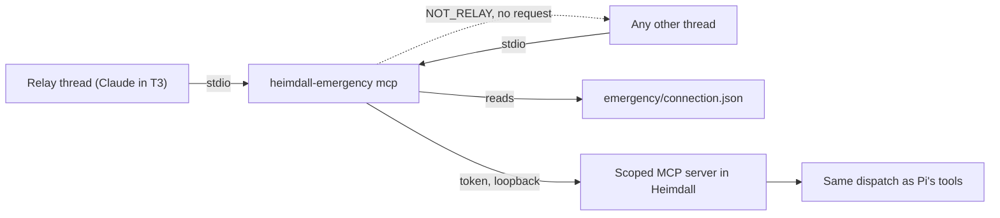

# The relay: Heimdall's agent as a T3 thread

Heimdall's main agent can be a thread in T3 Code (Claude on the user's Anthropic subscription) instead of Pi's model.
Heimdall relays to that thread everything that would wake Pi, and the thread acts through Heimdall's own tools.

Read this when: you want to run Heimdall's agent through Claude Code, you are changing how the relay thread gets its
tools, its first message or its context, you want to know which T3 harness or account a relay picks and how it
recovers from a failed account.
Code: `crates/app/src/emergency.rs` (the controller: `Reason::Chosen | Reason::Emergency`),
`crates/agent/src/emergency.rs` (brief, harness ranking, grant file), `crates/agent/src/routing.rs` (account choice),
`crates/app/src/emergency_recovery.rs` (recovery card), `crates/agent/src/mcp.rs` (the scoped server),
`crates/emergency-cli` (`heimdall-emergency`: `tools`, `call`, `mcp`, `mcp install`), `crates/app/src/relay_catalog.rs`.

## Two ways in, one mechanism

- **Relay mode** is the user's choice: Agent ▸ Model ▸ Claude Code subscription. The row is there once Add Provider ▸
  Claude Code subscription added it (`relay_added`, which never makes it the agent); Providers ▸ Claude Code
  subscription ▸ Remove offers it again, and is refused while it is the agent. It stays on across restarts until
  another model is picked.
- **Emergency mode** switches the same relay on by itself when Pi's agent fails (a spent quota, a rejected sign-in, a
  failing provider, no answer). It adds only detection, the indicator, probing, the hand-back and the local-engine
  offer: [emergency.md](emergency.md).

## Turn relay mode on

1. Agent ▸ Model ▸ Claude Code subscription opens to T3's Claude models (`orchestrator_capabilities`, read on each menu
   open). Pick one, then Confirm: like every row in Agent ▸ Model, a click only proposes (`ui::mac::model_choice`).
   The confirmed model is `agent_relay_model` (none: T3's first). A new model moves a running relay to a new thread.
2. Under the models, past a separator, pick the account: Automatic, or one T3 Claude provider instance that can run,
   by T3's display name (`agent::emergency::relay_accounts`). The confirmed one is `agent_relay_account` (the instance
   id, such as `claudeAgent_2`; none: Automatic), sent as `UiAction::SelectRelayAccount`. A new account
   restarts a running relay like a new model.
3. Check: the relay's first reply confirms the switch in one line naming the model or account it runs on.

Both lists come from `crate::relay_catalog` (read when the supervisor connects to T3 and on each menu open). The
`settings` tool offers and checks the same lists for `agent_relay`, `agent_relay_model` and `agent_relay_account`
([settings.md](settings.md)).

From code, the one switch is `agent_relay` (`crates/app/src/settings.rs`); the agent model stays as it is. A menu or
provider row selects it with `ui::UiAction::SelectAgentRelay` (`crates/ui/src/model.rs`), handled in
`crates/app/src/pipeline/actions.rs` like a model pick: it sets `agent_relay`, saves and restarts the agent, whose start
calls `Emergency::choose(true)`. Picking any other model row turns it off. Do not add a second switch.

## What the relay thread gets

| | Pi | Relay thread |
|---|---|---|
| Input | wakes, typed text, notices, task results, scheduled wakes, images | the same, one `t3_thread_send` each, in order, headed `[For Heimdall, …]`; images as private files (0600) |
| Tools | the main MCP server, as `mcp__heimdall__*` | the same tools, names and definitions (`mcp_contract::tools()`) plus `emergency_status` and `emergency_end`, as `mcp__heimdall__*` through `heimdall-emergency mcp`; the CLI's `call` as the fallback |
| Replies | the final answer is spoken and shown | the run's last assistant message goes through `Tools::agent_final_answer`: spoken, shown, `NO_REPLY` silent, de-duplicated against `speak` |
| Island | send arrow, working dots, ready | send arrow on each relayed input, working while the T3 run runs, ready when it ends |
| Stop | aborts the turn | `t3_thread_interrupt` on the running run, plus the Stop line in the thread |
| Record | Pi's session | Pi's session too, mirrored (below): every input, message and action, never a turn |
| Prompt | `crates/agent/prompt/heimdall.md` with its runtime fills, and the skills index | the same prompt, fills and skills index, plus `crates/agent/prompt/relay.md`, whole at the top of the first message |

Pi keeps running as the record: it takes context appends (local, no model call) so that Heimdall has everything when
Pi answers again. While the relay acts, Pi makes no model calls of its own: cache pings and idle compactions are held in
both modes. Session rotation at its size limit still compacts (one summary call on Pi's model). While the relay
answers, Pi's own calls report no provider problems to the menu: they are not the agent's.

Background model work (plan refresher, island updates, day timeline naming, suggester) does not move to the relay. In
relay mode it keeps running on Background Tasks ▸ Model; in emergency mode it pauses ([emergency.md](emergency.md)).
Background Tasks ▸ Model can itself be a Claude Code instance in T3 (`t3:<instance>`): each call is then a short-lived
thread separate from the relay ([background-call.md](background-call.md)).

## How the thread reaches the tools

Heimdall's MCP server is the one source of the agent's tools: Pi and the relay both get its `tools/list` and its
dispatch, so a tool added there reaches both ([mcp.md](mcp.md)). Pi's bridge (`crates/agent/runtime/heimdall.ts`)
registers each as `mcp__heimdall__<name>`; the relay's Claude sees the same names from the stdio server `heimdall` in
its user config.

- **The grant.** A second MCP server on its own loopback port with a 256-bit token, written to
  `<data>/emergency/connection.json` (folder 0700, file 0600, atomic) with the thread it was issued for: `pending`
  while T3 launches the thread, the thread's id as soon as `t3_thread_launch` returns. One token per launched thread,
  revoked when the relay ends; the server dies with the process. Outside a relay there is no file and no server. Agent
  off refuses it exactly as it refuses Pi. It serves the main server's tools on the same dispatch path (validation,
  crucial writes, permits) plus the relay's own two.
- **The MCP route.** T3 offers an outside client no way to give one thread an MCP server (`t3_thread_launch` and
  `t3_thread_configure` take none), so Claude Code's user config names one stdio server, `heimdall`:
  `heimdall-emergency mcp`, bundled beside Heimdall. Every Claude session starts its own copy, and T3 puts the
  session's thread id in its environment (`T3CODE_THREAD_ID`). The proxy reads the grant on each request: the grant's
  thread gets the scoped server's list and answers whole (images inline, as Pi gets them); a `pending` grant lets a call
  wait up to `mcp::SETTLE` (20 s) for the thread to be named; every other session lists no tools and its calls are
  refused (`mcp::NOT_RELAY`) without a request to Heimdall. The server's instructions carry the rule for other sessions
  (`mcp::RULE`).
- **Always loaded.** Claude Code defers MCP tools behind ToolSearch. The proxy marks the most-used tools with Claude
  Code's per-tool `_meta["anthropic/alwaysLoad"]` (`mcp::ALWAYS_LOADED` in `crates/emergency-cli/src/mcp.rs`); the
  rest stay deferred. Pi loads the whole catalog. T3 tasks get no such marker.
- **After an update.** The relay thread outlives Heimdall's restarts, and Claude keeps each tool definition it loaded
  in its conversation. The state keeps each tool's definition digest as the thread learned it (set at takeover); the
  next relayed input after a change starts with `[Heimdall was updated]`, naming the changed tools and the ToolSearch
  `select:` that loads them again.
- **Restarts and new tokens.** The proxy holds no state: a new port or token is read on the next call. A call that
  meets a retired token, a server that is gone, Agent off or a missing grant file never reached Heimdall's dispatch, so
  it is retried for up to 5 s, on the new grant when one comes. When the session's grant changes (named, new token,
  ended) the proxy sends `notifications/tools/list_changed`. Each call runs on its own thread; a cancel does not stop a
  call, as for Pi.
- **Outside T3.** A caller with no `T3CODE_THREAD_ID` (a script, a terminal) is refused by both the server and the CLI.

### Install the MCP entry

1. Run `heimdall-emergency mcp install` (the binary is in `Heimdall.app/Contents/MacOS`). It writes one
   `mcpServers.heimdall` entry into every Claude config T3 may run with: `$HOME/.claude.json`,
   `$CLAUDE_CONFIG_DIR/.claude.json`, and each `$HOME/.claude-*/.claude.json` that exists.
2. Check: a new relay thread lists `mcp__heimdall__*` tools. `heimdall-emergency mcp uninstall` removes the entry.

Without the entry, or on a harness without Claude's config (Codex, Grok), the relay prompt sends the agent to the CLI:
`heimdall-emergency tools` (the same server's list) and `heimdall-emergency call <tool> '<json>'`, images as private
files. The CLI has no tool code of its own.

### Who may use the tools

Heimdall's task rules (the task preamble above every brief, [skills.md](skills.md#the-task-preamble)) and the server's instructions say:
Heimdall's tools may be listed; use one only when the user directly asks, or under an explicit relay instruction, which
then requires them. The relay prompt says the relay must use them and that its own sub-agents are not the relay. A
direct ask in another thread is still refused by the grant: only the relay acts.

Protection: the token is Pi's equal, minus the file-descriptor hand-off. Any process of the user's account can read the
0600 file while the relay is on, and the thread check is against the environment, which such a process could set. The
grant stops Heimdall's other threads and sub-agents from driving him by accident; it is not a defence against a hostile
local process (Pi's token is equally reachable by the user's account). The token never leaves the Mac and never goes
into T3's transcript. Sub-agents inside the relay's own Claude session share its process and environment, so the grant
cannot tell them apart; the prompt rule covers them.

## Takeover: the first message

T3 threads take no system prompt, so the first message (`em::Brief`) carries it inline:

- **The relay prompt**, between `<system_prompt>` and `</system_prompt>`, first. `crates/agent/build.rs` composes it per
  edition from `crates/agent/prompt/relay.md` (what differs in a T3 thread), Heimdall's prompt
  (`crates/agent/prompt/heimdall.md`) and the index of the edition's bundled skills. At takeover
  (`agent::relay_prompt::text`) it gets the same fills as Pi's prompt (`harness::fill_prompt`), the CLI line, and the
  index of `<data>/agent/skills` when that folder exists, else the bundled sets.
- **The snapshot.** `crates/agent/prompt/relay.generated.md` is the composed template, checked in, the same for both
  editions. `relay_prompt::tests` fails when the prompt, a bundled skill or `relay.md` changed without it. Regenerate
  with `HEIMDALL_WRITE_RELAY_PROMPT=1 cargo test -p agent relay_prompt`. At runtime the relay also gets the user's
  private layer and their own skills ([skills.md](skills.md), "Two layers").
- **The context file**, `<data>/emergency/context.md` (0600): the recent conversation, the last 100,000 tokens of it
  (`CONTEXT_BYTES`, 400 KB at about 4 bytes a token, cut on a line), the open plan (`PLAN_BYTES`, 16 KB), the T3 tasks
  Heimdall follows, and the cause. T3 caps a first message at `FIRST_MESSAGE_CHARS` (120,000), so the message holds the
  prompt, the protocol, the cause, the last `TAIL_BYTES` (12 KB) of the conversation, the plan and the file's path;
  `em::tests` asserts it stays under the cap.
- **Emergency** opens with `OPENING`: continue Heimdall's work. The thread reads the context, picks up what was left
  unfinished, and sends the user one short message about it ([emergency.md](emergency.md)).
- **Relay** opens with `OPENING_RELAY`, without the emergency lines. A plain start (Heimdall relaunched with relay mode
  on) says to reply `NO_REPLY` unless something needs the user. A start that completes a switch the user asked for
  (relay on, another relay model or account, at most `SWITCH_FRESH_MS`, 5 min, old: `Emergency::switch_requested`,
  `pipeline::settings_apply::switch_label`) says to confirm it in one short line naming the model or account. The
  built-in agent gets the same once after a switch back or to another model (`agent::notice::switch_done_message`).
- A recent thread reused for a new takeover gets the same whole first message again.

A thread counts as answering at its first sign of life: its first CLI call, its first real assistant message, or its
run still working after `ANSWER_WAIT` (90 s). A harness error reply (`harness_error_reply`) fails it at once.

## Context continuity

The tool sets differ, so no tool call is ever replayed: messages go across whole, and each action as one plain line
with its result.

- **Going in**: the context file carries Heimdall's conversation from Pi's session: every message whole, each of
  Heimdall's tool actions one line (`Heimdall used plan_edit: … → Added …`), and everything that reached the session as
  context, including input held for a relay and the relay's mirrored lines.
- **While the relay acts**: Pi's session mirrors the thread (`mirror`, from `t3_thread_read`'s activity view, paged,
  each item's whole text): the relay agent's messages whole (`[Relay agent] …`), Heimdall's own messages to it, each
  other action one line (`[Relay agent ran] git log -1 → completed`). Its Heimdall tool calls arrive live
  (`[Relay agent] said to …: "…" → Speech queued: 1.`), so their CLI commands are left out of the mirror. The mirror runs
  every 5 minutes of a long run and when each run ends; each entry's id is its thread and position, kept in
  `state.json`, so a restart goes on without repeats. A message over `MIRROR_PART` (64 KB) goes in as consecutive
  parts. One pass carries at most 40% of the agent model's context window at four bytes a token (`mirror_budget`;
  `MIRROR_BUDGET` when the model is unknown): a larger backlog keeps its newest items and names the older ones in one
  line that points to the T3 thread.
- **Coming back**: the last of the thread is mirrored, then the hand-back turn says only that Heimdall is back and that
  the relay's conversation above is his; relay off adds one line that the user switched back. Input the relay had not
  finished wakes Pi, in order, after the hold lifts (`Emergency::open`, `Side::unfinished`); input before a Stop is
  dropped. A relay model change hands it to the new thread instead. No summary, no hand-off list. Once Pi is idle, the
  history it takes over is fitted to its model: past Heimdall's compaction mark, its newest turns up to
  `HANDOVER_PERCENT` (50%) of the budget stay, and one note in place of the rest names the relay's T3 thread,
  `emergency/context.md` and the session file (no model call; `Outcome::Handover` in
  `crates/app/src/bridge/compaction_fallback.rs`).
- **Size**: Pi's session grows by what the relay says and does. Relay mode compacts it as usual while held
  (`Bridge::set_hold_compacts`); emergency mode holds compaction and the main model compacts after the hand-back. When
  the agent's provider refuses a compaction, Heimdall summarises on the first model whose window holds it (Background
  Tasks ▸ Model, another signed-in subscription, then the local engine) and Pi writes that as its own compaction. If none
  can, the history stays with one notice, or, past the agent's budget, only the newest whole turns up to `CUT_PERCENT`
  (80%) of the budget stay in context (the rest stays in the session file).

## Which T3 harness

`orchestrator_capabilities` tells an outside client each provider instance's `providerInstanceId`, `driverKind`,
`displayName`, `constraints`, `runtimeModes` (absent means all), `canRunChildTask` and a short model list. No T3 call
reports subscription, quota left, reset times or sign-in health, so a harness is judged by trying it: the first run's
reply is the only health signal from T3.

Quota comes from each account's own reading (`agent::accounts`, shared with the background fallback in
[background-call.md](background-call.md)): one process-wide reading, the accounts' config folders from T3's
`providerInstances.*.config.homePath`, no prompt and no token read. The relay asks for a reading at most a minute old
and waits up to 20 s for a stale one (`Board::fresh`); a failed read is "quota unknown", never the older reading.
`agent::routing::quotas_from` turns it into the ranking's windows. The public edition has no quota reading, so every
account is "quota unknown".

Ranking, in order:

1. Eligible: enabled, offers full access, has a model, and not on the failed provider's subscription
   (`shares_subscription`: ChatGPT and Codex, OpenCode Go and OpenCode).
2. Driver kind in `relay_order` order (default `claude, codex, *` in both editions, `agent::emergency::default_order`).
   `*` is every other harness in T3's order; `-x` never uses `x`. Relay mode uses the same order, so when Claude does not
   answer another allowed harness takes the thread; set `relay_order` to `["claude"]` to keep it Claude only.
3. Each with the first model T3 lists for it.

`delegate_task` is not affected by this order.

## Accounts and recovery

`agent::routing` picks the account; `emergency_recovery` builds the cards.

- **Which account.** Among a driver's eligible accounts, the one whose quota resets soonest. An exhausted account (a
  window at 100%, or the provider says a limit is reached) is never eligible. A known quota ranks before an unknown one;
  a five-hour window at 95% or more ranks after the others; then the earliest weekly reset (to the hour), the earliest
  five-hour reset (to the quarter hour), then T3's order. A chosen `agent_relay_account` goes first; Automatic uses the
  rule. The rule runs when the relay starts and after a failure, never while it works.
- **On failure** (Pi's provider, or the relay's own account: a run failing with a quota or sign-in error): a quick scan
  (catalog, every account's quota, the local model), then the recovery card in the pull-down with a one-minute
  countdown. The card has four options (`OPTIONS`): "Wait for <original>" and the local model (when the engine is on
  this Mac: ready, or with its download size) take their places, and accounts fill the rest: the same model on the
  failed provider's other accounts first, then one account of every other provider (main assistant only). Each shows
  its quota or "quota unknown"; every account stays in the automatic search. Codex is
  left out after ChatGPT failed only while its own quota is unknown or spent. No pick in the minute, or the card
  closed: the search runs in that order by itself. Input is held meanwhile; what the failed relay had not finished goes
  to the next one, images included; finished actions are only in the conversation, never replayed.
- **Phases.** `Choosing` (the card), `Starting` (searching), `Covering` (a replacement runs normally, background work
  on), `NoCover` with `waiting` (the user chose to wait, or the local model is starting).
- **The original** (`emergency_recovery::Original`: the built-in agent and its model, or a relay account and model) is
  what hosted Heimdall when the chain of failures began ([emergency.md](emergency.md)). It is checked at its reset plus a
  minute: Pi by its probe, a relay account by its live quota (the reset passing is not proof). When it works, Heimdall
  says so once and shows "Back to …" / "Stay on …", only when no relay run is working. It never switches back by
  itself; `emergency_end` also only leads to the question. Back: the hand-back to Pi, or the relay moves to the
  original account. Stay, or no answer within `RETURN_MS` (4 h): the replacement stays, becomes the relay setting,
  and the user is not asked again. Waiting for a relay account: once its quota reads usable, the relay starts
  on it.
- **The same thread carries on.** A relay thread stopped by its account's failure is kept (`State::resume`). When the
  relay goes back to that account and model ("Wait for …", a search that lands on it before another thread covered, or
  a restart while waiting), Heimdall first sends that thread one short message (what stopped it, that its account works
  again, that held messages follow) with a new token; its run answering puts it back on duty and every held message
  follows in order. It is a new thread only when continuing is impossible: T3 no longer has the thread, or refused
  `RESUME_SEND_TRIES` (3) messages to it in a row; Heimdall then says why. Once another thread has covered, the stopped
  one no longer holds the whole conversation and is dropped.
- **Waiting is checked within seconds.** "Wait for <relay account>" checks 15 s after the pick (`WAIT_RETRY_MS`), then
  doubling to at most every 5 minutes, unless T3 reported a reset still ahead (then that reset plus a minute). After a
  failure that was not the quota (sign-in, provider error), a quota reading proves nothing: unless it reads spent, the
  test is the stopped thread's next run; a run failing again keeps the wait and its backoff. An agent restart keeps the
  wait.
- **The cause is named.** The card, Heimdall's line, the island and the waiting line say what failed in plain words
  (`em::short_cause`), such as "Claude · Fable 5.2: sign-in failed: 403 from Cloudflare." A relay run is one failure
  however many inputs were steered into it; "Failed to authenticate" reads as a sign-in failure.

## When nothing can relay

Order: the main agent, then the T3 relays, then the local engine, then the main agent again at the hand-back.
`relay_skip` goes straight from the main agent to the local engine.

When no harness answers (none suitable, all failed, or skipped), the island shows a large warning triangle: the quota
ran out and no T3 Code relay can drive Heimdall. Then (`crate::emergency_local::offer`):

- local engine configured: "Switch to the local model?" Yes / No;
- not installed: it says so, with what it needs (download, RAM, disk), and offers to download and set it up;
- No: it waits for the quota, with the reset time when known; relays are retried every 10 minutes.

Yes switches Agent ▸ Model to the engine model (`Emergency::local_fallback` remembers the main model). The return is in
[emergency.md](emergency.md) ("No relay").

If the relay's own harness runs out in relay mode, the recovery card above runs; with nothing left, the no-relay
triangle shows.

## Limits

- Barge-in and Stop: relay speech goes through the same speech queue as Pi's, so `Tools::interrupt` cuts it, and each
  relay run settles like a Pi turn (reply window, address, skip latch).
- The pull-down during a relay run looks like a Pi turn: thinking dots while the run works, and each Heimdall tool
  call's row (`speak` line, note, started task, question) as it happens. T3 reports no tool events; every Heimdall call
  the relay makes passes through `emergency::Own`, which hands it to `chat_history::relay_call`. The relay's other
  actions (shell commands, file edits) show nowhere live, as Pi's do not. After a relaunch, today's relay rows are
  rebuilt from Pi's session only for `speak` lines and replies.
- T3 closing while a thread relays is noticed only as failed sends, retried every 30 s.
- A relay run is followed for at most `FOLLOW_MS` (60 min).
- `T3CODE_THREAD_ID` reaching MCP servers is checked for Claude; for Codex and Grok relays it is not.

## Test it

`cargo test -p app emergency` (relay mode, the mirror, replies, Stop, takeover, recovery; `crates/app/src/emergency_tests.rs`),
`cargo test -p agent emergency` and `cargo test -p agent relay_prompt`, `cargo test -p heimdall-emergency` (proxy and
CLI). The full list is in [emergency.md](emergency.md).

## See also

- [emergency.md](emergency.md): detection, probing, the hand-back and the local engine
- [mcp.md](mcp.md): Heimdall's MCP server, the one tool surface
- [t3-orchestration.md](t3-orchestration.md): T3 tools and how Heimdall follows tasks
- [background-call.md](background-call.md): background model work and the account fallback
- [settings.md](settings.md): `agent_relay`, `agent_relay_model`, `agent_relay_account`, `relay_order`, `relay_skip`
- [install.md](install.md): installing the app and its helpers
