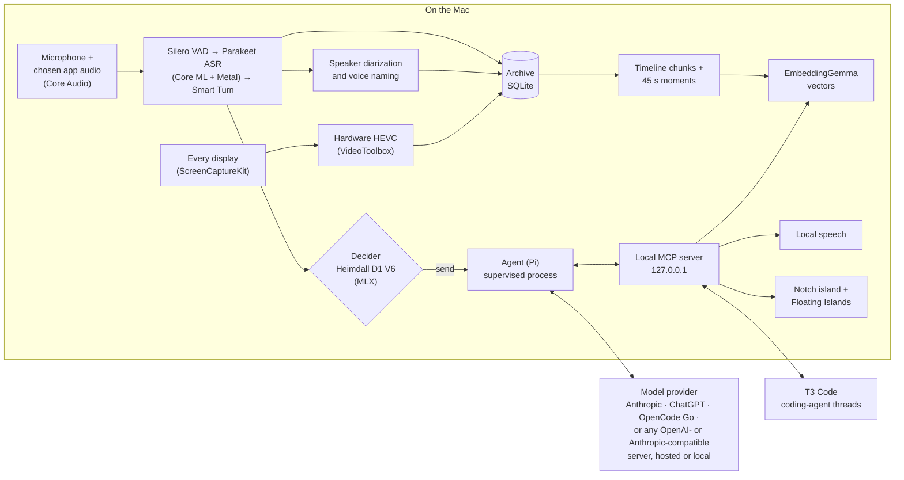
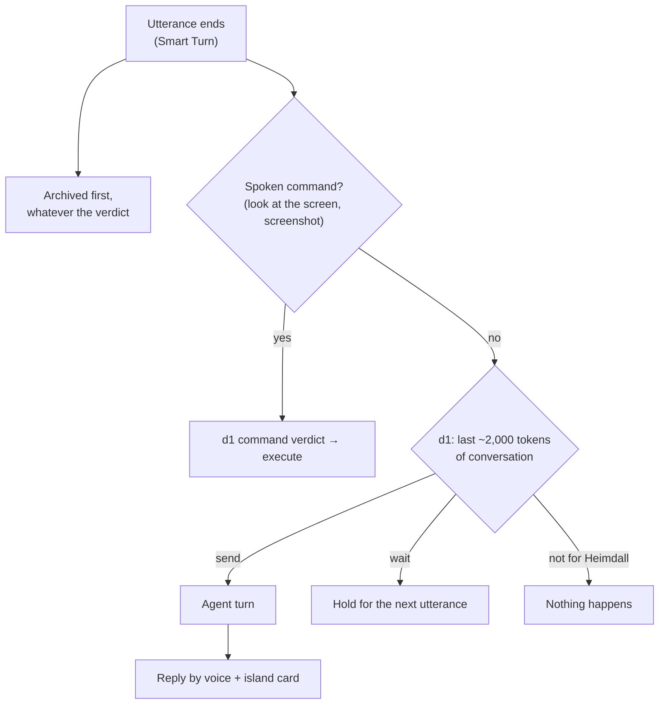
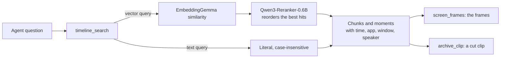
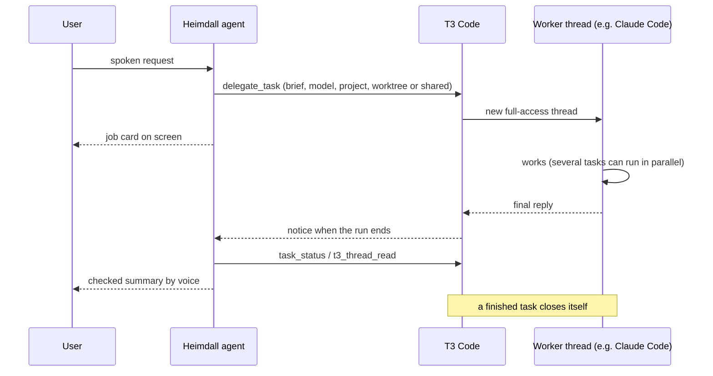
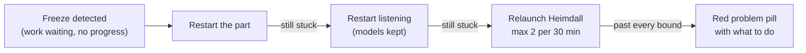

# Heimdall: condensed technical explanation

Heimdall is a voice assistant for macOS that runs all the time. It hears the microphone and chosen apps, sees the
screens, decides on its own when something is meant for it, and hands that to an agent that can talk, look, search
what happened and start longer jobs for coding agents. This page is the short version of how it is built; the full
reference is [architecture.md](architecture.md).

## The whole system on one page

| Part | What it does | Where it runs |
|---|---|---|
| Capture | Microphone and per-app audio taps; every display at half native resolution, 5 fps, hardware HEVC | Mac |
| Transcription | Silero VAD finds speech, Parakeet turns it into text with vocabulary biasing, Smart Turn detects the end of a turn; a separate worker assigns speakers and recognises known voices | Mac, no network |
| Archive and search | One SQLite store (monthly packs, WAL); timeline chunks and 45-second moments that join speech, app sound, window names and representative frames; EmbeddingGemma vectors; Qwen3-Reranker-0.6B reorders the best hits | Mac |
| Decider | Fine-tuned Heimdall D1 V6 (Decider V6 in the code) reads the recent conversation and chooses send, wait or not for Heimdall; also confirms the two spoken screen commands | Mac, MLX through a Rust engine |
| Agent | Pi as a supervised child process, on the model the user picks | Process on the Mac; model local or in the cloud |
| Tools | One loopback MCP server: speak, look, search the archive, island notes and questions, pointing and drawing, scheduled wakes, T3 tasks | Mac |
| Orchestration | Longer work goes to T3 Code as tasks, each a separate coding-agent thread | Mac (T3 Code), agents' own providers |

The app is Rust with a native AppKit interface; the Floating Islands helper is a second app bundled inside it. Each
domain is its own crate (for example capture, screen, listen, speakers, decide, agent, archive, speak, ui, islands,
keychain, t3, night).

## From speech to an answer

There is no wake word to say first. Every finished utterance goes through the decider, and the agent wakes on its
"send", or at once when the user addresses Heimdall by name.

- The decider is Heimdall D1 V6, fine-tuned from V5 with MLX and published on Hugging Face
  ([heimdall-d1-v6](https://huggingface.co/Toby-NoSkillSon/heimdall-d1-v6)). It runs in 16-, 8- or 4-bit (4-bit by default); a missing model folder falls back to the nearest one instead of failing.
- Every payload to the agent is written to the archive before it is sent, and the delivery ledger is durable, so a
  restart does not lose a turn.

## How the agent finds what happened

When the reranker is missing or cannot load, hits keep embedding order; when memory is too short for meaning
search, the tool says so and answers by words. Nothing in the archive is deleted for age. The `look` tool grabs the display under the pointer directly, and
Heimdall's overlays (command island, drawing overlay, pointer) never appear in a recording or a grab.

## Longer jobs: tasks for coding agents

- Heimdall connects to T3 Code as an outside MCP client with its own OAuth bearer, kept in the Keychain.
- Each task gets a job card (Floating Islands) as soon as it starts; `task_status` and `t3_thread_read` give its state
  and latest reply; `task_cancel` stops one.
- Background jobs outside the agent (plan refresher, suggestion cards, voice namer, day timeline) call model APIs
  directly through one request layer: Anthropic Messages, OpenAI Chat Completions, OpenAI Responses, or a short-lived
  T3 thread. Each sends an
  answer schema (JSON Schema); refused, cut-off or empty answers are logged and never used.
- Providers are separate billing routes: a subscription (ChatGPT, OpenCode Go), an API key (Anthropic),
  or any OpenAI- or Anthropic-compatible server the user names, hosted (OpenRouter, for one) or local. The built-in agent never switches provider by itself (when it cannot answer, emergency mode takes over, below);
background jobs may move to the next configured backend when one is spent.

## Phone (personal edition)

An iPhone companion app reaches the Mac over a private network through a bridge that Heimdall starts as its child
process. The bridge talks to one loopback listener in the app, authenticated with a per-start 256-bit token. It carries
typed messages, voice recordings and the phone's live microphone. The public edition leaves it out.

## Failure and recovery

- A freeze is work waiting with no progress (a microphone open but delivering no samples, a listen worker holding
  audio and finishing nothing, a live loop missing its tick), never silence or an idle agent.
- A relaunch keeps every committed record; a hang writes every thread's stack to `logs/hangs/`.
- When the agent cannot answer (a spent quota, a rejected sign-in, repeated errors or five minutes of silence),
  emergency mode hands the turns to a T3 thread with the same tools, and asks the user before handing back.
- One check script runs the whole test suite (over 4,000 tests) before each install of the developer's build, and it
  passed on this public release's source. The public alpha bundles its small models, downloads the large ones on first
  run and checks each against a pinned SHA-256.
