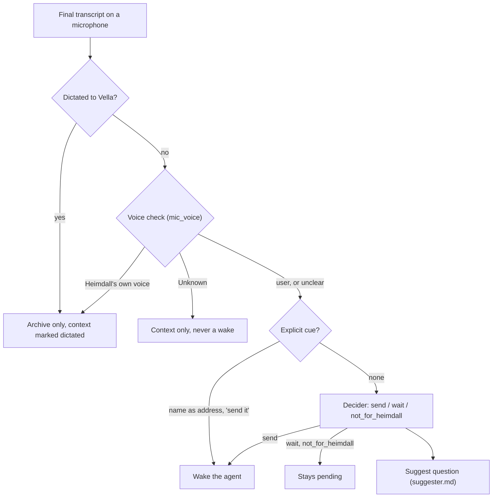

# Decision chain: from a spoken sentence to send, wait or ignore

How Heimdall decides whether a finished sentence is for it, how the two spoken screen commands are confirmed, how the
user's voice interrupts Heimdall (barge-in), which sources may reach the agent, and how Agent Off cuts tool work.

Read this when: you want to change when Heimdall wakes, you are debugging a missed or false wake, you are changing
barge-in or the reply hold, you are changing the spoken commands, you want to read `send_decision`,
`command_decision` or `barge_in` evidence, or you want the decider-label shortcuts.
Code: `crates/decide/src/send.rs`, `crates/decide/src/command.rs`, `crates/app/src/pipeline/` (`send_worker.rs`,
`utterances.rs`, `commands.rs`, `barge_in.rs`, `heimdall_voice.rs`, `mic_voice.rs`, `hotkeys.rs`),
`crates/app/src/bridge/` (`hold.rs`, `speech_policy.rs`, `questions.rs`, `call_interrupt.rs`),
`crates/app/src/context_policy.rs`.

## The chain

1. Every finished line is archived whatever the verdict.
2. Lines dictated to Vella never wake anything ([vella.md](vella.md)).
3. Each finished utterance on the primary microphone is judged by voice (`pipeline/mic_voice.rs`): only the user's
   voice reaches the decider as the user; Heimdall's own voice is archived only; another voice is "Unknown" and is
   context, never a wake. With no verdict (no profile yet, encoder down or late) the line stays the user's. The
   thresholds are in [speakers.md](speakers.md).
4. Host wakes that skip the decider's argmax (`decide::send::explicit_trigger`): the assistant's name (below) and
   "send it" when it opens its clause, follows a request frame ("can you send it") or joins another command ("write
   the reply and send it"); never inside talk about sending.
5. Otherwise the decider answers `send`, `wait` or `not_for_heimdall` over a 2,000-token text window
   (`send::WINDOW`), with the acknowledgement line it picks. It asks `crates/decide/questions/dispatch-v5.json` on
   every sentence. Oldest turns drop first; unsent text stays in the prompt unless it alone exceeds the window, when
   only its newest suffix is inferred. A `wait` or `not_for_heimdall` never consumes pending text. Typed messages send
   at once and form barriers.
6. Outside a call, on the user's microphone with no question card up, a `send` within `NEAR_TIE` (0.01) of
   `not_for_heimdall` and at least `wait` counts as a send although it is not the argmax (`send::d1_gate`,
   `D1Gate::NearTie`).
7. After each line's send decision the same conversation is asked the suggest question ([suggester.md](suggester.md)).

There is no follow-up window: a reply right after Heimdall spoke goes to the decider like any sentence.
`decide::send::FOLLOW_UP_NS` (30 s) survives only to restore Heimdall's finish time across a restart
(`bridge/tools.rs`). There is no silence wake, score-threshold setting or decider switch.

Which decider runs: `decider_model` (`v6` or `v5`) at `decider_precision` (`16bit`, `8bit`, `4bit`), default V6
4-bit (`decide::precision::Pick::DEFAULT`). Keys, hot swap and missing-folder fallback are in
[settings.md](settings.md); files and sizes in [models.md](models.md).

Other triggers (`decide::send::Trigger`):

- `OpenQuestion`: for `ANSWER_WINDOW_NS` (60 s) after a Heimdall question card appears, the user's line is sent when
  the decider's `send` is at least `OPEN_CARD_SEND` (0.35), even if it is not the argmax (`bridge/questions.rs`).
- `Dropped`: a drop on the notch while speaking (`pipeline/drops.rs`).
- `Guest`: a listened-to call guest addressing Heimdall by name ([speakers.md](speakers.md)).
- `PhonePress`, `Typed`. `FollowUp` appears only in old archives.

## The name as an address

`decide::send::addressed_by_name` reads the name as an address when it opens a sentence (after interjections such as
"yo", "hey", "okay") or is set off by a comma. With the default name Heimdall also matches the recognizer's known
misspellings (`KNOWN_ONE_WORD`, `KNOWN_TWO_WORDS`, `KNOWN_WHOLE_SENTENCE`); another configured name matches at a
sentence start within an edit budget by length (7 or more letters: 2 edits, 5 or 6: 1, shorter: exact).

- Address: "Heimdall, check this", "Heimdall is it done?" (inverted question), "Heimdall did you see that",
  "Heimdall can you…" (modal).
- Mention: the name as the subject of a statement, with no punctuation after it and a third-person verb next
  ("Yeah, Heimdall is searching already.", "Heimdall was down all night").
- Any name trigger wakes at once, in a call or not (night 1115). Every run the user's own words woke may answer
  aloud on a call (`speech_policy::addressed_wake`, set in `Pipeline::dispatch_pending`).

## Calls

- Night 1115 ("You shouldn't be less reactive because we are on the call"): a call changes nothing
  about which of the user's lines wake Heimdall. No call gate, no wait for the decider on names or "send it";
  `held_in_call` is written only for a listened guest's line the decider sent (guests wake by name or "send it").
- One call timer: a call is a live conversation (`speech_policy::in_conversation`), a line by a person the user named,
  or a call line within 2 min of the user talking to someone else (the decider: `not_for_heimdall`), lasting
  `CONVERSATION_NS` (45 s) after the last such line. Unnamed app audio in a call app (a stream, a video) is not a call.
- On a call, Heimdall's answer to the user waits for a pause in the others' talk (`hold::PATIENCE`, then plays over
  them); `speak` with `now` plays as soon as the user pauses. Runs the user did not start stay held for the call, with
  one soft cue (`speech_policy::held_cue`).
- A goodbye ends the call window early:
  - a farewell by either side (`decide::send::farewell`, English and Polish), ending the line with at most one word
    after it, or an unambiguous goodbye ("bye", "take care", "gotta go") ending any sentence of the line;
  - the user's "I'm off the call" or "you can talk to me now" (`decide::send::off_call`), not negated or conditional;
  - the user addressing Heimdall by name with nobody else heard for `ADDRESS_GAP_NS` (8 s) before the line, when the
    user also said nothing to the call for 8 s or the line says they are back ("I'm back", `decide::send::says_back`;
    `speech_policy::address_ends_call`).
  A call line within `FAREWELL_SLACK_NS` (5 s) after the goodbye is the call's own goodbye; any later call line starts
  the call again.
- The speech hold (`speech_policy::in_conversation`) keeps replies silent on the island during a conversation: 45 s
  after the last call line (`speech_policy::CONVERSATION_NS`), while a call source's voice is open, and until 3 s after
  the last call source stops (`CALL_SOURCE_GONE`). It honours the goodbyes. A held reply is said, newest only, as soon
  as the user's own words reach the agent after it.

## Which sources may reach the agent

Routing happens in the shared pipeline before `Command::Observe` reaches any harness (`context_policy::agent_context`):

- Every opted-in microphone supplies context as the user (subject to the voice check above).
- Known call apps supply context with their diarized speaker label or enrolled name. The list is
  `context_policy::CALL_BUNDLES` (Discord and its PTB and Canary builds, Slack, Zoom, both Teams bundles, FaceTime).
  Capture's owning-app bundle wins over helper-process identity; names and substring matches grant nothing.
  Browser-hosted calls are archive-only.
- Every other recorded app stays in the archive and transcript index, available to `timeline_search`, and never enters
  pending text, decider context or the agent's observations.
- Heimdall's own audible reply stays in the decider's conversation context; it is never an observation or a trigger.
- A call final without a diarized track waits as `awaiting_diarization` for the speaker actor; at most 64 wait
  (`pipeline/utterances.rs`), then `diarization_backlog_full`. Gaps, overflow or closure keep the transcript with an
  archive-only reason. Undiarized mixed speech is never passed under an invented name; unknown people keep a
  `Speaker n` label.
- `agent_context_routing` evidence records each archive-only or queued disposition; `given_to_agent` means queued to the
  bridge.

## The decider worker

- Send inference and the suggest question after it run on a bounded FIFO worker of `CAPACITY` (32) outstanding
  sentences (`pipeline/send_worker.rs`). Explicit cues enqueue their wake at once. Failed or saturated inference
  leaves speech pending and journals a problem.
- One owner thread holds the app's only decider instance. Commands use its higher-priority lanes: they run before
  queued sends, never in parallel.
- Wake, suggest and the command check share that runtime. The model reads the whole text each time (no KV cache).

## Spoken screen commands

The two spoken commands are "look at this" and "take a screenshot" (`pipeline::COMMAND_PHRASES`). Each is decided once,
as soon as it is detected, by a text question to the decider. No transcript rule overrides the decider.
`COMMAND_POLICY` (`crates/decide/src/command.rs`) names the current policy.

1. Detection: the phrase is matched in Parakeet's text on the primary microphone in a partial, a 15-s window decode
   or the final. A screen phrase holds the screen from the phrase's first word. Detections of the same command within
   1 s (`COMMAND_MERGE_NS`, `pipeline/mod.rs`) merge; a late duplicate adds a `phase: merged` row instead of a second
   action.
2. Text: a window or final detection uses its own words over the last 15 s (`SIDE_MAX_NS`) up to 200 ms after the
   trigger (`SIDE_AFTER_NS`). A partial's candidate waits for the window or the final; if the final no longer carries
   the phrase it is abandoned (`partial_phrase_retracted`) and the held screen released.
3. Decision: one question per command ("did the user, right now, ask Heimdall to look at the screen / take a
   screenshot?"), text only. Context is the recent delivered turns (20, `decide::MAX_CONTEXT`) and the pending
   transcript. Answers: `yes`, `false_alarm`, `unsure` (`CommandIntent`).
4. Outcome: `yes` runs the command on the screen pinned at the phrase (the screenshot is attached to the turn).
   `false_alarm` and `unsure` show nothing and release the held screen. `unsure` and inference errors write an
   automatic review entry to `bugs/command-reviews/` beside the bug inbox (`kind: command_decision_auto`,
   `crates/app/src/bugs.rs`), never into the inbox itself.

Stopping the agent is the Agent window's or island's Stop, or a request to the agent; there is no spoken stop or cancel
command. The main transcript is never split at a command.

## Barge-in

While Heimdall's voice plays, speech that speaker ID confidently matches to the user stops it at once. Heimdall's own
echo never does. There is no transcript and no decider question in this path
(`barge_in::POLICY` = `user-voice-v1;no-transcript;no-decider`). Code: `pipeline/barge_in.rs`,
`pipeline/heimdall_voice.rs`.

1. Arming: the user's speech starts on the primary microphone while Heimdall is speaking (agent speech queued,
   synthesizing or playing, with Speaking on), or Heimdall starts speaking during the user's speech. Heimdall's own
   app audio, other microphones and dictation to Vella never arm it.
2. The check: from the onset, every 0.5 s (`STEP_NS`) the microphone's last 1.5 s (`WINDOW_NS`, including 300 ms before
   the onset, `PREROLL_NS`) is embedded by the speaker encoder and scored against the user's voice profile and
   Heimdall's own voices (`heimdall_voice::user_verdict`).
3. Stop when `USER_WINDOWS` (2) windows in a row are the user's: at least `USER_MIN` (0.60) against the profile,
   beating the score against Heimdall's voices by `USER_MARGIN` (0.10), and not Heimdall's own voice (`HEIMDALL_MIN`,
   0.45). On a worn headset microphone (AirPods, Beats: `heimdall_voice::headset_device`) with Heimdall in the
   headphones the bar is `HEADSET_USER_MIN` (0.50). A window quieter than RMS `SPEECH_RMS` (0.0095) is never scored.
   Stopping is `Tools::interrupt`; the island shows nothing.
4. Continue on anything else: Heimdall's echo, another person, no confident speaker, a failed check, or a check slower
   than 1.5 s (`CHECK_LIMIT`). Checks go on 1.5 s past the user's last voice (`END_TAIL_NS`), so a short "stop" is
   judged; a sound too short for two windows never stops it. After a stop, continuing speech arms nothing for 1 s
   (`REST_NS`).
5. Before the profile has `USER_MIN_SAMPLES` (3) samples, a window confidently not Heimdall's voice stops it, so the
   user can always interrupt. How the profile is learned: [speakers.md](speakers.md).
6. Call voices are a separate path: during a conversation a call voice still open after `GUEST_CUT_AFTER` (400 ms)
   while Heimdall is audible stops it (`Tools::guest_talked_over`); while a guest is listened to, only that guest and
   unlabelled voices do (`bridge/call_interrupt.rs`). The rules are in [speakers.md](speakers.md).

Speaking off stops Heimdall at once; Listening off does not. Each checked window is a `barge_in` evidence record
(schema 2: the window, both scores, the verdict and the outcome).

## The reply hold

A reply never starts over the user (`bridge/hold.rs`). On the primary microphone, with the check ready, an onset makes
a coming reply wait while the barge-in window checks run (`armed_by`, outcome `hold_check`): the user's voice skips
the reply; another voice or Heimdall's echo lets it play; a quiet or unsure window decides nothing; with no answer it
plays `VERIFY_MAX` (3 s) after its first look. Without a check (no encoder or profile, another microphone) an onset
counts as the user's at once. The reply waits `QUIET_AFTER` (2.2 s) past `SpeechEnd`. Each skip's log line names the
source, how long it had been speaking and why it counted as the user's.

## Agent Off at the MCP boundary

The provider transport and the MCP server share one `DeliveryGate` (`crates/agent/src/delivery.rs`).

- Each tool request gets one epoch permit. Off prevents execution, cancels its future and invalidates its HTTP
  response, even if Agent is switched back on before delivery.
- The permit is passed into speech, screenshot and search work. Agent Off interrupts synthesis, playback and queued
  speech at once. Listening off stops no speech.
- Archive searches interrupt their SQLite query; screenshots check the epoch before capture and after acquisition, and
  cancelled results delete their scratch PNGs. A native capture already running may finish before it is discarded.
  Bytes already handed to the HTTP transport cannot be recalled.

## Label the decider: ⌃⌘\, ⌃⌘' and Stop

Two global shortcuts (the physical backslash and quote keys, `crates/ui/src/shortcuts.rs`, shown read-only in the
menu's Shortcuts submenu as Wake Heimdall and Suggest Now) and the island's Stop label lines for decider training.
Code: `pipeline/hotkeys.rs`.

- ⌃⌘\ Wake Heimdall (`UiAction::ForceWake`): everything said since the last wake goes to the agent at once as the
  user's own wake. The user's latest unsent line (else anyone's) is labelled `send`.
- ⌃⌘' Suggest Now (`UiAction::ForceSuggest`): a suggestion pass starts at once, past the pacing and the addressing
  hold. The latest decided line is labelled `suggest` = `yes`, with the suggest question asked again on the snapshot
  the decider saw.
- The island's Stop while Heimdall speaks (`UiAction::StopSpeaking`): the voice stops at once (lines held for after a
  call go too). The line whose `send` woke that run is labelled `not_for_heimdall`, once per line. A cut reply that no
  decider line woke (a T3 result, a notice, a typed message) leaves a `speak` row instead. The rest of that run's
  replies are shown on the island unsaid until the user's own words reach the agent again.

A line still being decided when a key is pressed is labelled when its decision lands. Each press is also a `hotkey`
evidence record.

Labels are JSON lines in `decider-v6-labels.jsonl` (`hotkeys::LABELS_FILE`) in the archive store, schema 1:

| field | meaning |
|---|---|
| `task` | `send` (⌃⌘\, Stop), `suggest` (⌃⌘') or `speak` (Stop on a reply no decider line woke: adds `spoken`, `in_call`, `words`) |
| `label` | `send`, `yes`, or `not_for_heimdall` (Stop) |
| `source` | `user-hotkey` (`LABEL_SOURCE`) or `user-stop` (`STOP_SOURCE`, with `speaking`) |
| `at_ms` | Unix ms of the label |
| `utterance_id`, `speaker`, `text`, `line_source` | the labelled line |
| `decider_input` | the exact decider request for that line |
| `v5` | the live decider's own answer: choice, probabilities, outcome, trigger, `d1_gate` (the field keeps its old name) |
| `woke`, `also_sent` | send only: whether the wake went out, and the other unsent lines it carried |

A Stop on a line a decider `send` woke appends a new `send` row for that line with `label` `not_for_heimdall`,
`source` `user-stop` and `speaking: true`; it never edits earlier rows.

## Evidence

- `send_decision`: the exact request, token counts, distribution, trigger, outcome, latency, trimming, `d1_gate` and
  audio reference; typed sends record inference as bypassed. `heimdall-archive timeline --problems` flags failures,
  inference above 500 ms and window truncation (`crates/archive/src/diagnostics.rs`).
- `command_decision`, phases `candidate`, `chain`, `merged` and `abandoned`. The chain row holds the candidate (source,
  trigger time, phrase), `stage` (`early` or `final`), the decider's text and its origin (`window_decode` or `final`),
  the one step's rendered question, typed answer with full distribution and native output, `policy`, `aliases`,
  `intent`, `approved` and `error`. Approval is not execution: `command_action` records the execution's error and
  dry-run flag. Journal appends use SQLite WAL with `synchronous=FULL`; authorization is committed before a command
  runs.
- Proposal origins: `parakeet_partial`, `parakeet_window`, `parakeet_final`. Older archives may show
  `keyword_spotter`, `side_parakeet`, `target_selection`, `d1_tcl` or `Question::Legacy` records; they still parse.
- Other kinds: `barge_in`, `hotkey`, `agent_context_routing`, `mic_voice`, `suggest_decision`, `d1_question`.

## See also

- [speakers.md](speakers.md): voice profiles, Heimdall's own voice, listened-to guests, call-voice interrupts
- [suggester.md](suggester.md): the suggest question and the cards
- [vella.md](vella.md): dictation that must not wake Heimdall
- [settings.md](settings.md): `decider_model`, `decider_precision`, hot swap and fallback
- [models.md](models.md): the decider's files and sizes
- [archive.md](archive.md): evidence records and the archive CLI
- [crates/decide/README.md](../crates/decide/README.md): the decide crate's code map and tests
