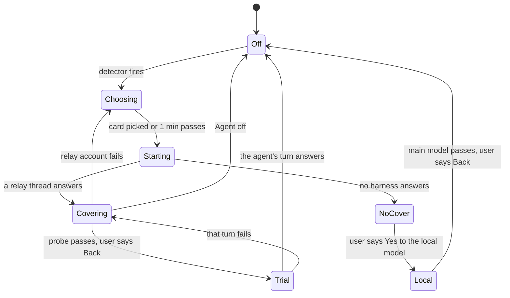

# Emergency mode

When Heimdall's own agent cannot answer, a T3 thread takes over as Heimdall's agent, with every tool the built-in
agent has, until the built-in agent answers again. It is relay mode ([claude-relay.md](claude-relay.md)) switched on by
itself. This page covers only what is emergency-specific: detection, the indicator, probing, the hand-back and the
local engine. The relay agent reads this page at runtime.

Read this when: you are the relay agent covering for Heimdall, you want to know when emergency mode starts and ends,
you are changing the detector, the probe, the recovery card or the hand-back.
Code: `crates/app/src/emergency.rs` (controller), `crates/agent/src/emergency.rs` (detector, brief, harness ranking),
`crates/app/src/emergency_recovery.rs` (recovery card), `crates/app/src/emergency_local.rs` (local-engine offer),
`crates/agent/src/limits.rs` (limit and reset parsing).

## If you are the relay agent in emergency mode

Your first message carried your system prompt (Heimdall's own, with the relay's notes and his skills index), then
named what failed and your context file. You act through Heimdall's own tools, `mcp__heimdall__*`, the same as his
built-in agent; without them in your list, through the CLI the message names (`<cli> tools`, `<cli> call <tool>
'<json>'`).

1. **Continue Heimdall's work.** Your prompt is at the top of the first message; read the context file. Find what the
   user and Heimdall were doing and left unfinished, pick it up, and tell the user in one short message (your reply to
   the first message): what broke, that you have it, what you are continuing. That is the one exception to "speak
   only when the user talks to you or must act". When your first message says Heimdall already said the quota
   sentence aloud, don't repeat it. `emergency_status` names your harness and thread, the quota's reset when it is
   known, and Heimdall's next check, which is not the reset.
2. **Answer what arrives.** Each message headed `[For Heimdall, …]` is something that would have woken Heimdall: the
   user's words (said, typed or clicked), a task result, a T3 question, a scheduled wake, the user's Stop. Answer it
   as Heimdall would. Your final reply is spoken and shown like his; `NO_REPLY` keeps quiet. Images arrive as file
   paths.
3. **Work on the cause** when you can do it from here: name the reset time, check the provider or the sign-in.
   File a bug note with the evidence.
   Model choice, money and accounts are the user's: ask the user.
4. **Hand back.** Heimdall checks his agent by himself, asks the user whether to go back to it, and tells you in this
   thread when to wrap up. Calling `emergency_end` early only brings that question forward. When you have finished
   early, call `emergency_end` with what you did. "Handed back" means stop acting now; "still fails" means keep
   covering until the time it names. When told to stop (Agent off), only `emergency_status` and `emergency_end` work,
   for two more minutes.

In relay mode (the user's choice, not a failure) your first message says to reply `NO_REPLY` unless something needs
the user, except when it completes a switch the user asked for (relay on, another relay model or account): then it
says so, and your reply to it is one short line confirming the switch and naming the model or account you now run on.

Heimdall's conversation mirrors this thread ([claude-relay.md](claude-relay.md), "Context continuity"): your messages
whole, each action one line, so his own agent carries on as if it had been here. No hand-off summary is needed.

## How emergency mode runs

Phases are `Phase` in `crates/app/src/emergency.rs` (`NoCover` with `waiting` set while the user chose to wait or
the local model starts). The emergency indicator shows only while choosing and searching;
a relay that answers runs as in relay mode.

## What Heimdall does

| Step | What happens | Code |
|---|---|---|
| Detect | A turn fails on a spent quota or credit (once is enough), a rejected sign-in (`AUTH_FAILURES`, 2 in a row), any other provider error (`PROVIDER_FAILURES`, 3 within `PROVIDER_WINDOW_MS`, 10 min), or work waits `NO_ANSWER_MS` (5 min) with no event from Pi. A running tool is not silence; a running compaction is not, up to `COMPACTION_WAIT` (15 min). A spent quota takes its reset from the quota module's `heimdall_quota` limit frame, or from the warning before it while that reset is still ahead. A success clears every count. The user's Stop, aborts and the loop guard are not failures. In relay mode nothing is detected: Pi runs no turns. | `agent::emergency::Detector`, fed in `bridge/supervisor.rs` |
| Controller | Runs whenever Heimdall runs, whatever Agent was at launch, and is started again on the 10 s tick if it ended. A message to a controller that is not running is logged. | `Emergency::respawn`, supervisor `emergency_run` |
| Hold | `Emergency::enter` puts the controller in `Starting` before the Bridge holds, so the first held wake is never taken for late input. From then every voice wake, typed message and waking notice is appended to Pi's session as context marked `emergency::HELD` and relayed; nothing starts a turn. Cache pings and idle compactions wait. | `Bridge::hold_turns` |
| Indicator | The warning triangle by the notch for as long as emergency mode is on, and one notice such as `Agent out of quota till 03:04 · backup agent on it, nothing to do`. Background Tasks in the menu dim, with one triangle whose tooltip names the reset. Back: the `Recovered` cue "Agent back". | `UiUpdate::AgentRelay`, `Cause::island` |
| Background | Background model work (plan refresher, island updates, day timeline naming, suggester) pauses quietly: no requests, no failure cues or quota notices; it resumes at the hand-back. Relay mode does not pause it. | `background_gate::emergency_pause` |
| Recovery card | Before any relay starts: what can take over (the failed provider's other accounts first, then other providers, the local model, waiting), with a one-minute countdown (`COUNTDOWN_MS`); unanswered, the search runs by itself ([claude-relay.md](claude-relay.md), "Accounts and recovery"). | `emergency_recovery`, `Running::offer` |
| Announced | The card is said, or shown on the island with Speaking off: "Opus 5.5 on Claude is out of quota until 13:00. In a minute I'll switch to Opus 5.5 on Claude code 2, unless you pick something else on the card.", with an island notice `Claude · Opus 5.5 out till 13:00 · switching in a minute`. The switch shows `Now on Claude code 2 · Opus 5.5`; in relay mode it is also said ("Switched to …"); in emergency mode the relay's own first reply tells the user. | `rec::card_line`, `Running::covering`, `mcp_actions::say` |
| Relay | Harness order, first message and context file, first-sign-of-life acceptance, the grant, replies, Stop and the send arrow: [claude-relay.md](claude-relay.md). | `crate::emergency` |
| The original | What was hosting Heimdall when the chain of failures began: in relay mode the relay's account and model, in emergency mode the built-in agent and its model. A later failure of a replacement keeps it. Relay mode never has the built-in agent as its original: a stale one is dropped when the state loads. A relay without a recorded route finds it from its harness line in T3's catalog. When the search lands on the original account itself, the chain is over and nothing asks to go back. | `Running::relay_failed`, `emergency_recovery::Original` |
| Limits | A failed relay run (status `failed`; an interrupted run, the user's Stop, is never a failure) is read from T3's own record: the run's `system_notice` and `error` items, and its reply when that is the provider's error ("You've hit your weekly limit · resets 1pm", "… resets Nov 6 at 9am", a `usage-limit:…:seven_day:<seconds>` notice id, "402 Payment Required: … balance exhausted"). `agent::limits` makes it `Cause::Quota` with the window and reset ("Claude's weekly limit is used up; it resets at 13:00."). The account is kept in `state.json`'s `spent` until that reset (a prepaid balance: `SPENT_BALANCE_MS`, 6 h; a limit without a reset: `SPENT_NO_RESET_MS`, 30 min), left out of the search and the cards; its reset is the card's "back at 13:00" and the original's next check; background helpers on it move off (`Side::account_spent`). The spent thread gets no "stop" message (that would start a run on the spent account); it is kept and continued once its account works. | `agent::limits`, `em::relay_cause`, `T3Cover::failure` |
| No relay | No harness answered, or `relay_skip` is set: the island's large triangle says the quota ran out and no T3 Code relay can drive Heimdall, and offers the local engine (switch, or set it up with its size, RAM and disk). No: it waits for the quota, with the reset when known; relays are retried every 10 min (`RELAUNCH_MS`). Yes: the agent switches to the engine model, which answers the hand-back (`Phase::Local`); the main model is probed and, when it passes, the island asks "<model> answers again. Back to it?" Yes / No (`emergency_local::offer_back`). Only Yes switches the agent back; nothing switches the agent's model by itself. | `crate::emergency_local`, `Emergency::local_fallback` |
| Probe | At the known reset plus a minute, else after 2 min, doubling to 30 min. ChatGPT: one tiny request on the agent's own model (the only check that sees the plan limit); other API providers: the sign-in check; the local engine: none. A model switch probes within 5 s. | `ProviderProbe`, `em::next_probe_ms` |
| Hand back | A passing probe (or `emergency_end` with a passing probe) asks the user, by voice and card, once no relay run is working; never by itself. "Back to …": the thread is told to wrap up, the token dies, the hold ends, and the agent's next turn is the `emergency-back-` notice: he is back, and the relay's conversation above (mirrored as it happened) is his; no summary. That turn answering ends it: Heimdall says "I'm back." Any failed turn in that trial puts the same thread back on duty with a new token. Input that reached the relay as it ended is passed to the agent as an `emergency-late-` notice that wakes it. | `Running::recover`, `Running::finish` |
| Off | Agent off ends emergency mode: the thread is told to stop, its token is swapped for an end-only one for `END_GRACE_MS` (2 min: `emergency_status` and `emergency_end`, on a gate of their own), the hold lifts without a turn, nothing is said. Quit is not Agent off: `state.json` keeps the emergency for the next launch. | `Running::stand_down` |

State survives Quit and a restart (`<data>/emergency/state.json`): the hold is back from the first start, the same thread
acts with a new token, and the agent is probed within 30 s. Log lines start with `emergency:` in `heimdall.log`; the
archive journal records `agent_emergency` (`on` with the cause, `released`).

## Boundaries

- The grant is [claude-relay.md](claude-relay.md)'s: a 0600 token file readable by the user's account while a relay is
  on; no file and no server otherwise.
- The relay's T3 runs never wake Heimdall: the controller talks to T3 directly, and the T3 observer never follows
  threads titled as relays (`t3::observer::RELAY_TITLES`).
- Pi itself crashing past its restart budget is the supervisor's red pill, not emergency mode
  ([resilience.md](resilience.md)).
- The probe sees a spent plan limit only on ChatGPT; elsewhere it checks the sign-in, so a spent prepaid balance costs
  one failing hand-back turn per probe.
- T3 offers no quota or plan health before a run, so a harness on a spent subscription is found by its first run
  failing (its limit and reset are then read from T3's record).
- A relay account's recovery is its live quota reading; accounts without one (the public edition has none) are never
  offered back by themselves.
- T3 closing while a thread relays shows as failed sends, retried every 30 s.

## Test it

No model inference. Supervisor tests need the guardian binary first: `cargo build -p agent --bins`.

- `cargo test -p agent emergency`: `agent::emergency::tests` (detector, harness order per edition and the
  subscription skip, probe times, the connection and context files, the first message), `agent::limits::tests` (limit
  and reset parsing from T3's records), `agent::sim::emergency_scenarios` (held input is context and a relay, never a
  turn).
- `cargo test -p agent --test mcp_scoped`: the scoped server.
- `cargo test -p heimdall-emergency`: the `mcp` proxy (another thread is refused, the relay's thread gets the answers
  whole).
- `cargo test -p app emergency`: `crates/app/src/emergency_tests.rs` (failover, the full toolset, relay mode, the
  mirror whole and through a restart, replies, Stop, the send arrow, early acceptance, hold ordering, a replaced
  controller, Agent off at launch then on, hand-back, no relay and the local engine, Agent off, restart, the true
  original, the limit and its reset on the card, no message into a spent thread, the announced card and switch, the
  search landing on the original, and the real supervisor with the fixture Pi on a spent quota).

## See also

- [claude-relay.md](claude-relay.md): the relay itself, the grant, takeover, accounts and the recovery card
- [resilience.md](resilience.md): every other failure, its fix, and where the logs are
- [background-call.md](background-call.md): background model work and its account fallback
- [settings.md](settings.md): `agent_relay`, `relay_order`, `relay_skip`
