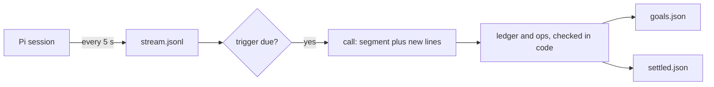

# Goals: the shadow job

A cheap background model follows the agent's conversation and asks each turn: did this move a goal forward, finish a
piece of work, or record a decision of the user's? It answers with ops that code checks and applies to the `goals.json`
and `settled.json` lists in the islands folder.

Read this when: you want to change what the Goals job reads, when it calls its model, what it may write, how it
settles finished work, or replay a recorded day through it.
Code: `crates/app/src/goals/` (`stream.rs`, `trigger.rs`, `segment.rs`, `shadow.rs`, `ledger.rs`, `ops.rs`,
`settled.rs`, `proof.rs`, the loop in `mod.rs`), the prompt `crates/app/prompt/goals.md` (public edition:
`crates/app/prompt/public/goals.md`), the lab `crates/app/src/bin/goals-lab.rs`.

The rules every list follows (the user's yes, proof, proposals, the record) and the file formats are on
[one-system.md](one-system.md). This page is the job.



Why: this is the one background job with a rolling context, so each call pays only for its new lines and reads the
rest from the provider's prompt cache. Every other job is a stateless call.

Setting: Background Tasks ▸ Goals (key `goals`, `ui::BackgroundTask::Goals`), on by default, with its own model row
(else the shared model, through `background_model::task_endpoint`); see [settings.md](settings.md). Agent off and
emergency mode's pause hold it as every background job.

## The stream (`stream.rs`)

- Renders the agent's Pi session as Pi builds context (`pi_session.rs`): messages and `custom_message` entries
  (relayed transcripts, T3 task notices, catch-ups). Lines: `Incoming:` (the user), `Notice:`, `Heimdall:`,
  `Heimdall called <tool> <args>` (args cut at 300 characters, `ARGS_CHARS`), `<tool> answered:` on one line (300,
  `TOOL_CHARS`). A message is cut at 4,000 characters (`MESSAGE_CHARS`). The relay agent's record counts as Heimdall's.
- Dropped: thinking, images, receipts, model changes, compactions, edits, delivery and clock headers, the pipeline's
  repeated instruction lines, `NO_REPLY` turns, the plan refresher's own notices.
- Each entry is rendered once, by id, into `<data>/goals/stream.jsonl` as `{id, at, lines, kind}`. Those ids plus
  `seen.ids` (rotated ids, newest 20,000, `SEEN_KEEP`) are the cursor: a Pi compaction or a new session file repeats
  nothing. Past 5,000 lines or 4 MB (`ROTATE_LINES`, `ROTATE_BYTES`) it rotates, keeping the lines no turn carried and
  the 30 before them (`segment::TAIL_LINES`).
- The loop looks every 5 s (`TICK`) and reads only what the session file gained, from `<data>/goals/cursor.json` (path,
  inode, offset, size, mtime, last entry id). It rereads the whole file when another file is active, the inode changed,
  the file shrank, its mtime went back, or the new entries do not continue the branch it last took.
- First start: the existing session is the past; its last 30 lines open the first segment's header.
- Job off or no model connected: lines are read but are not news later. Agent off or emergency pause: lines wait, and
  the loop wakes on `background_gate::resumed`.

## When it calls (`trigger.rs`)

- The user's words fire after 60 s of quiet (`QUIET_MS`), at most 3 min after the first pending words (`MAX_WAIT_MS`).
- A finished task (a `terminal:` notice) fires 20 s after it (`TASK_MS`). Everything else rides on the next call.
- Calls are at least 45 s apart (`GAP_MS`); events meanwhile join one call. Nothing new: no call.
- Failed without cost (network, server, backend down): retry after 2 min, doubling per failure in a row up to 30 min
  (`shadow::RETRY_MS`, `RETRY_MAX_MS`). The backoff holds every call, new words included.
- Refused at the gate (Agent off, emergency pause): goes again when the gate opens, no backoff.
- Paid for without a usable answer, or refused over the $0.50 run limit (`background_call::LIMIT_USD`): the lines are
  set aside and a new segment starts, so a context grown past what a run may cost never stalls the job.
- Every time is passed in, so the lab replays a day in simulated time.

## The segment (`segment.rs`, `shadow.rs`)

`<data>/goals/segment.json`: `{id, started, header, turns: [{user, volatile, assistant, at}], sent}`.

- A call (`goals::call`) sends the prompt as system, the turns as history, then the new turn: stable (the header on a
  segment's first turn, then `<new_lines>`), then volatile (`<goals_now>`, the clock, the ledger). Stored turns keep
  the two apart so a resent turn matches the cached prefix.
- The header: `<goals_at_start>` (the Goals with every finished task: the memory) and `<earlier_lines>` (the last 30).
  `<goals_now>`: goals with ids, `now` and `next` tasks, finished tasks only counted, waiting proposals, open asks.
- A turn carries the newest 400 lines and 60,000 bytes at most (`TURN_LINES`, `TURN_BYTES`); older ones are set aside,
  logged. A whole call stays under 100,000 bytes (`CALL_BYTES`): over it the segment starts over, then the oldest new
  lines go. Why: T3's `t3_thread_launch` refuses a message over 120,000 characters.
- A turn that leaves the segment over 40,000 estimated tokens (`COMPACT_TOKENS`, bytes / 3) starts a new segment. Why:
  the estimate runs under the real count, and this keeps a full call under the 100k-token price step.
- API backends get the turns resent (`background_call::Call::history`). On a T3 instance the job keeps one thread per
  segment (`Call::session`, key `goals-<segment id>`), ended by `background_call::t3::end_session` when the segment
  ends, the job is turned off, or its model leaves T3.

## The answer (`ledger.rs`, `ops.rs`)

The schema (`ops::schema`) requires four arrays; every key inside is required, `""` when unused:

- `finished`: `{n, goal, task, title, now}` for each numbered `<finished_tasks>` notice (completed task notices, marked
  "(the task is still running)" when the framing says so); several entries may share a number.
- `reported`: the same, for each `<heimdall_reports>` line (Heimdall's lines saying work finished).
- `checked`: `{ask, status: open|answered|moot, quote}` for each `<asks_to_check>` entry (every open ask, every turn).
- `ops`: `{quote, op, goal, task, title, state, now, kind, detail, ask, icon, about}`, `quote` first.

Code turns `finished` and `reported` into `progress` done ops quoting the notice's first 14 words, and `checked` into
`answered` or `drop_ask` (moot); a missing entry is logged, and a model op on the same task or ask gives way. The
model's ops (`ops::MODEL_OPS`) are below; the job raises no asks (`ask` is refused).

| op | does | keys |
|---|---|---|
| `progress` | a task to `done`, `now` or `next` (a new one by title); the goal's `now` and `moved`; resumes a paused goal | goal, task or title, state, now |
| `decided` | the user's decision that moves a goal: a Settled `decided` row | goal, title |
| `add_goal` | proposes a new goal | title, icon, about, now |
| `finish_goal` | proposes a "done?" card under the goal; the user's Yes finishes it | goal, now |
| `pause_goal` | sets an active goal paused | goal |
| `drop_task` | removes an abandoned task that is not done | goal, task |

A new task by title: `next`, or `now` not quoting the user, becomes a step proposal; `now` quoting the user is added
with `yes: {by: "voice"}`; `done` is added done and settles. An existing task matches by title, else the same thing in
other words (`goals::settled::same`).

## Checks (`ops::apply_file`, under the folder lock, against the file as it is then)

- The quote must be in the new lines (normalised; at least 4 characters, `QUOTE_MIN`), else the op is dropped, logged.
- Taking something away (`finish_goal`, `pause_goal`, `drop_task`, `drop_ask`, `answered`) needs a 3-word, 15-character
  quote (`REMOVE_WORDS`, `REMOVE_CHARS`); `answered` in the user's words needs 2 words, 6 characters (`ANSWER_WORDS`,
  `ANSWER_CHARS`). `answered` and `decided` must quote the user or the user's click; so must `drop_ask` for an ask the
  job did not raise (`by: "goals"`).
- Refused: unknown goals, tasks and asks; a task id under another goal; `progress` on a finished goal; a 7th active goal
  (`MAX_ACTIVE` 6, counting goal proposals waiting); a new task the user removed from Settled.
- Caps: titles 40 characters (`TITLE_CHARS`), `now` 60 (`NOW_CHARS`), `about` 140 (`ABOUT_CHARS`), 12 ops an answer
  (`MAX_OPS`).
- A ticked task (`ticked: true`) never goes back; a finished task is never dropped. Asks answered by a click (done, or
  `chosen` other than `later`) leave first.
- `moved` and a task's `at` are the time of the quote's line. A proposal drafted this turn that is the front is told to
  Heimdall in one notice.

## Writing Settled (`settled.rs`, `proof.rs`)

In the same lock hold, each task newly done becomes a `shipped` row and each kept `decided` op a `decided` row
(`by: "goals"`, `at` the epoch second of the quote's line).

- Proof (`proof::near`) comes only from the quote's sentence and the next: a commit (named with a commit word, and found
  in a local repository by `proof::commit_exists`), a passing test run, an install, or a file written within two days
  before `at`. A ticked task's tick and a decision's quote are quote proofs. No proof: claimed.
- Refused: no goal or title; what the user removed from Settled (60 % of the shorter title's content words and at least
  2, or the same quote, `REMOVED_SHARE`) for 14 days (`REMOVED_DAYS`; undated removals never lapse); the same task, or
  a title sharing 75 % of content words within 3 days (`SAME_SHARE`, `SAME_WINDOW`); a 3rd decision in a turn
  (`DECISIONS`). Titles up to 64 characters (`goals::settled::TITLE_CHARS`).
- A closed job's row for the same work (`by: "job"`, within 30 min, 60 % shared words: `JOB_SAME_WORK_S`,
  `JOB_SAME_SHARE`) is taken over, keeping its file proof.

At each start, after the clean slate, `ops::ensure` restores goals from a closed or kept copy when the file lost them and
migrates a leftover `todo.json` once (timed items to Scheduled, waiting ones to asks, after a one-time
`backup-goals-<stamp>/` copy beside the islands folder).

## Replay a day (`goals-lab`)

A lab binary, never bundled: `cargo run -p app --bin goals-lab -- <command>`.

```
goals-lab replay --session <pi jsonl> --from <iso> --to <iso> --runner <cmd> --out <dir> \
    [--seed default|empty|<goals.json>] [--seed-settled <settled.json>] [--effort low] [--compact-tokens N]
goals-lab stream --session <pi jsonl> --from <iso> --to <iso>
goals-lab prompt
```

- `replay`: the window in simulated time through the real stream, triggers, turns, checks and apply, into
  `<dir>/islands-root`; the session before `--from` is the first header. `--seed` defaults to `default` (the built-in
  seed goals), `--effort` to `low`.
- The runner runs once per call with `{session, system, schema, history: [{user, assistant}], user, effort}` on stdin
  and prints `{"text", "usage": {"input", "cache_read", "cache_write", "output"}, "ms"}`; one printing
  `{"text": "{\"ops\": []}"}` calls no model.
- Output: `<dir>/turns.jsonl` (per call: `seg, turn, at, trigger, new_lines, user, answer, ops [{…, kept, reason}],
  malformed, goals_after, settled_after, usage, ms, segment_tokens, compacted`) and `<dir>/final.json`.
- `stream` prints the rendered lines with times; `prompt` the prompt's and schema's size and token estimate.

## Check it

- `cargo test -p app goals`: stream, cursor across compaction and restart, triggers in simulated time, ledger, ops
  checks and caps, apply with ticks and clicked asks, Settled and proof, compaction, seed and migration, the call's
  history and session, a lab replay.
- `cargo test -p app islands::`: close-hide, `plan_edit`, proposals and responses.

## See also

- [one-system.md](one-system.md): the rules, list files, proposals, responses, the clean slate and the record.
- [background-call.md](background-call.md): the shared call path, rolling sessions and the run limit.
- [settings.md](settings.md): Background Tasks ▸ Goals and its model.
- [mcp.md](mcp.md): the `plan_edit` tool.
