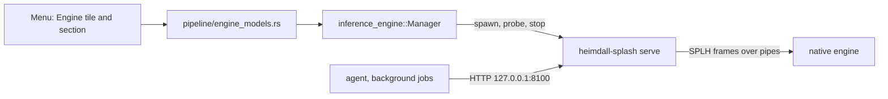

# Built-in inference engine

Heimdall can run a local language model on the Mac: Splash's native engine, driven by `heimdall-splash`, a Rust
server with no Python. The app owns the engine's lifecycle separately from Listening, Seeing, Speaking and the agent,
and both editions ship it, off by default.

Read this when: you want to change how the engine starts, stops, recovers or adopts a running one, change the model
catalog or its ceilings, debug a download or delete, change the menu's Engine tile or section, or change
`heimdall-splash` itself (protocol, HTTP API, bundling).
Code: `crates/app/src/inference_engine.rs`, `crates/app/src/inference_engine/models.rs`,
`crates/app/src/pipeline/engine_models.rs`, `crates/app/src/pipeline/settings_apply.rs`,
`crates/app/config/inference-engine.json`, `crates/splash/`, `scripts/bundle_splash.sh`.

## The catalog and its ceilings

- `crates/app/config/inference-engine.json` is the default, compiled into the app (`DEFAULTS`) and copied to
  `Contents/Resources/inference-engine.json`. Keys: `executable` (`heimdall-splash`), `port` (8100), `max_memory`
  (`48G`), `max_cache_disk` (`100G`), `default_model`, `models`.
- Each model has `id`, `label`, `context` (262,144 for all), `quant` and `source` (the default precision) and `quants`
  (`quant`, `source`, `size_bytes`, `ram_bytes`). The default file lists six models and 24 precisions.
- `ram_bytes` is derived, not measured: weights + vision projector + DFlash2 draft + int8 KV per token x 262,144 +
  1 GB. Precisions above the 48G ceiling stay listed; the menu refuses to load them and says why.
- An override at `<data>/splash/engine.json` replaces the default. Nothing creates one. `Config::load` rejects it
  unless `max_memory` is exactly `48G` and `max_cache_disk` exactly `100G`, every model id and precision is unique, the
  default model exists and the executable is a bare name or an absolute path. An unusable override is set aside: the
  bundled default runs and the reason goes to the log and the health journal (`configuration-default`).
- An override in the older shape (one `quant`/`source` per model) reads as a one-precision model.
- An absolute `executable` (for example Homebrew's `splash`) is used as given; a bare name resolves beside Heimdall's
  own binary (`Contents/MacOS/heimdall-splash`).

## Settings it reads

`engine_on`, `engine_model`, `engine_quant` (precision per model), `engine_thinking`, `engine_context` and
`engine_added`; [settings.md](settings.md) owns their meaning and defaults. Rules the engine code adds:

- `engine_model` empty means none picked: an engine turned on shows Waiting and loads nothing.
- A precision not chosen, or no longer offered, serves the model's default (`Model::chosen`).
- The engine and the agent's model are independent: loading an engine model never changes the agent's model, and an
  agent pick never starts or stops the engine.
- First launch: a profile without `engine_on` whose agent model is local adopts a running engine verified by its cache
  directory and PID file (`Settings::adopt_engine`, `inference_engine::existing_model`) and saves On, keeping a
  non-default precision. Otherwise it starts Off.

## Lifecycle

Only the live app starts the manager (`Pipeline::start_inference_engine`); replay, idle diagnostics and pipeline tests
never do. All process and HTTP work runs on the manager's helper thread.

- Startup with a saved Off never sends a stop, even when an external engine is running.
- The engine starts only when the chosen precision is on disk. Why: `serve` would download a missing one itself.
- Launch: refused when the port is taken by a listener that is not the verified cache owner, when more than one
  process owns the cache, or when an orphaned native engine holds it. An existing `serve` using the exact cache
  directory is adopted, even without a PID file. A running engine with a different model must be turned off first.
- The command line is `serve --model <source> --port <port> --served-model-name <id> --persistent-cache
  --max-cache-disk 100G --cache-dir <data>/splash/prefix-cache --max-memory 48G` (`Config::args`), in its own session.
- Polling (`Timing`): every 2 s while starting, every 30 s when ready or idle. Startup allows 30 minutes
  (`startup_limit`) for a first download.
- Recovery: two failed ready probes in a row, or the process exiting, stop and restart an engine Heimdall started.
  One automatic restart per explicit enable or retry; after that the state is Error and a red health pill says the
  menu's Engine line has the reason. Recovery shows orange "Restarting inference engine…", then "Inference engine OK".
  No timer resets the bound.
- An adopted engine is never stopped or restarted on failure; health only reports. Only an explicit Off stops it.
- Stop: TERM to the launcher and its native descendants, up to 30 s for the cache to flush, then KILL of the remaining
  verified process identities. PID and start-time checks guard against PID reuse; only the matching PID file is
  removed. Nothing removes the prefix cache or model weights.
- Quit stops engines Heimdall started before draining capture, archive and agent work; adopted engines keep running.
- `<data>/splash/lifecycle.lock` (advisory `flock`, non-blocking) serializes lifecycle operations; a busy lock reports
  "engine lifecycle is busy" instead of waiting.
- Files: `<data>/splash/splash.pid`, `<data>/splash/prefix-cache`. The log is `Library/Logs/Heimdall/splash.log` in
  the user's home for the main profile, `<data>/logs/splash.log` for any other data folder; manager failures are
  appended there too.

## Models on this Mac

- A precision is downloaded when its selection link `<data>/splash/models/OWNER/REPO:VARIANT` resolves to an assembly
  whose files are all present at their recorded size. Checked on launch, when the menu opens and after a download or
  delete.
- Download: `heimdall-splash pull <source> --models-dir <data>/splash/models` with `HF_HUB_CACHE` set, at nice 19 in
  its own process group, one at a time. Its `Downloading · repo · file · N% of X GB` lines become
  `EngineModel::download`, at most four updates a second (`PROGRESS_EVERY`, 250 ms). Cancel stops the group and removes
  the `.incomplete` partials it left.
- Models are prepared from files in the Hugging Face cache, which Homebrew Splash's downloads also fill, so a model
  Homebrew Splash already has downloads nothing.
- Each successful pull records the hub-cache files it fetched in `<data>/splash/downloads/<sha256 of the link>.json`
  (mode 0600).
- Selecting a model whose precision is missing downloads it, then selects it unless another model was picked
  meanwhile. A precision over the 48G ceiling is refused with the reason on its row; its download button still
  downloads it without switching. A precision switch of the running model restarts the engine once the new weights
  are here.
- Delete (`models::delete`) removes the selection link and its `refs/splash` pins; the assembly and derived metadata
  unless another link names them; and only the hub-cache files in this precision's manifest that nothing else uses
  (another assembly here or in Homebrew Splash's models root, another snapshot entry, another manifest, or a pin from
  an installation outside these roots). A kept file another Heimdall installation uses moves to that installation's
  manifest. A precision with no manifest never loses cache files. Every path is checked to be inside the roots.
- Delete is refused, with the reason on the row, while the engine serves that precision, a server holds the assembly,
  it downloads, or an installation runs here or in Homebrew Splash's root. Opening the menu clears old reasons.

## Menu and UI types

- Actions (`crates/ui/src/model.rs`): `SetEngine(bool)`; `LoadEngineModel { id, quant }` (engine on with that
  downloaded precision, agent untouched); `SelectLocalAgent` (the agent on whatever the engine holds, engine
  untouched); `DownloadEngineModel { id, quant, then_select }`; `CancelEngineDownload { id }`; `DeleteEngineModel
  { id, quant }` (confirmed in the menu first); `SetEngineThinking`; `SetEngineContext`; `AddBuiltInEngine` and
  `RemoveBuiltInEngine` (the provider row). `SelectEngineModel(String)` (agent local on that model, downloading it
  first) comes only from the user's own words: the island's "Switch to the local model?" Yes and the `settings` tool.
  `SetEngineQuant` is kept for older callers; the menu does not send it.
- State: `EngineState::{Off, Starting, Waiting, Loading { percent }, Ready, Idle, Error(String)}`.
  - Waiting: on with no model it may load; nothing runs or downloads.
  - Starting: process launched, no status line yet.
  - Loading: from Splash's log since this start (`Loading · …`, `Chat template · …`, `Downloading · … N% of X GB`,
    which sets `percent`). Loading weights into memory reports nothing, so that phase is a spinner
    (`inference_engine::loading_state`).
  - Idle: Splash reports released weights; a request restores them.
  - Error: the failure's own words, one line, at most 120 characters (`failure_reason`), shown under the Engine header.
- Update: `UiUpdate::Engine { state, model_id, model_label, models, port, context_limit, cache_used_bytes,
  cache_limit_bytes, memory_limit_bytes }`. `None` metrics mean unavailable; Off, Starting and Error clear them.
  Context comes from `/v1/models`; cache numbers from `/status`'s top-level `disk` (`used_bytes`, `capacity_bytes`).
- The Engine tile (independent of Listening) and the Engine section (`crates/ui/src/mac/engine_section.rs`) are
  described in [crates/ui/README.md](../crates/ui/README.md). `SetEngine` goes through the menu-settings path, so it
  persists `engine_on`. Every state but Off counts as on, so one click always toggles: a failed engine turns off, the
  next click starts it. Explicit clicks reach the manager even when the saved value is unchanged.

## heimdall-splash

`heimdall-splash` (package `splash`, `crates/splash/src/main.rs`) ports Splash 1.4.1's Python server and installer to
Rust and drives Splash's native engine (`splash`, `splash.metallib`, `host-step.metallib`, Apache-2.0).

Commands (`crates/splash/src/server/cli.rs`):

- `serve --model OWNER/REPO[:VARIANT] …`: prepares the model (downloading what the cache lacks), starts the engine,
  waits up to 600 s for it to load (`NATIVE_START_TIMEOUT`) and serves HTTP. Status lines go to stderr.
- `pull OWNER/REPO[:VARIANT]`: prepares a model without serving it.
- `inspect`: prints as JSON which files a model needs, which the cache holds, and what a download would cost.

Crash handling: a crashed engine is stopped and relaunched, the first relaunch at once, later ones after
`RESTART_BACKOFF` (5 s) doubling. Three consecutive failures each within 60 s of starting (`CRASH_LOOP_LIMIT`,
`CRASH_LOOP_WINDOW`) end it; the server exits and the app's manager takes over. SIGTERM or SIGINT stops the engine
first, leaving it `STOP_GRACE` (25 s) to flush.

The engine seam: `serve-native` runs as a child with stdin and stdout as pipes. Both sides speak protocol version 11
(`protocol::PROTOCOL_VERSION`): 16-byte frame headers (`SPLH`, u16 version, u16 type, u64 payload length) and
little-endian payloads. The server sends REQUEST, CANCEL, MASK_RESPONSE, STATUS_REQUEST and RELEASE_REQUEST; the engine
sends READY, START, PROMPT_PROGRESS, TOKENS, MASK_REQUEST, DONE, ERROR and STATUS_JSON. Prompts travel as token ids:
chat templates, tokenization, grammars and output parsing are the server's. The engine has no HTTP of its own.

### The HTTP API

Code against this contract, not the process. OpenAI-compatible HTTP on `127.0.0.1:8100` (`agent::runtime::BASE_URL`),
routes in `crates/splash/src/server/http.rs`:

- `POST /v1/chat/completions`: streamed or whole; tools and `tool_choice`, `reasoning_effort`,
  `chat_template_kwargs`, `response_format` `json_schema`, `stop`, `max_tokens`, sampling, images as data URLs.
- `GET /v1/models`, `GET /v1/models/{name}`.
- `GET /health`; `GET /ready` (200 when the engine's last status said ready; a busy engine keeps its last ready answer
  for up to 120 s).
- `GET /status`: the engine's status JSON plus the server's (`weights.released`, `disk.used_bytes`,
  `disk.capacity_bytes`).
- `POST /v1/memory/release`.

The server binds to 127.0.0.1, answers only loopback Host names, and refuses pages of other origins and non-JSON
bodies.

Not ported (requests for them fail): the chat web page; `/v1/responses`, `/v1/messages`, `/v1/completions`;
`/tokenize`, `/apply-template`, `/metrics`; `/v1/judgments`, `/v1/systemone`; PDF and document input; encrypted
client-carried reasoning; API keys, `--allowed-host`, `--allowed-origin`, `--thinking-end-text`; parallel downloads;
arithmetic-coded and lossless JPEGs (400).

Known differences from the Python server: numbers in schemas only Python keeps exact (`-0`, integers beyond 64 bits);
float formatting in a template's `~`; jsonschema and minijinja error wording (status codes match); damaged images that
Pillow partly decodes; mask parity checked for Qwen only.

### Layout (`crates/splash/src`)

| module | what it holds (Python original) |
|---|---|
| `protocol.rs`, `engine.rs`, `engine/fake.rs` | frames, the child process, masks, status, liveness; a scripted fake engine for tests (protocol.py, runtime.py) |
| `chat/` | chat formats, templates via minijinja, tokenization, output parsing, the streamer |
| `constrain/` | tool schemas, constraints and schema validation on llguidance |
| `images/` | image decoding and resampling, matching Pillow |
| `hub/` | Hub download and verification, GGUF metadata, assemblies |
| `server/` | the HTTP front end, chat completion shapes, options, `cli.rs` |

## Bundling

1. `scripts/bundle.sh` builds `heimdall-splash` alone (`cargo build --release -p splash --bin heimdall-splash`). Why:
   Splash's serde_json `preserve_order` must not reach Heimdall's JSON.
2. `scripts/bundle_splash.sh` copies the engine pinned by `scripts/splash-engine.lock.json` (version and the SHA-256
   of every file) from a verified cache, `Library/Caches/Heimdall/splash-engine/<version>` in the user's home. It fills
   the cache from a local Homebrew Splash of that version when its files match, else from the pinned release tarball.
3. It installs `Contents/MacOS/heimdall-splash`, `Contents/Resources/splash/engine/` and the notices
   (`Resources/licenses/splash-LICENSE.txt`, `splash-THIRD_PARTY_NOTICES.txt`, `splash-NOTICE.txt`), and re-signs both
   binaries with the app's identity.

## Tests

- `cargo test -p app inference_engine`: fake-engine tests for adoption without a duplicate launch, state, metrics and
  idle release, one crash restart and OK, exhaustion to red, persistent unready, explicit retry, TERM escalation with a
  native child, stale or foreign PID, locked lifecycle, foreign port, first-profile adoption, saved Off startup,
  adopted health and Quit survival, owned shutdown, the tile to manager retry path and the exact default arguments.
  `crates/app/src/inference_engine/models_tests.rs` covers install detection, download, cancel and delete. None
  touches an installed app, a real profile, a real Splash or a cache.
- `cargo test -p splash`: no model. Protocol bytes against Python, every engine-client path over the fake engine, chat
  templates, tokens and output parsing against Python goldens, grammars and masks against Python's, images against
  Pillow, GGUF metadata against Splash's, and the HTTP server end to end (`crates/splash/tests/server_http.rs`).
  The goldens' generators are in `crates/splash/lab/`.
- Opt-in real check: `cargo test -p splash --release --test real_engine -- --ignored`, with `SPLASH_REFERENCE` naming
  the JSON `crates/splash/lab/real-check/reference.py` wrote. It loads a model of about 22 GB and compares prompt
  tokens, greedy output, every teacher-forced position and decoded text with Python's on the same engine. See
  `crates/splash/lab/real-check/README.md`.

## See also

- [models.md](models.md): the agent's models and how the local engine is chosen as one
- [settings.md](settings.md): the `engine_*` settings
- [editions.md](editions.md): what each edition bundles
- [resilience.md](resilience.md): health pills and logs
- [crates/ui/README.md](../crates/ui/README.md): the Engine tile and section
