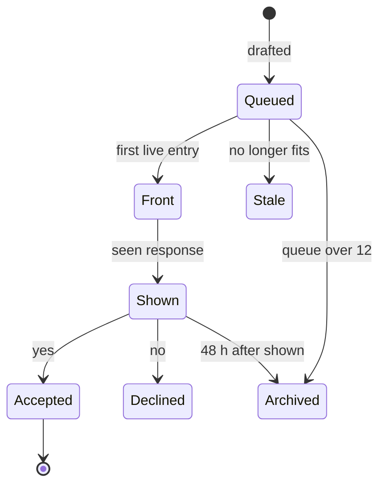

# One system: Goals, Scheduled, Settled and job islands

Goals, Scheduled and Settled are three plan lists under one set of rules, kept beside the job islands that show
running work. This page owns the rules, the list files, proposals, responses, the record and how job islands stay current.

Read this when: you want to change what a plan list holds or draws, add a writer to a list, change how proposals queue,
expire or are refused, read the record, or change when a job island is updated.
Code: `crates/app/src/islands/` (`proposals.rs`, `guarantee.rs`, `slate.rs`, `plan.rs`, `responses.rs`, `binding.rs`,
`stages.rs`), `crates/app/src/island_agent.rs`, `crates/app/src/plan_refresher.rs`, `crates/app/src/goals/proof.rs`;
drawing in `crates/islands/src/model/onesys.rs` and `crates/islands/src/mac/` (`goals.rs`, `scheduled.rs`, `settled.rs`).

## Rules the code holds

- Nothing enters Goals or Scheduled without the user's yes: by voice (`plan_edit accept`, or `plan_edit add` quoting
  the user's own words) or one click (Yes on a proposal). Anything Heimdall, the Goals job or the plan refresher wants
  there is a proposal.
- Nothing settles without proof: a commit, a test run, an output file, an install, or the user's own quote
  (`goals/proof.rs`). A finished piece with none is claimed: drawn dashed, never counted.
- Running comes from open T3 turns: thread-bound job islands (`islands::binding`), their stage from tool calls
  (`islands::stages`). A goal's task lights blue only while a running job island names that goal (`goal`).
- Unsure is said: a running job island silent for 15 min dims and reads "not heard from in N min" (`guarantee::SILENT_S`,
  `onesys::SILENT`); the guarantee line reads "Not sure" when `checked` is over 30 min old (`onesys::SWEEP_STALE`).
- Only real blocks wait on the user: an open ask in Goals, a job island waiting or failed, a promise 30 min past its
  `due` and unticked (`guarantee::MISSED_S`). Proposals never wait on the user.
- One proposal per list shows (the front); the rest count as "+N". Unanswered, it is archived 48 h after the user first
  saw it (`proposals::EXPIRE_S`): into the record, no badge, no count, never back.
- Nothing animates at rest.

## List files

Each list is `islands/<list>.json` (`goals`, `scheduled`, `settled`) with the plan-island keys (`id`,
`preset: "todo"`, `list`, `title`, `icon`, `side`, `order`, `hidden`, `expanded`; unknown keys survive), plus `slate`
(epoch seconds of the clean slate), `proposals` (Goals and Scheduled) and `removed` (`[{title, quote, at}]`, written by
`plan_edit` remove). Accepted entries carry `yes: {by: "voice" | "click", at, quote?}`.

- `goals.json`: `goals: [{id, title, icon, about, state: active|done|paused, now, moved, tasks: [{id, title,
  state: done|now|next, at, ticked?, yes?}], ongoing?, finished?}]` and `items`, the asks (something only the user can
  do now; drawn on Scheduled's guarantee line, not in Goals). An `ongoing` goal has no end: it is never finished or asked
  "done?". Field meaning and caps: [goals.md](goals.md).
- `scheduled.json`: `items`, promises, each with `due` (epoch seconds; an item without `due` is not drawn), optional
  `goal`, `icon`. `guarantee: {checked, waiting: [{id, title, line, goal, choices: [{label, action}], source}],
  unsure: [{id, title, line?, since?}]}`, written by the sweep. An unsure entry with `since` reads "<title> not heard
  from in N min" from the app's clock; a waiting entry's `line` leaves out the goal (the app draws it).
- `settled.json`: `items: [{id, title, done: true, at, kind: shipped|decided, goal, task, by, quote, proof?}]`,
  `proof: {kind: commit|test|file|install|quote, value, label}`. No `proof`: claimed. `by` is `goals` (the Goals job)
  or `job` (a closed job's report, `goals::settled::JOB_BY`). The newest 300 stay (`goals::settled::KEEP`).

Writers: every writer starts from `goals::ops::current` under the folder lock (the file, else its closed copy
`.closed-<list>.json`, else its kept copy `.kept-<list>.json`) and writes through `goals::ops::write_list`, which
refreshes the kept copy. Closing a list or `islands_remove` on one hides it (`hidden: true`), never deletes it;
`refresh_plan`, each plan refresher pass and `plan_edit show` bring it back (`islands::plan::reopen_closed`).

What each list draws (`crates/islands/src/mac/`): Goals, per active goal, a progress ring, a segmented bar (done green,
running blue, queued dim, a dashed segment for its front step proposal), the `now` line, "N running on the right", at
most 3 queued tasks (`QUEUED`) and the front step proposal as a ghost row with Yes; a front goal proposal is a ghost goal
after the goals. Scheduled: the guarantee line, a 7-day strip (`onesys::WEEK_H`), the rows by time, the front proposal
as a ghost row. Settled: the proved count since the slate while it is under 7 days old, else this week's, "N claimed",
7 day columns, today's newest 3 rows (`OPEN_CAP`) with proof chips, "› N earlier today".

## Proposals

A proposal is `{id, title, why, by, proposed, front?, shown?}` in its list's `proposals` queue, oldest first
(`islands::proposals`). Goals: `kind: "goal"` (with `icon`, `about`, `ongoing?`), `kind: "step"` (under `goal`) or
`kind: "complete"` (a "done?" card for `goal`). Scheduled: `due` (required, in the future), optional `goal`, `icon`.
`title` at most 64 characters (`TITLE_CHARS`), `why` (the words behind it, shown when its title is clicked) at most 300
(`WHY_CHARS`). `by`: `heimdall`, `goals`, `refresher` or `slate`.

- `proposed`: when drafted. `front`: when it became the one on screen; Heimdall hears it then in one notice
  (`proposals::notice`). `shown`: when the islands app first drew it with its list open and on screen. Only `shown`
  starts the 48 h, so a list left closed never loses a proposal the user did not see.
- The front is the first entry not past 48 h; "+N" counts the live entries after it.
- A yes keeps the proposal's `id`: a goal joins as active (refused at 6 active goals, `goals::ops::MAX_ACTIVE`), a step
  joins its goal's tasks as `next`, a "done?" card finishes its goal, a promise joins Scheduled at its `due` (or the time
  the user named).
- At most 12 queue per list (`QUEUE`); beyond that the oldest unseen go to the record as archived.
- The sweep also takes out stale proposals: ones that would be refused if drafted now (goal finished or gone, the step
  already there or removed, a past time).
- Refused when drafted: the same title already in the list, the queue or the record (equal once normalised, or both of
  at least 3 content words sharing 75 %: `goals::settled::same`); a title the user removed from that list (Goals and
  Settled: no expiry; Scheduled: 14 days, `goals::settled::REMOVED_DAYS`); a Settled proposal (Settled fills only from
  proof).

## Responses

The islands app writes these; `islands::responses` acts on them.

- `{island: "goals" | "scheduled", kind: "seen", value: <proposal id>}`: the app drew this proposal (open, on screen,
  islands not hidden), once per proposal per app run. Heimdall stamps `shown`; nobody is told.
- `{island: "goals" | "scheduled", kind: "approval", action, value: <proposal id>}`: `yes` accepts, `no` declines into
  the record; any other action changes nothing.
- `{island: "scheduled", kind: "waiting", action, value: <waiting id>}`: a choice on the guarantee line, applied to its
  source (an ask's proposal action, or Done or Drop on a missed promise; Done on a promise with a `goal` settles it with
  the click as proof), and the agent is told.
- `{island: "scheduled", kind: "due", action, value: <item id>}`: a promise fell due. It stays in Scheduled, drawn
  due; the agent hears it once per `due`.
- `{island: <viewer id>, kind: "report", ...}`: a report page in the viewer; see [viewer.md](viewer.md).

## The sweep

`islands::guarantee::run`, every 60 s (`PERIOD`) on its own thread: archives proposals past 48 h and stale ones, stamps
the next front (Heimdall hears it), then writes `guarantee` into Scheduled when it changed or every 5 min (`REFRESH_S`).
When the island agent has no usable account, its line is the first unsure entry ("Island updates").

## The clean slate and the record

Once, when `goals.json` has no `slate` (`islands::slate::ensure`, before anything else writes the lists): the three
lists, their kept and closed copies, `todo.json` and `.todo-migrated.json` are copied into
`<islands root>/record/clean-slate-<YYYYMMDD-HHMMSS>/`; Scheduled, Settled and Goals are written empty with `slate`,
each keeping its `removed`. Old active goals come back as proposals (`by: "slate"`); old Scheduled and Settled items
stay in the record only. A first run with no lists at all: the personal edition proposes its own seed goals; the
public edition proposes none.

`<islands root>/record/proposals.jsonl`: one line per proposal that left without a yes, `{list, proposal, outcome:
"archived" | "declined" | "stale", at}`. Titles there are never proposed again on that list.

## How job islands stay current

- Thread-bound job islands are code-driven. After every T3 pass (every 30 s, the tick in
  `crates/t3/src/workers.rs` `watch_inner`, and at once when a followed run's wait returns), the binding
  (`crates/app/src/islands/binding.rs`) reads each bound thread's new activity items, its sub-agents and any training
  run its commands point at into one reducer per run (`crates/app/src/islands/stages.rs`). It writes, with no model,
  what code owns: `stage`, `started`, `summary`, `progress`, the step history, counters, the latest picture and the
  `band` part. A weak stage (Reading, Editing) must hold 45 s before it replaces another (`stages::WEAK_HOLD_S`). A new
  run starts over.
- The island agent (`crates/app/src/island_agent.rs`) gets every bound island's signals after each sync and makes one
  stateless call per island for what code cannot choose: the now line, the graphic, the icon, the title, the helpers'
  names and the open target. A call is due on a stage change, a run end, a new picture, a finished helper, a new eval,
  a status file change, 5 new loss points (`LOSS_POINTS`, at most one such call per 10 min, `LOSS_EVERY`), or a 30 min
  heartbeat when anything changed (`HEARTBEAT`). Per island: at least 120 s between calls (`MIN_GAP`) and 90 s after the
  first reason (`COALESCE`); one call in flight across islands. Without a credential, or with Background Tasks ▸ Island
  Agent off, a due island is looked at again after 10 min (`DEFER`).
- The plan refresher (`crates/app/src/plan_refresher.rs`) proposes Scheduled items that have a real future time and
  rebuilds the job islands that follow no thread. Passes are at least 5 min apart (`PERIOD`, so at most 12 an hour).
  The user's own words or a `refresh_plan` request run a pass 5 min after the last one; other changes wait 15 min
  (`SLOW_LANES`), 30 min once the user has been quiet for an hour (`QUIET_LANES`, `QUIET_AFTER`). It reads no thread:
  each bound island is one read-only line in its prompt. It never reads or writes Goals or Settled. Items it leaves
  out stay as the user has them.

Fields a job island carries (`sent`, `goal`, parts) and when it leaves: [islands-capabilities.md](islands-capabilities.md).

## Check it

- `cargo test -p app islands::` (proposals, the sweep, the guarantee, the slate, responses, binding, stages).
- `cargo test -p app island_agent` and `cargo test -p app plan_refresher`.
- `cargo test -p islands onesys` (what the lists draw from their files).

## See also

- [goals.md](goals.md): the Goals job that moves goals, proposes and writes Settled.
- [islands-capabilities.md](islands-capabilities.md): what an island shows, job island fields, leaving rules.
- [mcp.md](mcp.md): the `plan_edit` tool.
- [viewer.md](viewer.md): the viewer and the report bridge.
- [background-call.md](background-call.md): the call path the jobs share.
- [settings.md](settings.md): Background Tasks settings.
- [../islands/README.md](../islands/README.md): the islands helper and its file format.
- [../islands/docs/island-style.md](../islands/docs/island-style.md): how item text is written.
