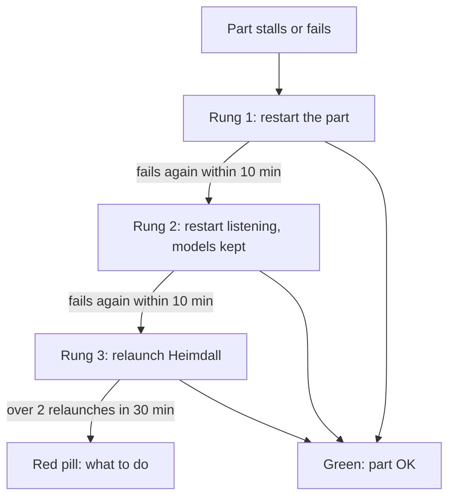

# Troubleshooting and recovery

What can fail in Heimdall, how it notices, how it recovers by itself, what the island shows, and what to do when it
asks for you. Organised by symptom, with where the logs are and how to reconstruct an outage.

Read this when: Heimdall misbehaves and you want the cause and the fix, you want to read the logs, you want to know
what a red or orange pill means, you are changing a watchdog, a recovery ladder or a health cue.
Code: `crates/app/src/watchdog.rs` (freeze watchdog, relaunch, forced quit), `crates/app/src/pipeline/resilience.rs`
(stall checks and lower rungs in the live loop), `crates/app/src/health.rs` (de-duplicated health, ladder, microphone
switch), `crates/app/src/hang.rs` (stack samples), `crates/app/src/resource_watch.rs` (swap and GPU),
`crates/app/src/preflight.rs` (agent pre-flight), `crates/app/src/bridge/health.rs` and
`crates/app/src/bridge/supervisor.rs` (agent health), `crates/app/src/diagnostics_lines.rs` and
`crates/app/src/diagnostics_log.rs` (log lines and the log file).

## Where the logs are

`<data>` is Heimdall's data folder, `<home>/.heimdall` ([home.md](home.md)).

| File | What is in it | Bound |
|---|---|---|
| `<data>/logs/heimdall.log` | One timestamped plain line per failure, fallback, retry, timeout, state change and event; also stdout, stderr and panics | rotates at 2 MiB into `.1` … `.10` (`LIMIT`, `COPIES`): at most about 22 MB |
| `<data>/logs/tools.log` | Every agent tool call and its outcome, one line each | `MAX_BYTES` (1 MiB), then `tools.log.1`: at most twice that |
| `<data>/logs/hangs/hang-<time>-<menu\|live\|quit>.txt` | Every thread's stack when the UI thread or live loop stalls past 2 s, or a Quit is forced | newest 20 kept; one per thread per 10 min |
| `<data>/archive` | The structured journal: `health`, `recovery`, `gap`, `invariant_violation` and every other evidence record | read with `heimdall-archive timeline` (below) |
| `<data>/recovery.json` | Automatic relaunch history, counted across launches | atomically replaced |
| `<data>/stop-intent.json` | The latest switch intent (Listening, Agent …) that a relaunch must keep | atomically replaced |
| `<data>/emergency/state.json` | Emergency and relay state ([emergency.md](emergency.md)) | — |

Read the end of a log: `tail -n 200 "<data>/logs/heimdall.log"`. Every line starts with its local time
(`2026-10-19 18:48:32.390 voice: …`), so search by the time the problem happened.

## Find what went wrong

1. Note the time the problem happened.
2. The timeline reader is not in the app bundle; build it once from the source:
   `CARGO_TARGET_DIR=target/archive cargo build --release -p heimdall-archive --bins`. It lands in
   `target/archive/release/heimdall-archive`. Check: `heimdall-archive timeline --since 00:00 --problems` prints JSON
   lines or nothing, and no error.
3. Run `heimdall-archive timeline --since 10:28 --until 10:34 --problems` for errors, failed, stalled, restarting and
   unavailable transitions, memory refusals, diagnostic drops and invariant violations.
4. Run the same without `--problems` to see the recovery and clear transitions around them: an outage needs both.
5. Narrow by kind: `heimdall-archive timeline --since 2026-10-16T10:28 --until 2026-10-16T10:34 --kinds
   agent_wake,agent_send,agent_reply,agent_state,agent_transport_reply,invariant_violation`.
6. Match the line to a symptom below.

Timeline rules (`crates/archive/src/event_timeline.rs`):

- Output is JSON Lines in local time order, with decoded payloads, evidence ids, session, source and utterance ids,
  and host and wall timestamps.
- `HH:MM[:SS]` is today in local time; `YYYY-MM-DDTHH:MM[:SS]` selects a date. `--since` is included, `--until`
  excluded; no `--until` runs to now. `--archive ROOT` reads another archive (default `<data>/archive`).
- `model_output` rows are left out unless named in `--kinds`; `--problems` examines them too.
- Final `utterance` lines come from the transcript projection: their negative ids are projection row ids, not evidence
  ids.
- `video_gaps` and `chunk_embedding_errors` are projections, not evidence events.
- A record that fails to decode prints its evidence and payload ids and the error; nothing is dropped silently.
- The reader is read-only: every database handle opens `SQLITE_OPEN_READ_ONLY`, it creates no lock, WAL or SHM file,
  it takes a shared lock on the existing `.compact.lock`, and a busy compactor gives an explicit retry error. A
  WAL-format database without its WAL and SHM sidecars, or a historical pack without a lock file, is refused; copy a
  consistent snapshot to an isolated folder and pass it with `--archive`.

## How Heimdall recovers by itself

- **Frozen, not quiet.** A freeze is work waiting with no progress: a microphone that is open but delivers no audio
  (silence still delivers samples), a listen worker holding queued audio while finishing nothing, a live loop that stops
  handling its 2-second tick, a UI thread that stops running a block posted every 10 s. Silence, Listening off, an idle
  agent and a sleeping Mac never count: watchdog clocks pause in sleep and re-baseline at wake.
- **A ladder, never a loop.** Each part's rungs count within 10 minutes (`health::Ladder`). Automatic relaunches: at most
  `RELAUNCHES` (2) per `RELAUNCH_WINDOW_SECONDS` (30 min), counted across launches in `<data>/recovery.json`. An
  unreadable history or a failed write of the count forbids automatic relaunch and shows the red pill.
- **A relaunch keeps state.** The latest switch intent is written to `<data>/stop-intent.json` before exit; a failed or
  stalled write blocks the relaunch with the red pill. At launch a persisted On never overrides settings Off. A relaunch
  from a working loop goes through a normal Quit (drains audio and deliveries); one from a frozen loop exits after
  1.5 s and loses only the uncommitted tail of the current archive commit. The relaunch runs through LaunchServices
  (`open Heimdall.app`), so macOS attributes permissions as for a normal open: no permission prompt.
- **Quit always ends.** Once teardown makes no progress for `QUIT_LIMIT` (8 s), and at most `QUIT_CAP` (30 s) after the
  click, the process exits with `_exit`. Why: exit handlers would run ggml's Metal destructors, which abort while a
  model is loaded. Quit first preempts archive compaction (`compact::preempt_all`). Each teardown step is named
  (`Beats::quit_step`, `watchdog::progress_step`), so a forced quit logs where it waited
  (`Watchdog: quit did not finish (in the agent's stop, no progress for 8.2 s)`) and saves every thread's stack to
  `logs/hangs/hang-<time>-quit.txt`.
- **Switches never wait for the archive.** Listening off waits at most 2 s for the last archive commit (Quit settles the
  rest); Seeing on waits at most 2 s for its stream and a later tick adopts a slower one; Seeing off stops the stream on
  its own thread. Screen starts and stops run in one ordered lane, and a start cancelled before its turn never starts.

## What the island shows

| State | Look | Meaning |
|---|---|---|
| Restarting | Orange reload glyph and "Restarting …", static orange outline until it ends | a rung is running |
| Back | Green check, "… OK", 1.7 s, then gone | the part recovered |
| Needs you | Red pill, two lines (what is wrong, what to do), static red outline; menu-bar helmet red | a click runs the action and collapses it to a red glyph. Commands and raw errors go to the log, never the pill |
| Part down, returns by itself | Orange, shown once for 2.6 s, then a small glyph at the notch until it returns | nothing to do |
| Notice | Accent colour, 3.2 s | a microphone switch, a harness update |

- Health shows whether or not Heimdall listens. Listening off clears the listening parts' conditions; the agent's,
  speech's and the screen's stay.
- A heard command or its result takes the island for its moment, then the health pill returns. A health message that
  arrives while something else holds the island waits its turn and then shows for its full time. A message stays at
  least 1.2 s before one about something else replaces it; one about the same condition (a restart's OK) replaces it at
  once.
- At rest a restart outranks a problem, a problem outranks a pending command, and the small glyph comes last.

## Microphone and audio

| Symptom | Cause | What Heimdall does | What you do |
|---|---|---|---|
| Notice "AirPods Pro → MacBook Pro Microphone" | The chosen mic was unplugged, Bluetooth dropped, or it was removed while recording (HAL device-list event, no polling) | Opens the built-in mic in the same pass; switches back when the chosen one has been present `MIC_BACK_SECONDS` (5 s) | Nothing |
| Same notice, once, while the chosen mic is plugged in | The chosen mic delivers no callbacks for 3 s, or fails to start | Retries at 2, 4, 8, 16 s; the built-in mic records between retries; after 4 failures stays on built-in until a HAL event, a route change, a wake or a new choice in the menu | Re-plug the mic or pick it again in the menu |
| "Shure MV7 disconnected", then an orange mic glyph | An extra mic switched on in the menu disconnected | Reopens it when it returns ("… back"); the primary is unaffected | Nothing |
| Red "No microphone · Click to pick one in the menu" | No mic at all (built-in gone with the lid closed, chosen one absent) | Waits for a HAL event; "Microphone OK" when one appears | Click and pick a microphone |
| Orange "Restarting the microphone…" | An open mic delivered nothing for `CAPTURE_STALL` (15 s); app taps are exempt (silent when their app is) | Restart capture, then listening, then relaunch; "Microphone OK" when audio flows | Nothing; if it repeats, check the mic and see the log's `capture_stalled` |
| Red "Microphone permission is off · Click to open Settings" | Permission revoked (read passively when you switch apps; never a prompt) | Waits; "… permission back" when granted | Click, then grant Microphone in System Settings |
| Red "System Audio permission is off" | App taps deliver exact silence for 10 s while a recorded app plays | Waits | Click, then grant System Audio Recording |
| Nothing | The system default input changed | Ignored: Heimdall uses the chosen mic, else built-in | Nothing |
| Nothing | Default output, sample rate or format changed | Sources restart with the new format in the same pass (tens of ms) | Nothing |

Logged as `source_removed`, `gap`, `microphone_cue`, `capture_stalled`, `recovery` and `health`. Capture details:
[capture.md](capture.md).

## Transcription stops

| Symptom | Cause | What Heimdall does | What you do |
|---|---|---|---|
| Orange "Restarting transcription…", then "Transcription OK" | The listen worker ended (crash, panic, model error) | Restarts it, at most 3 per 10 minutes, then relaunches | Nothing |
| Same | The worker hangs: queued audio and nothing finished for `WORKER_STALL` (30 s), or models not loaded in `WORKER_LOAD_STALL` (2 min) (`ListenWorker::progress`) | The hung worker is left behind (a model call cannot be interrupted), its output discarded, a new one started; same bound | Nothing |
| Red "Transcription keeps stopping" | Past the relaunch bound | Stops trying | Quit and reopen Heimdall; read `listen_worker_ended` or `listen_worker_hung` in the timeline |

A hung worker keeps its thread and models (about 2 GB) until the process ends; that is why hang restarts share the
bound that leads to a relaunch.

## Commands do not run

| Symptom | Cause | What Heimdall does | What you do |
|---|---|---|---|
| Orange "Commands paused · reloading" | The decider failed to load | Retries after 10 s, doubling to 5 min; the agent starts regardless | Nothing |
| Red "Commands and replies are off · Click to restart Heimdall" | 3 failed decider loads, or a replacement owner cannot start | Waits for the click | Click to relaunch |
| Orange "Commands paused · reloading", then "Commands OK" | The decider owner thread panicked, exited or missed its deadline: 1 s plus one ms per token up to `decide::send::WINDOW` (at most 3 s); 30 s while loading, 10 s for the first 3 requests after a load; checked every 100 ms | Replaces only the owner and retries the same request. From the third failure in 10 min the replacement pauses 30 s, doubling to 5 min (`owner_pause`); meanwhile requests fail at once and the agent is still woken by name. Never a relaunch. At most `MAX_OWNERS` (3) owner threads hold a model | Nothing |
| "Commands paused · decider not answering" | A replacement owner is paused | As above | Nothing |
| Nothing visible | 3 decider inference errors in a row | The decider is dropped and reloads at the next decision (`decider_reloaded`) | Nothing |

Decider behaviour: [decision-chain.md](decision-chain.md).

## Screen capture and `look`

| Symptom | Cause | What Heimdall does | What you do |
|---|---|---|---|
| Orange "Restarting screen capture…", then "Screen capture OK" | The stream stopped or errored, or the display changed | The screen crate retries; display changes reconfigure the stream; an ended stream owner restarts once per 10 min | Nothing |
| "Screen capture paused" | The Mac is locked, displays asleep, or no display | Waits for a display | Nothing |
| "Screen capture stopped" | The stream owner ended a second time within 10 min | Stops | Turn Seeing off and on |
| The agent says `SEEING_OFF` or `CAPTURE_UNAVAILABLE: <reason>` | `look` found Seeing off, a missing permission, a locked Mac, or dark displays (`screen::capture_blocker`), or its one-shot grab failed | One retry after 250 ms; `look` does not use the recording stream, so a stalled stream never blocks it; it never returns success without an image | Turn Seeing on or grant Screen Recording; `tools.log` has the reason |
| Red "Screen Recording permission is off · Click to open Settings" | Permission revoked while Seeing is on | Waits; "Screen Recording permission back" when granted | Click, then grant Screen Recording |

Gotchas for code changes:

- A screen recovery clears its health cue only with a nonzero display count (`Pipeline::screen_event`); a configuration
  success alone never clears a capture error.
- Every explicit video write transaction begins `IMMEDIATE`. Why: a deferred transaction that read first and then wrote
  failed at once with `SQLITE_BUSY_SNAPSHOT` beside a concurrent audio commit, bypassing the busy timeout.
- An epoch's first row that finds the archive busy (`heimdall_archive::live::Busy`, its 2 s wait over) is not a stream
  failure: that display's frames are dropped until the writer catches up, then recording resumes (at most a minute
  later it tries anyway). A drained backlog also refreshes a stream that gave up.

Screen details: [screen.md](screen.md).

## Recording and the archive

| Symptom | Cause | What Heimdall does | What you do |
|---|---|---|---|
| Red "Disk almost full · not recording" | Free space is below `free_space_floor_bytes` (default 10 GiB, at least 1 GiB) | Pauses recording; "Recording again" when space returns | Free disk space; the click opens the archive |
| Orange "Restarting recording…" | The archive database is locked or hit an I/O error; capture stops with it (nothing is recorded unarchived) | Restart capture (reopens the archive), then listening, then relaunch | Nothing |
| Red "Recording keeps stopping" | Past that bound | Stops | Check the disk; read `gap` and `recovery` in the timeline |
| Red "Archive database is damaged · Click to show it in Finder" | SQLite reports the store malformed or not a database | None: a restart reopens the same file | Move the damaged archive aside in Finder and reopen Heimdall, or restore a backup |
| Red "Archive stopped · not recording" | Any other archive stop | Stops | Click to show it in Finder; the error is in `heimdall.log` |
| "Catching up · N notes to save" | The oldest unsaved note has waited `SHOW_AFTER` (10 min), or writes were dropped | Keeps writing; a backlog that drains within minutes shows nothing | Nothing, unless it grows for hours |

A damaged store cannot journal itself: its cause goes to stderr, which is in `heimdall.log`. Archive details:
[archive.md](archive.md).

## Heimdall freezes, restarts itself or will not quit

| Symptom | Cause | What Heimdall does | What you do |
|---|---|---|---|
| Orange "Restarting Heimdall…", then "Heimdall OK" from the new process | The live loop did not handle its 2-s tick for `STALL` (60 s; `STARTUP_STALL`, 180 s, before the first), or the UI thread did not run its block (posted every `CHECK_EVERY`, 10 s) for 60 s | Relaunches | Nothing; `logs/hangs/` has the stacks |
| Same, or red "Heimdall stopped" | The live loop returned an error | Relaunches within the bound | Read the full error in `heimdall.log` |
| Red "Heimdall keeps freezing · Click to restart it" | More than 2 relaunches in 30 min, or `recovery.json` cannot be read or written | Stops relaunching | Click to restart; send `logs/hangs/` with a bug report |
| Heimdall quits a few seconds late | Teardown made no progress for 8 s | Exits at once (at most 30 s after the click), no relaunch | Nothing; `heimdall.log` names the step it waited in |
| The Mac is slow and swapping | macOS swap reached `SWAP_WARN` (2 GB; checked once a minute) | The agent gets one notice naming the swap, Heimdall's own total and the three largest processes, so it can hold heavy jobs it started; warns again only after swap fell under `SWAP_REARM` (1.5 GB), at most once an hour (`SWAP_EVERY`). With Agent off it is a `memory:` log line only | Close heavy apps |

Any UI thread or live loop silent past `hang::HANG` (2 s) writes every thread's stack to `logs/hangs/` and a summary
line to `heimdall.log`. For each 10-minute window in which the GPU averaged 25% or more, or Heimdall's processes used
5% of GPU time, one `gpu:` line gives device utilisation, Heimdall's GPU time per part and the three busiest other
processes (source: the IORegistry's per-client `accumulatedGPUTime`).

## The agent does not answer

| Symptom | Cause | What Heimdall does | What you do |
|---|---|---|---|
| Red "Agent runtime is missing from Heimdall" or "Agent runtime in Heimdall is damaged" · "Reinstall Heimdall" | Agent On's pre-flight (on a helper thread, `preflight.rs`) found the Node and Pi runtime sealed in the app missing, its integrity receipt wrong, or the wrong Node or Pi version | Nothing is downloaded or repaired | Reinstall Heimdall ([install.md](install.md)) |
| Orange "Restarting the agent…", then "Agent OK" | Pi crashed or exited, a broken pipe, a malformed, oversized or truncated RPC frame, or an active turn without progress: 180 s in a turn, 600 s in a tool, `COMPACTION_WAIT` (15 min) in a compaction; stderr is not progress | Stops the process group, restarts on the same session; `supervision::MAX` (3) restarts per 10 min with backoff; a restart that opens resets the count | Nothing |
| Red "The agent could not recover · Check free disk space, then reload it in Open Agent" | The restart budget is spent, or a durable ledger, config or session write failed | Keeps the prior session; no fabricated success or blind replay | Free disk space, then click the pill (or Debug Agent in the menu) to open the Debug Agent window and click Reload |
| Orange "Restarting the agent…", red "The agent keeps stopping" | The agent runtime thread ended; 3 times in 10 min is a problem | Restarts the runtime | Quit and reopen Heimdall |
| "Agent waiting for the engine" | The local engine is starting, restarting, has released its weights, is missing metadata, its queue is full, or the provider stream dropped | Keeps prompts in a durable spool, polls readiness every 10 s, sends when ready; no Pi restart is spent | Nothing; see the engine row below |
| Notice "Agent out of quota till 03:04 · backup agent on it, nothing to do" | Spent quota or credit, a sign-in rejected twice, 3 provider errors in 10 min, or 5 min without an answer (`agent::emergency::Detector`) | Emergency mode: a T3 thread covers until the agent answers ([emergency.md](emergency.md)) | Nothing; pick on the recovery card if you want another account |
| "Agent couldn't answer; your words go with the next request" or "Agent stopped partway after an error" | A wake failed or was interrupted (provider error, Pi crash, reload, app restart) | Resolves by itself from the delivery ledger and Pi's session (`heimdall_effects` is written before each tool runs): a receipt completes it; any sign a tool started settles it without replay; no sign resends it once marked as repeated, and a second failure hands its words to the next wake. The Agent window keeps a review only for a delivery recovery could not decide | Nothing; check the Agent window if it shows a review |
| Notice "Agent stopped a repeating loop" | The same tool with identical normalised arguments returned an identical result 5 times in a row (`crates/agent/runtime/loop-guard.json`) | The sixth identical call is blocked with a tool error that explains how to escape; after 3 blocked attempts in one user turn the supervisor clears both queues and aborts, keeping the session. Counts reset on settlement, reload or Off | Nothing |
| Agent caption "Stopping after compaction…" or "Stopping after saving…" | Agent Off arrived during a compaction or a state write | Finishes it first (up to `COMPACTION_WAIT` of Pi silence, or `WRITE_WAIT`, 10 s), then Off; a model switch parked behind the compaction is kept for the next Agent On | Wait |

More agent facts:

- A compaction that dies with Pi is counted once per process; Heimdall's own compactions are then held 10 min, then
  20, from the third, until Pi completes one (`crates/app/src/bridge/compaction_hold.rs`).
- A session file past `session::ROTATE_BYTES` (32 MiB) at settlement is compacted: Pi stops, the whole original is
  archived, and a safe checkpoint and the recent branch are kept; a failure is visible.
- A reload during a turn waits for the tool result and settlement, restarts on the same session and rereads
  extensions, settings, MCP servers and the prompt.
- Quit or a relaunch never leaves two Pi processes on one session: stdin closes, the process group is cleaned up, and
  an inherited session lock and parent guard retire an orphan ([crates/agent/README.md](../crates/agent/README.md)).
- There is no account login or cloud pre-flight; Agent Off during the pre-flight wins.

## Permissions, speech, settings and the engine

| Symptom | Cause | What Heimdall does | What you do |
|---|---|---|---|
| Red "Accessibility permission is off · Click to open Settings" | Accessibility was turned off in System Settings | Waits; "Accessibility permission back" when granted | Click, then grant Accessibility |
| "Speech unavailable" (orange glyph), then "Speech OK" | Speech synthesis failed | The next reply tries again | Nothing |
| "settings.json is invalid · using the last good one" | The settings file does not parse or apply | Keeps the last good settings; "Settings OK" when fixed | Fix the file ([settings.md](settings.md)) |
| Orange "Restarting inference engine…", then "Inference engine OK" | The local engine exited or stayed unready (2 s startup probe, 30 s ready probe, two failed ready probes) | One automatic restart per explicit enable or retry | Nothing |
| Red "Inference engine unavailable · Click Engine to retry" | The restart failed | Holds until a click on Engine; an unusable `engine.json` override is set aside for the bundled default and noted in the log | Click Engine ([inference-engine.md](inference-engine.md)) |

## What the log and the journal record

- **`heimdall.log`.** Evidence records become lines at the archive's front door (`diagnostics_lines.rs`, on the
  caller's thread), so a stuck or full archive still leaves its line. Every record kind gets one line unless it is in
  `diagnostics_lines::QUIET` (per-frame streams, and records whose payload is message text: transcripts, the agent's
  wire traffic and context). Covered: component health and recovery, island cues and notices, agent state changes,
  deliveries and acknowledgements, the decider's wakes and failures, barge-in outcomes, relaunches, capture stalls,
  T3 connection changes, failed tool calls (`tool: …`; the full call is in `tools.log`), every changed setting by name
  (values only for short non-credential scalars) and every action with its source
  (`action: menu|agent tool: SetListening(false)`).
- **Repeats.** A line that loops (a refusal every 30 s, a flapping part) is written once per 10 minutes with a count
  (`REPEAT_WINDOW`); identical consecutive lines within 30 s collapse into one count line in the file. Distinct events
  never fold.
- **Masking.** Lines are bounded (`LINE_LIMIT`, 700 bytes) and mask API keys, bearer tokens, `api_key=`, `token:` and
  `password` values and long base64 or hex runs.
- **stdout and stderr.** At start, stdout and stderr (with panics and inherited helper output) go to a pipe read by a
  dedicated thread that timestamps each line and writes `heimdall.log`. No archive, model or network is involved. A
  normal exit allows 250 ms for the final drain; a forced exit or power loss can lose the unread tail. A write failure
  falls back to the original stderr. The per-turn JSON stream goes to stdout only in replay and CLI runs.
- **Health records.** Pipeline and agent health use the `health` evidence kind; component status records carry
  `component`, `state`, `reason` and the previous message. They are de-duplicated, including a changed cause behind an
  unchanged label; normal ticks append nothing.
- **Problem context.** Each structured problem record gets a `system_context`: sample time, installed source commit
  (`source-commit.txt`, or `unbundled`), free, wired and compressed memory, an available-memory estimate, swap and its
  change since the last problem, memory pressure, load averages, thermal state, power source and battery, the RSS of
  Heimdall and its helpers, and the five switches with agent state. An unreadable reading is null, never zero.
- **Invariant checks** emit `invariant_violation` with the original evidence ids: agent completion signals without a
  completion after 5 s; agent queue depth above one; decider, command and voice-reply failures, once per run;
  duplicate image ids in one wake; a command without its final cue (or a cue without its command) after 5 s; a health
  cue without its health record. They diagnose; they never change behaviour. Rejected diagnostic writes are counted by
  `diagnostic_drops`.
- **When the archive cannot write.** A corrupt, full or unwritable database, or its mutex held by a frozen thread, can
  block a diagnostic commit: the cause goes to stderr (so to `heimdall.log`), no success is faked, and recovery waits at
  most 250 ms for it.

## Not covered

- A permanently stuck native decider call: its owner can be abandoned but not killed. Replacements retry the request;
  if the native lock stays held, repeated deadlines reach the relaunch ladder. Quit never joins the hung owner.
- A capture owner stuck inside Core Audio: the stall check restarts capture, and if dropping it blocks the live loop
  too, the watchdog relaunches. Not exercised against a real stuck HAL call.
- Agent observation API errors can stay in the Agent window instead of reaching the island; the `health` and
  `agent_delivery` records keep the cause.
- Dispatch is not visibility: `command_cue` and `health_cue` record `stage: dispatched` and whether a UI was attached,
  not that a cue was seen. Proving that needs presented and replaced callbacks from the island renderer, which do not
  exist yet.
- Unplugging devices, revoking permissions and real freezes are tested in code and through the real `Pipeline`, not on
  an installed app.

## Test it

No model inference, no installed app: `cargo test -p app watchdog`, `cargo test -p app resilience`,
`cargo test -p app hang`, `cargo test -p app resource_watch`, `cargo test -p app diagnostics`. The stdout and stderr
subprocess test starts with both attached to `/dev/null` (the Finder case) and checks durable output, a panic, bounded
rotation, problem context and linked invariant evidence.

## See also

- [emergency.md](emergency.md): when the agent's provider fails and a T3 thread covers
- [capture.md](capture.md): microphones, app audio and routes
- [screen.md](screen.md): screen recording and `look`
- [archive.md](archive.md): the archive store
- [decision-chain.md](decision-chain.md): the decider
- [inference-engine.md](inference-engine.md): the local engine
- [settings.md](settings.md): every setting, including `free_space_floor_bytes`
- [home.md](home.md): where `<data>` is
