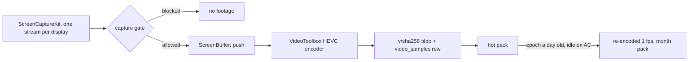
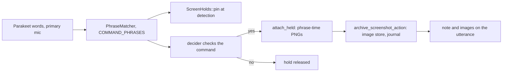

# Screen recording and screen commands

Heimdall records every display into the archive as hardware HEVC, and two spoken commands ("look at this", "take a
screenshot") attach what was on every display when the phrase began.

Read this when: you want to change how the screen is recorded or tiered, find out why footage is missing, read
recorded frames back, change how a spoken screen command picks its frame, or measure the recorder's cost.
Code: `crates/screen/src/` (code map: [crates/screen/README.md](../crates/screen/README.md)),
`crates/archive/src/video.rs`, `crates/archive/src/video_native.rs`, `crates/app/src/pipeline/commands.rs`,
`crates/app/src/mcp_frames.rs`, `crates/app/src/drawing.rs` (`look`).

## How a frame reaches the archive

- `ScreenCapture::start_recording` (`crates/screen/src/macos.rs`) owns one thread that runs every SCK stream. No
  callback writes pixels to disk on the SCK queue; frames go through `ScreenBuffer` (`buffer.rs`).
- Size: `ScreenConfig::size`. The default is half the display's native pixels (3456 × 2234 becomes 1728 × 1116);
  the other choices cap width and height. Both sides are rounded down to even numbers because the hardware encoder
  codes even sizes, and SCK is asked for that same size.
- Rate: `ScreenConfig::fps`, default 5, accepted 1 to 30 (`ScreenConfig::validate`).
- No RGB history is kept: a three-surface SCK queue (`setQueueDepth(3)`), one encoder per display and one transient
  RGB frame.
- Clock: SCK presentation times are converted from `SCStream.synchronizationClock` to the host clock with
  `CMSyncConvertTime`, the clock audio, words and evidence use. Join footage to anything else by session and host
  time. Invalid Core Media times are refused, never read as zero.
- SCK idle frames (unchanged pixels) extend the previous sample's coverage; nothing is encoded or stored for them.
- Screen states for timeline search are detected on the same frames (`Detector`, `frontmost_context`); indexing is on
  [chunk-index.md](chunk-index.md).

## When nothing is recorded

- Permission: capture checks `CGPreflightScreenCaptureAccess` (`screen_permission_granted`) and never requests it.
  No API in the crate raises a permission prompt.
- Seeing off stops capture. The app swaps in `ScreenBuffer::idle()`, a placeholder with no store, and clears pending
  command holds (`Pipeline::clear_screen_frames`). Footage already recorded stays. Why: building a real empty store
  there blocked the live loop on fsync.
- `CaptureGate` (`gate.rs`) refuses a display that is asleep, a session that is locked or at the login window, and a
  panel whose brightness reads 0. The built-in panel's brightness comes from a read-only DisplayServices query;
  panels without one fall back to display-asleep.
- Lock, sleep, wake and display-change notifications invalidate the capture generation; a frame callback re-checks the
  generation before publishing, so no pre-wake frame lands.
- Excluded windows: Heimdall's windows titled as in `screen::EXCLUDED_WINDOW_TITLES` (`Heimdall Command Island`,
  `Heimdall Draw Overlay`, `Heimdall Pointer`, `Heimdall Drop Target`) never appear in a recording or a grab. Drawing
  mode composites the user's strokes into screenshots instead (`drawing::mark_shots`). Check by hand with
  `cargo run -p screen --example island_exclusion` (needs Screen Recording granted to the terminal).
- Disk floor: below the free-space floor `ScreenBuffer::push` closes its epochs and refuses frames. The floor itself is
  on [resilience.md](resilience.md).
- Gaps: `gaps.rs` logs `screen capture gap: display N kept no frame for X s; …` when more than 1 s (`GAP_NS`) passes
  between archived frames, naming what SCK sent meanwhile, at most one line a minute (`LINE_EVERY_NS`). It changes
  nothing about capture.

## Stream recovery

- A stream that stops is restarted after 250 ms, then 1, 2, 4 and 8 s (`ScreenEvent::Recovering`). After five failed
  attempts it reports `ScreenEvent::Unavailable` and waits for an OS display or wake event, not a timer.
- A healthy stream for 30 s resets the attempt count.
- Starts and stops run in one ordered screen lane off the live loop (`screen_lane` in `crates/app/src/live_loop.rs`;
  see [resilience.md](resilience.md)).
- The owner thread reports `Started`, `DisplaysChanged`, `Configured`, `Paused { reason }`, `Error` and `Unavailable`
  on `ScreenCapture::events`.

## Encoding and storage

- VideoToolbox hardware HEVC only (`video::native::Encoder`): no software fallback, no external codec process.
  Quality 0.8, no frame reordering, a keyframe at least every 60 s and every 300 frames.
- One-minute codec epochs per display (`video::SEGMENT_NS`). A resolution or rate change or a capture gap starts a new
  one.
- An epoch whose first row meets a busy archive leaves one closed, empty row. The display's frames are dropped (the
  stream keeps running) until the writer catches up, or after `ARCHIVE_RETRY` (60 s), then a new epoch starts.
- Each encoded sample is its own fsynced pack blob `v/<sha256>` plus a `video_samples` row, so no MOV trailer is
  needed. A crash loses only the in-flight frame; committed samples decode from the epoch's saved HEVC parameter sets.
  Table layout: [archive.md](archive.md).
- At the next recording start, open epochs of a dead writer are closed after checking their `owner_pid`; another live
  writer's epochs are left alone (`Writer::recover_previous`).

## Tiering old footage

The compactor re-encodes each epoch once all of it is 24 h old (`DAY_NS`).

- Cold tier: HEVC quality 0.5 at 1 fps, into the month pack. The hot blobs are then collected and the hot pack gives
  its pages back to the disk.
- Gate: on AC power after five minutes without input (`video::native::maintenance_allowed`). Unknown power or idle
  state closes the gate. The gate is checked between frames.
- At most `video::PASS_EPOCHS` (16) epochs per pass, oldest first, one at a time. New samples are decoded and fsynced
  before one short publication transaction; an interrupted re-encode keeps the hot footage.
- A pending screen command's pinned epochs and epochs a reader holds stay hot and are passed over.
- Closed epochs with no sample are marked `archive` once a day old, `video::RETIRE_EPOCHS` (512) per writer job.
- A failed epoch is reported with its error, keeps its hot footage and is retried after `video::FAILED_RETRY` (1 h).
  After `video::PARK_AFTER` (3) failures, counted in `video_tier_failures` across restarts, it is parked: reported
  once more with its reason and never decoded again. `DELETE FROM video_tier_failures` lets parked epochs try again.
- A swap refused after the cold blobs were written queues those blobs for collection, which removes only blobs nothing
  references.
- A pass that finds old epochs but tiers none logs `Archive video tiering tiered none of N epochs older than a day
  (…)`, at most once an hour per process.

## Catch up tiering by hand

1. Know the two gates: each pass takes the compactor's owner lock (`.compact.owner`) without waiting, and runs only
   while the Mac is idle on AC power. If another compactor holds the lock, the pass does nothing and the command ends.
2. Run `heimdall-archive tier ARCHIVE_ROOT SECONDS`. It runs video tiering alone, pass after pass, for at most
   `SECONDS`, and stops early when a pass tiers and retires nothing.
3. Read one JSON line per pass (`tiered`, `retired`, `errors`, `seconds`, `hot_bytes`) and a final total with
   `hot_bytes_before` and `hot_bytes_after`.
4. Check: `hot_bytes_after` is below `hot_bytes_before`, and a second run prints `"tiered":0`.

Measured on a busy M5 Max: about 3.2 s per epoch.

## Change resolution or frame rate

1. Pick a value in the menu's Recording submenu, or set `screen.resolution` / `screen.fps` (keys, accepted values and
   defaults: [settings.md](settings.md)).
2. `ScreenSettings::config` (`crates/app/src/settings.rs`) maps the choice to a `ScreenConfig`; the owner thread
   reconfigures every stream and replies `ScreenEvent::Configured`. A failure restores the displays already changed.
3. Check: the next frame starts a new epoch at the new geometry or rate; stored footage keeps its own.

## Read footage back

- In code: `heimdall_archive::video` (`range`, `at`, `samples`, the native `Decoder`) and the store catalogue.
- MCP `screen_frames` (`crates/app/src/mcp_frames.rs`): `at` (a time, or `now` for the newest recorded frame) or
  `chunk_id` (a screen chunk from `timeline_search`), optional `display_id`, `count` 1 to 4 (chunk only), `quality`
  `preview` or `full`. It looks back at most 10 s from the time.
  - An archived time is exact: the frame at it, or the last one before it.
  - `timeline_search` prints whole-second times, so a whole-second `at` with nothing at or before it means that
    second: its first frame. Never the second's last frame.
  - Seeing off refuses current and past frames with `CAPTURE_UNAVAILABLE: no screen frames are available`.
  - No frame in the window is `FRAME_NOT_FOUND`.
- Movies of any window: `archive_clip` and `heimdall-clip` ([archive-clip.md](archive-clip.md)).

## The agent's look

- `look` (`crates/app/src/drawing.rs`) grabs the display under the pointer directly through `screen::native_grabber`,
  not from the recording, so a stalled stream never blocks it.
- Seeing off is an error: `SEEING_OFF: no screenshot was taken because Seeing is switched off in Heimdall (off since
  …)` (`bridge::SCREEN_OFF`, `Tools::seeing_off_error`).
- A known blocker (`screen::capture_blocker`: permission off, Mac locked or at the login window, every display asleep
  or dark) is `CAPTURE_UNAVAILABLE: no screenshot was taken because <reason>`, with no grab tried.
- A failed grab is retried once after 250 ms (`LOOK_RETRY`), then is `CAPTURE_UNAVAILABLE: the screen grab failed
  twice: <cause>`. `look` never returns success without an image.

## Screen commands

### Which phrases fire

- The app matches only `COMMAND_PHRASES` (`crates/app/src/pipeline/mod.rs`): `look at this` and `take a screenshot`.
  Every other alias in `screen::SCREEN_PHRASES` (English and Polish) reaches the agent as ordinary speech; the full
  table is used by the probe and the eval bench.
- Only the primary microphone proposes commands. App playback, Heimdall's own sound on the microphone and words
  dictated to Vella never do ([vella.md](vella.md)).
- Phrases are matched in partials, window decodes and finals. Each match is a candidate that the decider must confirm
  ([decision-chain.md](decision-chain.md)); the decider reads up to 15 s of the turn ending 200 ms after the trigger.
- Seeing off: an approved command adds `[screenshot not taken: Seeing is switched off in Heimdall]`
  (`SCREEN_OFF_NOTE`) and the island shows "Seeing is off".

### Timing and holds

- Phrase start is the first word's `start_ns`, which listen has already moved to the first Silero-voiced 32 ms block
  (`crates/listen/src/onset.rs`). `PhraseMatch.start_ns` selects and labels the frame; `trigger_ns` is the start of
  the phrase's last word.
- A phrase spans at most 4 s from its first word's start to its last word's start. Why: Parakeet stretches a last
  word's end over trailing noise.
- At detection `ScreenHolds::pin` holds a recording range under the archive reader lock, keeping no RGB:
  `LOOKBACK_NS` (5 s) before the detection, detections within `HOLD_MERGE_NS` (1 s) merged, at most `MAX_HOLDS` (32)
  holds and `MAX_HELD_BYTES` (512 MiB) of held native pixels (beyond it, full-resolution supplements go oldest first,
  then oldest holds).
- The full-resolution grab starts at detection on its own thread (75 to 90 ms per display, measured). A phrase first
  seen in the final is pinned at the decision (`pin_now`).
- Grab deadlines: 5 s per capture, 10 s for display enumeration. A wake, stop or reconfiguration (a capture generation
  change) during the grab discards its results.

### Frame choice and the attachment

- Per display, the attachment takes the last recorded frame at or before the phrase start whose coverage still
  includes it: never a later frame, never one from before a gap. A missing display or a start outside the recording
  fails the attachment (`ScreenActionEvent::Failed`), and the transcript shows `[screenshot unavailable: <error>]`.
- The app needs 256 MiB above the disk floor to attach; below it the island shows "Disk almost full".
- `ScreenActionEvent::Action` carries the note `[screenshot HH:MM:SS attached]`, `image_path` (first display) and
  `shots` for every display, each with display id and frame time. The original utterance stays beside the note.
- Each display also gets one full-resolution PNG from the grab (`Shot.kind` `ring` is the recorded frame,
  `full_resolution` the grab; `ShotKind::Ring` is a wire name kept for compatibility). A full-resolution `frame_ns`
  is the grab's receipt time, not the phrase time.
- The agent gets the full-resolution frame instead of the recorded one only when it was grabbed within 1.5 s of the
  trigger (`FULL_RESOLUTION_SAME_MOMENT_NS`). A later grab is attached second, beside the phrase-time frame, and the
  note gives both times: `[screenshot 21:28:16 attached, and a sharper one from 21:28:24]`.
- Grab failures (permission, the 20 MiB PNG limit, a generation change) keep the recorded PNGs and go to
  `full_resolution_errors` (archived, logged, and the component status says "Full-resolution screenshot unavailable").
- Files: PNGs are written 0600 in 0700 directories under `<data>/run/<session>/shots/`.
  `archive_screenshot_action` (`crates/app/src/bridge/tools.rs`) stores each image in the archive's SHA-256 image
  store, journals a `screenshot` event, then removes the PNG.

### Phrase matching rules

`PhraseMatcher` (`crates/screen/src/commands.rs`). `PhraseMatcher::new(table)` runs the same rules over any table.

- Matching folds case and Polish accents, keeps token boundaries, and allows one edit in one word of five or more
  characters. Polish imperatives (`spójrz`, `zobacz`, `zrób`, `popatrz`, `zerknij`) must match exactly after folding.
- `zobacz to` allows at most two hesitation words between (`yyy`, `eee`, `um`, `uh`, `no`, `proszę`), commas
  included. A pause over 1 s or a sentence boundary stops a match.
- The longest overlapping alias wins. A partial that could still extend into a longer alias waits until the final or
  until a word rules the longer one out.
- Negation earlier in the same clause suppresses any phrase (`don't`, `not`, `never`, `nie`, `wouldn't`,
  `shouldn't`, `couldn't`, `can't`, `cannot`, `won't`, `didn't`, `doesn't`). A sentence end, a pause over 1 s or a
  contrast (`but`, `instead`, `ale`, `jednak`) resets it.
- Command position, English screen phrases only: the phrase must open its clause (utterance start, sentence or comma
  break, a pause over 1 s, `but`, `so`) after at most four lead words (interjections, the assistant's name words from
  `set_name_words`, `please`, `just`, `like`, `look`…); or follow a request frame (`can/could/would/will you`,
  `want/need/like you to`, `let's`, `go ahead and`); or join another command with `and`/`then` whose clause starts
  with an imperative verb from a fixed list (`open Safari and take a screenshot`). Inside a statement it never fires
  (`we should take a look…`, `he told me to look at this invoice`).
- Quoted speech never fires a screen phrase, in either language: a phrase right after a speech verb (`said`, `told`,
  `asked`, `powiedziałem`, `mówi`, `zapytałam`…), optionally with the person told (`told him,`, `powiedziałem mu,`),
  or after `was like`. `Like I said, …`, `jak mówiłem, …` and `I told you, …` still fire.
- Words are borrowed, never filtered.

### Utterance identity

- A command's identity is source, stable utterance ID and covered word positions, never ASR timestamps, so revisions,
  finals and re-decodes cannot fire it twice. IDs stay recorded until `reset_source` (a source discontinuity), with no
  time expiry.
- Call `observe_utterance` with the utterance's stable ID and final flag. `observe` treats each source as one
  cumulative transcript: never feed it word arrays that restart positions per utterance.
- Repeats of the same command in one turn are one action, even more than 1 s apart.

## Test it

- `cargo test -p screen` covers capture gates, phrase-start selection at 5 fps, holds without RGB, display and
  generation races, the disk guard, minute rotation, idle coverage, a hardware codec round trip, real SIGKILL
  recovery, full-resolution fallback, and labelled utterances including real transcript lines
  (`archive_lines_fire_only_as_commands`). Tiering tests are in `cargo test -p heimdall-archive`.
- Not driven by tests: unlock, sleep and brightness transitions and several physical displays (gate and generation
  coverage only).

## Measure cost with the probe

1. Use a signed build that already holds Screen Recording. If the preflight refuses, stop: never prompt, reset TCC or
   grant the probe on its own.
2. Run `heimdall-screen-probe --after-grant --recording --data-dir NEW_DIR --seconds 20`. `NEW_DIR` must not exist
   and must lie outside the real Heimdall profile. `--seconds` takes 10 to 30.
3. For grab cost, run `heimdall-screen-probe --after-grant --full-resolution --data-dir NEW_DIR --commands N`
   (`N` 1 to 3). Add `--powermetrics` for GPU figures (it tries `sudo -n`; GPU stays unmeasured without it).
4. Check: the JSON lines report process CPU, the selected phrase frame at or before the phrase time, and
   `derived_store_mb_per_hour`.

Measured on a busy M5 Max with one internal display: recording at 1728 × 1116, 5 fps used 3.47 % of one core and grew
the store 1.95 MB per hour on a mostly static desktop (161.5 MB per hour on a changing one); process CPU only.

## See also

- [archive.md](archive.md): the store, packs, video tables and compaction around tiering
- [archive-clip.md](archive-clip.md): movies of any recorded window
- [chunk-index.md](chunk-index.md): screen states in timeline search
- [capture.md](capture.md): audio capture on the same host clock
- [decision-chain.md](decision-chain.md): the decider that confirms a spoken command
- [settings.md](settings.md): `screen.resolution`, `screen.fps` and the Seeing switch
- [resilience.md](resilience.md): disk floor, the screen lane and failure symptoms
