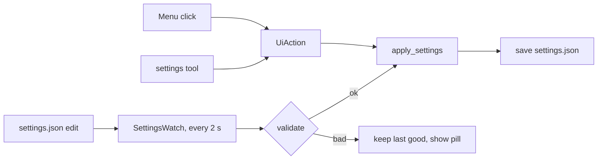

# Settings

Every Heimdall setting: where it is stored, its default, how a change applies in the running app, and the agent's
`settings` tool that changes them.

Read this when: you want to change a setting by hand or from the agent, add a setting, find a default, or work out
why an edit to `settings.json` did not apply.
Code: `crates/app/src/settings.rs` (`Settings`, defaults, validation, migrations), `crates/app/src/settings_tool.rs`
(the `settings` tool), `crates/app/src/pipeline/settings_apply.rs` (applying a change), `crates/app/src/live_loop.rs`
(`reload_settings`).

## How a change applies

Settings live in one file, `<data>/settings.json` (the data folder: [home.md](home.md)). Every setting applies in the
running app; none needs a relaunch.

- Menu actions and `settings` tool calls apply at once and are saved.
- A hand edit is picked up on the next 2-second tick (`settings_tick` in `live_loop.rs`). The watcher compares
  modification time, length and inode, so an atomic replace is seen even when it keeps the time and length.
- Known values are validated (`Settings::validate`) before anything applies. An invalid revision is reported once
  ("settings.json is invalid · using the last good one") and the previous settings stay in force.
- Unknown fields are ignored at every depth. A field the file leaves out takes its default.
- Deleting the file does not reset a running app.
- The raw archive, the transcript database and the session identity stay open through ordinary setting changes.
- A failed save is retried on every tick until it lands (`settings-save` component).
- Many fields are written only when they differ from their default (the code marks each `skip_serializing_if`), so a
  default file stays readable by older builds.

## Change a setting in the file

1. Open `<data>/settings.json`. Write the new file to a temporary name and rename it over the old one; a partial
   write is read as invalid.
2. Use the key names and values in the tables below. A key the file lacks is the default.
3. Wait two seconds. Check: the menu shows the new value, and the app log has no `Settings rejected` line.

`computer_control` and `computer_clicks` are the exception: a file edit can turn them off but never on while Heimdall
runs (`computer_from_file`). The value stays off and the file is rewritten.
Why: any shell can write that file, and an edit would skip the `owner_asked` check the tool and menu enforce.

## Switches and user settings

| Key | Default | Menu | How it applies |
|---|---|---|---|
| `paused` | `false` | Listening tile (Off = `true`) | Off drains capture and listening, records the deliberate gap and unloads the decider. The agent, speech and the screen keep their own switches; the agent is not told. The stop intent has its own latch (`Tools::listen_latch`), persisted beside the agent's. Setup's Allow All orders On at the click (`SetupAllowed`); an Off clicked while permission dialogs are open wins. |
| `screen_off` | `false` | Seeing tile (Off = `true`) | Off stops ScreenCaptureKit and clears pending command holds; footage stays. Voice screenshot commands add `[screenshot not taken: screen capture unavailable]`; the agent's screenshot tools fail plainly. On records again once setup was allowed and Screen Recording is granted, whatever Listening says. |
| `dry_run` | `true` (Agent off) | Agent tile (Off = `true`) | Off closes the transport gate at once, then the agent actor switches to dry run. Queued observations stay local; capture and transcription continue. |
| `speak_replies` | `true` | Speaking tile | Atomic speech gate; Off interrupts playback without touching capture, the agent or the archive. |
| `engine_on`, `engine_model`, `engine_quant`, `engine_thinking`, `engine_context` | off, none | Engine tile, Agent ▸ Model | [inference-engine.md](inference-engine.md), [models.md](models.md). |
| `agent_model`, `api_models` | the edition's | Agent ▸ Model | The agent restarts on the new model or budget; a thinking change for the running model needs no restart. The public edition starts with no added models. [models.md](models.md). |
| `agent_relay`, `agent_relay_model`, `agent_relay_account` | off, T3's first model, automatic | Agent ▸ Model ▸ Claude Code subscription | Relay on or off, its T3 model and its T3 Claude account; a change restarts a running relay. Only what T3's catalog lists is offered. [claude-relay.md](claude-relay.md). |
| `agent_speed` | `"standard"` | none | `"fast"` asks OpenAI routes for the priority tier, read per request. [models.md](models.md). |
| `background_model`, `background_efforts`, `task_models`, `background_off`, `background_fallback_paid` | the edition's | Background Tasks | From each job's next pass. `background_efforts` holds a thinking level per model (a model without one runs each job's own effort). `task_models` is a task's own model and is always written. `background_fallback_paid` (off) lets the fallback end on the paid Anthropic API key. [models.md](models.md), [background-call.md](background-call.md). |
| `identity` | Heimdall's own | Personalisation ▸ Name & Icon | Name (also the wake word), user name and mark. [personalise.md](personalise.md). |
| `speech_voice`, `voice_speed_percent` | the edition's voice, `115` | Personalisation ▸ Voice, Speed | The next sentence. Speed is 80 to 160 percent (`speak::stretch`). [voices.md](voices.md). |
| `wake_sound` | `true` | Personalisation ▸ Wake Sound | macOS's Tink at a quarter volume (`CUE_VOLUME`) when a spoken request goes to the agent; not for typed requests or with the agent off. Independent of the Speaking tile. Its sound on the microphone is archived as Heimdall's, never as a turn or a wake (`bridge/speech_policy.rs`). |
| `microphone` | built-in | Listening ▸ Microphone | Only the affected input devices change; app taps stay armed. A disconnected choice keeps its labelled built-in fallback. |
| `extra_microphones` | none | Listening ▸ Microphone | Only the opted-in extra inputs open or close. |
| `recorded_apps` | none | Listening ▸ App Audio | Only the changed app's processes are armed or removed. The list keeps at most `HEARD_APPS_KEPT` (24) apps that are neither recorded nor playing. |
| `screen.resolution`, `screen.fps` | half native, `5` | Seeing ▸ Recording | Streams update on their owner thread and start a new codec epoch; stored footage keeps its geometry. FPS is 1 to 30 in the file; the menu offers 1, 2, 5, 10 (`ui::SCREEN_FPS`). [screen.md](screen.md). |
| `islands_hidden` | `false` | Show Islands (⌃⌘,) | Every floating island hidden at once; the islands themselves are kept. |
| `islands_on_streams` | `false` | Show Islands on Streams | Islands appear in screen shares and recordings. |
| `islands_display` | follow | Islands Display | Missing means Follow Cursor: the islands open on the display with the pointer. A display's name as macOS gives it locks the notch island and the floating islands there (the helper's `display.json`). A locked display that is not connected falls back to following; the menu lists it checked and greyed. `"follow"` and similar words written by hand mean follow (`ui::islands_display::is_follow`). |
| `computer_control` | `false` | Agent ▸ Control Apps | The agent's `computer` tool on or off (`heimdall_computer::gate`, read on every call). Turning it on without Accessibility shows macOS's Accessibility prompt once. File edits cannot turn it on (above). [mcp.md](mcp.md). |
| `launch_at_login` | `false` | Launch at Login | `SMAppService` registers or unregisters in place. A rejected registration is named in Reload. Only a signed bundle can exercise it. |
| `menu_collapsed` | none | section headers | The menu's folded sections, kept across launches. |
| Speaker name, skip, rename, forget | none | Speakers | The naming actor applies it; no capture or model restart. [speakers.md](speakers.md). |

## Models and backends

Backend choices live in the settings file, so they change on the running app without environment variables.
Probe-only environment switches remain for the standalone parity and measurement tools.

| Key | Values (default) | How it applies |
|---|---|---|
| `parakeet_backend` | `metal`, `coreml` (`metal`) | A candidate recognizer is built on the listen inference thread, then only the recognizer is replaced. Every source's audio, VAD, transcript and timestamp state stay. A failed candidate keeps the old model. |
| `turn_backend` | `metal`, `cpu` (personal `metal`, public `cpu`) | Same transaction, replacing only the Smart Turn detector. Metal needs the bundled matching assets (the public edition ships the stock model, which runs on the CPU); missing assets keep CPU and name the failure in Reload. Why Metal where it can: measured 9.2 vs 21.4 ms and 0.030 vs 0.110 J per decision, with 7 flips in 8,338 held-out pauses, all within 0.006 of the threshold (not exact parity). A file from before the Metal default holds `"cpu"` only as the old default (there is no menu for it), so launch migrates it to `metal` once and records `turn_backend_migrated: true`; a later deliberate `"cpu"` sticks. |
| Silero VAD | not selectable | One pinned native CPU kernel. Its per-source state survives recognizer and turn swaps. |
| `decider_model` | `v6`, `v5` (`v6`) | Which trained decider runs. `v5` is the rollback; set it in the file (the `settings` tool has no key for it). Honoured at every load; a live change hot-swaps the decider like a precision change, at the same precision. If the chosen version has no folder on this Mac the other loads, and the log and the Decider section say so. An unknown value runs V6. The log names what loaded: `decider: d1-2B-heimdall-v6-4bit (Decider V6, 4-bit) loaded in 0.4 s`. |
| `decider_precision` | `16bit`, `8bit`, `4bit` (`4bit`) | Menu Decider section (click, then Confirm), Setup's Decider step or the file. The decider owner finishes the decision in flight, drops the old instance, loads the new folder and asks it one short decision before the menu stops spinning (`pipeline/decider.rs`, `decider_swap.rs`). Sentences arriving meanwhile wait in its queue. A failed load goes back to the previous precision, writes it back and shows the reason under the section header. A missing folder loads the nearest present one and says so. An unknown value runs 4-bit. `HEIMDALL_D1_LIBRARY` and the transport override are launch-only developer inputs. [decision-chain.md](decision-chain.md). |
| `tts_backend` | `auto`, `metal`, `cpu` (`auto`) | Interrupts and drains the speech queue, then builds the chosen synthesizer for the next reply. |
| `--models`, debug traces, tensor captures | launch inputs | Not settings. |

Microphones decode final-only, with forced 15-second rollover; responsive policies remain for lab tests only. Why:
final-only cut encoder calls per speech minute by 75% and listen-engine CPU by 31% with identical text (measured on one
public clip replayed four times; listen-engine CPU only, not whole-app energy).

## Hidden fields

No menu row; set them in the file. Fields not listed here are documented at their declaration in `Settings`.

| Key | Default | Meaning |
|---|---|---|
| `memory_rerank` | `100` (`DEFAULT_CANDIDATES`) | How many of a memory search's best worded hits the reranker reorders; `0` turns reranking off; at most 400 (`MAX_CANDIDATES`). Read at each search. [chunk-index.md](chunk-index.md). |
| `ack_delay_ms` | `0` (`DEFAULT_ACK_DELAY_MS`) | Quiet after the user's last voiced audio before the spoken acknowledgement ("On it.") and the island's send arrow and thinking dots; one setting for both (`pipeline/ack.rs`). `0`: they come as the turn ends. Never delays the wake itself. At most 10000 (`MAX_ACK_DELAY_MS`). Read at each wake. [decision-chain.md](decision-chain.md). |
| `computer_clicks` | `false` | The `computer` tool's pointer-click fallback. Applied with every settings change; a file edit can turn it off, never on. [mcp.md](mcp.md). |
| `echo_cancel_off` | `true` | `true` keeps Apple's echo cancellation off on speakers (the text echo guard stays). Writing `false` turns it on, live. [capture.md](capture.md). |
| `floating_islands_off` | `false` | `true` stops Heimdall launching the bundled Floating Islands helper; the tools and the watcher stay. |
| `free_space_floor_bytes` | 10 GiB | Shared floor for the raw writer, transcript writer and screenshot and speech guards; a change invalidates raw-writer capacity credit. At least 1 GiB. |
| `relay_order`, `relay_skip` | empty (`claude, codex, *`), `false` | Which T3 harnesses a relay tries, and whether emergency mode skips them for the local engine. [claude-relay.md](claude-relay.md). |
| `task_failover_off` | `false` | `true` stops moving a task that hit a Claude usage limit to another Claude account with quota. [t3-orchestration.md](t3-orchestration.md). |
| `setup_requested` | `false` | Whether already-granted capture may start. Editing it requests no permission; only the Setup window requests grants. [setup.md](setup.md). |
| `system_audio_confirmed` | `false` | Records that system audio delivered at least once; grants nothing. |

Setup and migration markers (`first_run_*`, `setup_step`, `t3_connect_allowed`, `harness_autonomy`,
`turn_backend_migrated`, `screen_recording_migrated`, `engine_added`, `relay_added`, `goals_added`,
`anthropic_models_added`, `delivery_generation`) are written by the app; leave them alone. The personal edition has
fields of its own; their declarations say so.

Retired fields load and are never written again: `disabled_sources`, `voice`, `harness`, `archive_format`,
`archive_choice_pending`, `retention_days`, `anthropic_credit_usd`, `anthropic_credit_day`, `wake_words` inside
`identity`, and `islands_model` (moved to `background_model` once). The archive keeps everything at the source's
quality with no retention deletion ([archive.md](archive.md)).

## Reload

The menu's **Reload** row is normally disabled. A candidate that cannot load, or a failed native apply, leaves a named
pending component and turns the row orange: `Transcription Backend`, `Screen Recording`, `Agent Session` or
`Launch at Login` (`settings_result`). Reload retries only those components, in process; success removes the name. It
never asks the user to quit. Pi recovery, engine wait and GPU fallback keep their own component statuses rather than
claiming a model loaded.

Agent Off and Listening Off persist through the stop-intent latch (`<data>/stop-intent.json`), which survives a
relaunch even when `settings.json` still holds a stale On; [resilience.md](resilience.md) has the rules.

## The settings tool

The agent's `settings` tool changes any menu setting. Schema: `SETTINGS_KEYS` and `identity_tools()` in
`crates/agent/src/mcp_contract.rs`; behaviour: `crates/app/src/settings_tool.rs` (`KEYS` holds the same keys in menu
order, and a test keeps the two equal).

- Arguments: `action` (`list`, `get` or `set`, required), `key`, `item`, `value`, `owner_asked`.
- `list`: every key with its value, by menu section. `get` with `key`: the value, what `set` takes and the current
  choices. `set` with `key` and `value` (and `item` where the key needs one).
- A change is planned as the menu's own `UiAction`s, checked against what the menu offers, and sent through the menu's
  callback (`ui_action_callback`), so the latches, the live loop, `apply_menu_settings`, the save and the redraw are
  exactly a click's. The tool then reads the value back every 200 ms for up to about three seconds and answers
  `key: before → after`, `key is already …`, or that the change was sent but not yet shown.
- A refused change starts with `NOT_CHANGED:` and says why.
- `item` names a microphone, app or task as the menu shows it: an exact name first, then the one name containing the
  given part ("Ego" finds "Ego Browser"); an ambiguous part is refused with the matches. An app is listed once it has
  played sound this session or is recorded.
- `personalise` is the older tool for the name, user name, icon and voice. It takes `name`, `user_name`, `icon`,
  `icon_svg`, `speaking_model`, `voice` and `wake_words` (ignored); with no arguments it describes the current identity.

| Key | Section | `set` takes |
|---|---|---|
| `listening`, `seeing`, `speaking` | Tiles | `true` or `false` |
| `agent` | Tiles | `true` or `false`; `false` needs `owner_asked` |
| `engine` | Tiles | `true` or `false`; `true` also makes the engine's model the agent's; `false` while the agent runs on it needs `owner_asked` |
| `microphone` | Listening | a connected microphone's name, or `built-in` |
| `extra_microphone` | Listening | `item`: a microphone's name; `true` or `false` (off works on a saved extra that is not connected) |
| `app_audio` | Listening | `item`: an app's name; `true` (recorded) or `false` |
| `recording_resolution` | Seeing | `540p`, `720p`, `half` or `native` |
| `recording_fps` | Seeing | `1`, `2`, `5` or `10` |
| `islands_on_streams` | Seeing | `true` or `false` |
| `agent_model` | Agent | `local`, `local/<engine model>`, or an added model's name or id (`provider/name`); its provider must be connected |
| `agent_thinking` | Agent | a thinking level the selected model lists |
| `agent_speed` | Agent | `standard` or `fast` |
| `agent_context` | Agent | tokens; snaps to the menu's nearest stop (the local model: 128000 up to its window) |
| `agent_relay` | Agent | `true` or `false`; `false` returns to `agent_model` |
| `agent_relay_model` | Agent | a Claude model T3 lists (id or name); also turns the relay on |
| `agent_relay_account` | Agent | `automatic`, or a Claude account T3 lists (instance id or name); also turns the relay on |
| `computer_control` | Agent | `true` or `false`; `true` needs `owner_asked` that asks for it (below) |
| `name`, `user_name` | Personalisation | text, at most 32 characters (`NAME_CHARS`) |
| `icon` | Personalisation | `helmet`, an SF Symbol name, an absolute PNG/PDF/SVG path, or SVG source (saved under `<data>/identity/`) |
| `speaking_model` | Personalisation | `phonon` or `own_engine` (`SPEAKING_MODELS` also lists voices this edition routes to Phonon S) |
| `voice` | Personalisation | a voice of the current speaking model |
| `voice_speed` | Personalisation | percent of natural speed, 80 to 160 |
| `wake_sound` | Personalisation | `true` or `false` |
| `ack_delay` | Personalisation | seconds, 0 to 10: `2`, `2.5`, `"2.5 s"` or `"1500 ms"`; stored as `ack_delay_ms` |
| `background_model` | Background Tasks | `provider/id`, `local/<engine model>` or `t3:<instance>/<model>`, optionally `@<level>` (`@default`: each task's own). With `item` a task: that task's own model, or `shared`. With `item` `paid_fallback`: `true` or `false` |
| `background_task` | Background Tasks | `item`: `islands`, `plan`, `voice_names`, `day_timeline` or `suggestions`; `true` or `false` |
| `show_islands` | Windows | `true` or `false` |
| `islands_display` | Windows | `follow`, or a connected display's name or a part of it |
| `launch_at_login` | System | `true` or `false` (through the app's `SMAppService` path) |

### Guards

- `agent` false, and `engine` false while the agent runs on the local engine, are refused unless `owner_asked` quotes at
  least three words found in one of the user's last 30 lines, spoken or typed (`agent_off_check`,
  `Tools::recent_user_lines`). An allowed one is logged (`record_agent_off`) and answers that the agent is switching off;
  no read-back follows, because the agent's own delivery gate closes.
- `computer_control` true needs `owner_asked` quoting a recent line that asks for control as a verb and its object
  ("turn on computer control"), with no "don't" or "if" just before (`heimdall_computer::asks`). Off always passes.
- A new `name` or `user_name` answers "end the turn now": Pi reloads after the turn with the new prompt and keeps the
  conversation. Never quit, kill or restart Heimdall for a setting.

Not in the tool: provider sign-ins and API keys, adding or removing API models, speakers (the agent has `name_voice`
and `listen_to`), shortcuts, and Quit. There is no speaker-device setting: Heimdall plays to the Mac's default output.

### Add a setting

1. Add the field to `Settings` with its default in `impl Default`, `#[serde(default)]` behaviour, and
   `skip_serializing_if` when a default file must stay readable by older builds.
2. Add a range or choice check to `Settings::validate` for any value that can be wrong.
3. Apply it in `pipeline/settings_apply.rs` (`apply_settings`) without restarting unrelated parts.
4. For a menu setting: the row and its `UiAction`, then a key in both `KEYS` (`settings_tool.rs`) and `SETTINGS_KEYS`
   (`mcp_contract.rs`), and rewrite the schema snapshot (see [mcp.md](mcp.md)).
5. Add a row to the right table on this page.
6. Check: `cargo test -p app --bin heimdall settings` and `cargo test -p agent --test mcp_v2`.

## Checks

- `cargo test -p app --bin heimdall settings`: defaults, persistence, migrations, unknown fields, atomic replacement
  (`settings.rs` tests), and the tool's plans (`settings_tool.rs` tests).
- `cargo test -p agent --test mcp_v2`: the tool's schema, including the key list's length.
- `python3 scripts/test_release_docs.py`: phrases this page must keep.

Not verified on a signed install: live talking plus app audio through backend swaps, real ScreenCaptureKit
reconfiguration under display and wake races, login registration. The replay tests use synthetic screen frames and no
native capture.

## See also

- [personalise.md](personalise.md): name, user name, mark and wake word
- [voices.md](voices.md): the voice picker and samples
- [models.md](models.md): the agent's and background models
- [mcp.md](mcp.md): the tool server the `settings` tool lives in
- [resilience.md](resilience.md): the stop-intent latch and recovery
