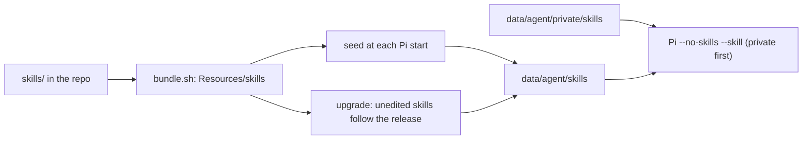

# Skills

Heimdall keeps its system prompt minimal and puts procedures in skills: plain Markdown folders its agent reads when a
topic comes up. Prompt and skills each have two layers: a general one, the same for every user, and a private one that
belongs to one user and never leaves their Mac. This page says what goes where, how skills reach a profile, how
bundled skills upgrade, and what keeps private text out of a release.

Read this when: you want to add or change a skill, decide whether a rule belongs in the prompt or a skill and in which
layer, find which skill covers a topic, work out why an edited or updated skill did not change, or change what a
public export may take.
Code: `skills/` (the general skills' source), `crates/agent/src/skills.rs` (seeding, the two folders),
`crates/agent/src/environment.rs` (the private layer), `crates/update/src/skills.rs` (upgrades),
`crates/agent/prompt/` (the general prompts), `scripts/check_public_split.py` (the split's check), `scripts/bundle.sh`
(what the app bundles).

## Two layers

| | General (class `public`) | Private (class `private`) |
|---|---|---|
| True for | any user of the app | one user's install |
| Holds | what the app, its tools, islands, tasks, voice, screen, memory and settings do and how to use them | their Mac, accounts, apps, projects, model picks, taste and standing rules |
| Prompt | `crates/agent/prompt/heimdall.md`, compiled into the app, the same in both editions | `<data>/agent/private/environment.md`, put under it at every start |
| Task rules | `crates/agent/prompt/worker.md`, above every brief | `<data>/agent/private/task-rules.md`, under it |
| Skills | `skills/public/`, `skills/shared/`, bundled and seeded into `<data>/agent/skills/` | `<data>/agent/private/skills/`, never bundled, seeded or upgraded |
| Ships | in the app and the public repository | nowhere |

- **The private prompt layer.** `environment.md` opens with a list between two markers that Heimdall rewrites at every
  Pi start (`environment::generated`): the Mac, the edition and folders, the agent's model, providers, background
  model, microphone and app audio, Control Apps, whether T3 Code, the agent command-line tools, Vella and Arsenal are
  there or not, and the user's own skills. Every line is read from a file's existence, `sysctl` or `settings.json`;
  nothing reads the Keychain or raises a prompt. Everything under the second marker is the user's: setup notes the
  generator cannot see (accounts, subscriptions, projects) and standing rules. `environment::refresh` keeps it byte
  for byte. The general prompt tells the agent to write a correction or a standing rule there, in the user's words
  with the date.
- **Loading.** `harness::private_layer` puts the file under the general prompt for Pi (`APPEND_SYSTEM.md`) and for the
  relay (`relay_prompt::text`), with the same path names filled. The general prompt says that where a rule in "This
  install" differs from a general one, the user's wins.
- **Private skills.** Pi gets two `--skill` folders, the private one first (`skills::folders`), and keeps the first
  skill of a name. So a private skill named like a general one replaces it, and a private `my-<name>` adds to
  `<name>`: the general prompt tells the agent to read both. A `my-` skill holds only the additions.
- **Class.** Every `SKILL.md` declares its class under `metadata:` in its frontmatter (`skill_index::class`):

  ```
  ---
  name: t3-tasks
  description: …
  metadata:
    class: public
  ---
  ```

- **Keeping it true.** `heimdall --environment check` (the weekly skill audit runs it) reports a stale block, a layer
  over its word cap (`environment::WORD_CAP`), a path in the notes that no longer exists, a private skill without its
  class, and a private skill that shadows a general one. `--environment show` prints the layer as the agent gets it.

### What keeps private text out of a release

`scripts/check_public_split.py` is the one place that says which prompt and skill files a public export may take
(`--list`) and it fails when:

- a skill declares no class, or a `class: private` skill sits in a public place;
- `skills/` holds a set other than `public` and `shared`;
- a private path is in an exported tree or bundle (`PRIVATE_PATHS`: `prompt/personal`, `skills/heimdall`,
  `skills/workers`, `agent/private`, `lab/prompt-split`, `docs/personal`);
- a general prompt or skill matches a built-in private pattern: a home path, a personal vault, a dated quote of a
  rule, or one user's model routing stated as a rule (a provider prescribed or forbidden, a model named as the one
  to use; general text says how a model is picked, the user's `my-models` says which);
- with `--private <folder>`, any string of that folder's `private-strings.txt` or any line of its Markdown files is
  in the public layer, or, with `--tree`, anywhere in the tree.

It runs in `scripts/bundle.sh` before any skill is copied, inside `scripts/check_public_bundle.py` on every public
bundle, and its own test in `scripts/check.sh` (`public-split-rules`) checks this repository's layer on every run.
`crates/agent/tests/split.rs` holds the same rules for `cargo test`. A release runs it once more over the exported
tree with the developer's private folder: `python3 -I scripts/check_public_split.py --tree <tree> --private <folder>`.

## Prompt or skill

The system prompt carries only what applies on nearly every turn, or must hold even when no skill is loaded:

- **Identity**: who the assistant is, what wakes it, how its messages look.
- **Hard safety**: only the user (and a guest they listen to) gives orders; ask before anything irreversible or
  outward-facing and before system changes; never propose contacting anyone; Heimdall itself is untouchable.
- **Handshakes**: `GO INSTALL` (only the integrating task installs), `CONFIRM_REQUIRED` (ask exactly its question,
  repeat with `confirm`), `NO_REPLY`, the wake rules (never poll).
- **Every-turn behaviour where reading a skill would slow a spoken answer**: the reply, speaking while working, when to
  stay silent, opening apps, pointing, the pointer to model routing.
- **Lines with placeholders the harness fills at launch** (`HEIMDALL_TOOL_LOG`, `HEIMDALL_CONNECTORS_DOC`,
  `HEIMDALL_MEMORY_DIR` and others): skills are plain files and are not filled, so these stay in the prompt.

Everything procedural, occasional or long goes in a skill. Pi lists each skill's name and description in the system
prompt and the agent reads the body when the topic comes up; the prompt says so in one line. Where a moved rule is
safety or every-turn, the prompt keeps one line pointing at it.

`crates/agent/tests/prompt.rs` reads the general prompt, the task prompt and the general skills together, so each rule
it pins must be in one of them; its word cap bounds the prompt alone.

## Skill sets

| Folder | Who loads it | Class |
|---|---|---|
| `skills/public/` | Heimdall's own agent | public |
| `skills/shared/` | Heimdall and the agents it starts (`update-skills`) | public |
| `<data>/agent/private/skills/` | Heimdall's own agent, before the two above | private |

Heimdall's general skills:

| Topic | Skill |
|---|---|
| Writing a `delegate_task` brief; briefs for pages, apps, images and comparisons | `writing-briefs` |
| Choosing a task or sub-agent model and effort, provider limits, routing, local model checks | `models` |
| "Heimdall is slow": why speed depends on the model, which model to run | `speed-and-models` |
| T3 threads after they start: reading, steering or queueing, questions and approvals, archiving | `t3-tasks` |
| The skills and tools of the agents started through T3, one line each | `task-skills` |
| The `ask` card beyond one yes or no: several questions, multiple picks, Other | `question-cards` |
| Floating islands, Goals, Scheduled and Settled lists, scheduled wakes | `islands-and-plan` |
| The memory folder of small notes and its `MEMORY.md` index | `memory` |
| How the user decides and gives feedback; treating your own work on their Mac | `working-with-the-user` |
| A new user's tour: what Heimdall does, a live demo, personalising | `onboarding` |
| Questions about itself: what it hears and sees, what happens to recordings, why it has no web search | `about-heimdall` |
| Changing Heimdall's own switches, devices, voice and models with `settings` | `heimdall-controls` |
| Changing itself: Pi settings, skills, the private layer, reloading | `heimdall-setup` |
| Offering a bug report to the developer | `report-bug` |
| Adding or changing a skill and copying it into every harness | `update-skills` (shared) |

### The task preamble

The T3 tasks' default prompt (`crates/agent/prompt/worker.md`; `agent::harness::WORKER_PROMPT`) holds the rules
every brief would otherwise repeat: Heimdall is untouchable, the cursor, one report per background job, system
changes, never answering a gate for the user, no sound, never contacting anyone, done means checked the way the user
meets it, design and report rules, and cleanup. The T3 layer puts it above every `delegate_task` brief
(`t3::Workers::set_brief_preamble`, set from `crates/app/src/mcp_actions.rs` with the chosen names filled in), so
Heimdall writes only the task. The user's own rules for tasks, when `<data>/agent/private/task-rules.md` has any, go
under it (`agent::harness::task_preamble`). T3 Code has no per-thread system prompt; the top of the first message is the closest
equivalent and works in every harness T3 runs.

## How skills reach a profile

`skills/` in this repository is the one source of the general skills. Nothing syncs it to other harnesses automatically: no command, daemon,
MCP tool or start-up sync. The `update-skills` skill (`skills/shared/update-skills/SKILL.md`) owns the table of the
folder each harness loads (Pi, Claude Code, Codex, OpenCode, Grok) and the guarded hand copy.



- `scripts/bundle.sh` copies `skills/public/` and `skills/shared/` into `Heimdall.app/Contents/Resources/skills/`, in
  both editions.
- Pi starts with `--no-skills --skill <data>/agent/private/skills --skill <data>/agent/skills`
  (`crates/agent/src/harness.rs`): only Heimdall's two folders, never skills installed for other agents.
- At each Pi start, `agent::skills::seed` copies every bundled skill of the two general sets that the
  folder's `.seeded` list does not name and that has no folder of that name. Each copy goes to a temporary name and is
  renamed into place; the name is then added to `.seeded`. A fresh install needs no setup, an edited skill is never
  overwritten by seeding, and a removed one never comes back.
- A development build reads the checkout's `skills/`.
- After an agent edits the profile's folder, Heimdall calls `reload_me` and the new Pi process reads it.

### Change a skill

1. A rule true for every user: edit the general skill under `skills/<set>/<name>/SKILL.md`. One user's own rule: edit
   or add `my-<name>` in their `<data>/agent/private/skills/`, with `class: private`; nothing else is needed but a
   reload. Keep the frontmatter's `description` free of `": "` (Pi drops such a skill silently).
2. Follow `update-skills` to copy it into each harness folder that loads it, including the profile's
   `<data>/agent/skills`.
3. Check: `cargo test -p agent --test skills`, then `reload_me` and confirm the agent lists the skill.

## Skill upgrades

A later build's change to a skill already seeded does not arrive through seeding. The upgrade
runs after each seed (`agent::skills::after_seed`, set in `crates/app/src/updates.rs`) and calls
`heimdall_update::skills::upgrade`. It keeps the hash of the bundled copy last applied to each profile skill in
`skill-baseline.json`, in the updater's state folder (public edition) or `<data>/agent/skill-updates/` (personal
edition):

- Profile copy equals the new bundled copy: nothing to do; the baseline follows it.
- Profile copy equals the baseline (unedited) and the bundle changed: the profile copy is replaced (staged beside it,
  renamed in).
- Otherwise (edited, or no baseline and different): the profile copy is kept byte for byte; the incoming copy is saved
  to `incoming-skills/<name>/`, outside the loaded folder, and listed as a conflict.
- Skills the user made, and bundled skills the user removed, are never touched.
- Each release writes one notice to `inbox/<release>.json` (updated skills and conflicts; empty when nothing changed),
  before any change, never rewritten for the same release, pending until acknowledged.

The personal edition has no app updater, but it runs the same skill upgrade after each seed (`updates::launch`), so
its general skills follow each build it installs. A user's own skills are in another folder and are never touched.

## Checks

- `cargo test -p agent --test skills`: frontmatter every harness accepts, a declared class, no repeated name within
  sets loaded together, the `task-skills` index names every task skill.
- `cargo test -p agent --test split`: only public sets and public-class skills in the repository, no private pattern
  in the general prompts and skills, and `scripts/check_public_split.py` passing.
- `cargo test -p agent --test prompt`: the general prompts' rules, read from the prompt and the general skills
  together, and the word cap.
- `cargo test -p agent --lib environment`: the generated block, a refresh that keeps the user's text, the check.
- `cargo test -p agent --lib skills`: seeding once and the upgrade hook.
- `cargo test -p heimdall-update`: baselines, conflicts and the release notice.

## See also

- [mcp.md](mcp.md): the tools skills tell the agent to call
- [t3-orchestration.md](t3-orchestration.md): T3 tasks and briefs
- [updates.md](updates.md): the in-app updater that runs skill upgrades
- [models.md](models.md): the agent's model and providers
