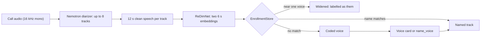

# Speakers

Who is speaking: live diarization of call audio, voice identity, quiet naming of new voices, guests Heimdall listens
to, Heimdall's own voice, and whose line a microphone utterance is. Everything runs locally; the speakers SDK
captures no audio, draws no UI and requests no permissions.

Read this when: you want to change how call voices are named, you want to know why a line is labelled "Unknown" or
a coded voice, you are changing `name_voice` or `listen_to`, you are changing who may interrupt Heimdall, or you are
tuning a voice threshold.
Code: `crates/speakers` (SDK, code map in [its README](../crates/speakers/README.md)), `crates/app/src/speakers_runtime.rs`,
`crates/app/src/voice_namer.rs`, `crates/app/src/voice_suggest.rs`, `crates/app/src/pipeline/` (`voice_names.rs`,
`speaker_tracks.rs`, `listen_to.rs`, `heimdall_voice.rs`, `mic_voice.rs`, `playback.rs`, `barge_in.rs`),
`crates/app/src/bridge/call_interrupt.rs`.

## Diarize a call

- One speaker actor per call source (`speakers_runtime.rs`) owns a `CallScopedSpeakers` session. The models run in the
  bundled `heimdall-speakers-worker` child, so neither loading nor a request blocks audio intake. The host feeds mono
  16 kHz PCM in chunks of at most one second with its VAD speech flag and calls `expire` from a timer.
- `QUIET_TIMEOUT` (120 s, `crates/speakers/src/call.rs`) without speech ends the session and kills and reaps the
  child, freeing its memory. The next speech starts a new session with anonymous tracks again.
- Helper failures back off 1, 2, 4, 8 s; five failures open a five-minute circuit; a healthy minute resets it.
- `Diarizer::load` verifies the pinned Nemotron 3 Q8_0 GGUF (size and SHA-256), opens it with the `v3-streaming`
  preset and checks the model has eight tracks. Geometry is the publisher's ultra-low-latency setting, in 80 ms
  encoder frames: chunk 3, right context 1, left context 0, FIFO 264, speaker cache 264, update period 222. The input
  buffer is `(3+1) × 80 ms = 320 ms`, before compute.
- Segments use the native library's defaults: onset and offset 0.5, no padding, no gap filling, no minimum duration
  (`DiarSegmentationCfg` in the vendored `diar_pipeline.h`).
- `Diarizer` and its streams are `!Send`/`!Sync`: create and use them on their owning worker thread.
- `SpeakerPipeline` keeps a 12 s ring of audio. Per track it collects clean speech only: predicted overlap removed,
  100 ms trimmed at each speech edge, no gap filling. At 12 s of clean speech it embeds two six-second windows and
  hands them to naming; the newest window is the query.
- A capture gap or a new call needs a new session; missing audio is never joined. The original mixture belongs to
  capture and the archive ([capture.md](capture.md), [archive.md](archive.md)).

## Identify a voice

- `ReDimNet::load` verifies the ReDimNet2 B6 ONNX FP32 file (vb2+vox2 large-margin). `VoiceEncoder::embed` takes clean
  16 kHz PCM and returns a unit-normalised 192-value embedding. ORT runs on the CPU with one thread and no spinning.
- `EnrollmentStore::default()` carries the calibration from `crates/speakers/tests/fixtures/calibration.json` and no
  people. `identify` takes each name's best cosine over its samples; the cutoff is `0.455542` (six-second windows, two
  samples per name; FAR and FRR 2.08% each on the calibration set). Below the cutoff, an exact tie, or a missing or
  invalid calibration returns `Identity::Unknown` with its reason.
- Heimdall's own voices score under the name `Heimdall` only at `HEIMDALL_IDENTIFY_MIN` (0.6) or more, so a guest is
  never labelled Heimdall by a near match. That label cannot be renamed.
- The user's own microphone lines carry the fixed internal label `ui::identity::DEFAULT_USER`; the UI and the agent
  show the user's chosen name instead (`crates/agent/src/identity.rs`).

## Coded voices and widening

`NamingFlow` keys tracks by source, call session and speaker number. When a track's two windows arrive:

1. A name matches: the track is labelled with it (`SpeakerEvent::LabelChanged`).
2. A voice ignored on the old prompt (`ignored`) matches: the track stays "Speaker N".
3. A coded voice matches: the track takes its code (`VoiceCoded`, `new: false`).
4. A near miss widens a person's set (below).
5. Otherwise a new coded voice: a label such as `Speaker Fri 23 Oct 21h #3`, stored in `speakers.json` under `voices`
   with its samples (first two windows plus the newest, at most `VOICE_SAMPLES` = 8), calls, days, first and last
   heard, and the line it said.

Every write re-reads `speakers.json` under the app's enrolment lock, so two calls never code one voice twice and a
name given meanwhile wins. A write that fails leaves the track "Speaker N" until its next windows.

Widening (`EnrollmentStore::near_miss`, `identity::WidenedSample`), for one voice heard through different microphones:

- A voice that matches nothing but is at most `WIGGLE` (0.05) below the cutoff against one person's own samples, and
  `WIDEN_MARGIN` (0.10) closer to them than to anyone else (Heimdall included), joins that person's `widened` set,
  tagged with where it was heard ("Discord", "Call"). It is labelled as them.
- At most `WIDENED_PER_DEVICE` (3) per person per device; the oldest leaves first.
- Drift guards: the wiggle is measured only against a person's own samples, never widened ones; a voice recognised
  only through a widened sample is labelled but its samples are not kept; the user, Heimdall and listened guests are
  never widened, and `identify` ignores widened samples for them.
- Not sure: a new voice within `ASK_BAND` (0.08) below the cutoff of a named person carries that name in its
  `VoiceCoded` event (`near`). The app puts one notice to the agent (`voice-question:<code>`, at most one per call
  source per hour, `ASK_EVERY_MS`) to ask the user at a natural pause. The answer goes through `name_voice`. The app
  itself says nothing.

## Naming voices

Nobody is interrupted to name a voice: no popup, no notification, no sound. Two paths share one island card at a time
(`pipeline/voice_names.rs`), on the background model (`crate::background_model`). Turning off the Voice Names task
(`background_off` contains `voice_names`) stops both; `task_models` can give it its own model
([settings.md](settings.md)). A voice that never reaches 12 s of clean speech in a call stays "Speaker N", not coded,
so it gets no card. No call app's participant list is read.

New-voice card (`voice_suggest.rs`):

- Shown for a coded voice on a track of an open, active call that said `MIN_LINES` (3) lines and `MIN_WORDS` (12) words
  in the last 30 minutes (`RECENT_MS`), the newest in the last three minutes (`voice_namer::ACTIVE_MS`).
- Card, in order: "New voice: “…”" (its newest sentence of four words or more), up to `MAX_CANDIDATES` (2) guessed
  names as one-click chips only when there is a real guess, a name field ("Type the name"), Not important last.
- The guess runs before the card shows: the voice's lines and the lines around them (`voice_namer::context`), the call
  app, the names Heimdall knows, and the known voice it sounds closest to (cosine `NEAR_MIN` 0.40 or more, below the
  cutoff). The model (`voice_suggest::SYSTEM`) lists up to three names. Code keeps only confidence high or medium, a
  name said in the transcript, never the user, Heimdall or a name turned down for this voice. Order: sure names
  (confidence high and `SURE_HINTS` (2) hint lines where the voice says it as its own or answers within 20 s after
  someone says it, and never addresses it), then the model's order, then the sound-alike. Without a model, or when it
  fails, only the sound-alike.
- A chip names the voice. Return in the field saves the name as typed. Not important is Forget: the voice keeps its
  code, is never suggested again, and is listed in the Speakers window with Ask Again. Esc, the lip, or
  `CARD_MS` (5 min) unanswered puts it away for `SNOOZE_MS` (3 h).
- The field never takes the keyboard by itself (one click gives it focus) and answers no Option+digit shortcut.
- Rate: one card at a time, at least `GAP_MS` (10 min) apart and `PER_DAY` (6) a day. Several new voices: one card at
  a time, for the one that spoke last. The card goes when the voice's call goes quiet.

Returning-voice proposal (`voice_namer.rs`, for regulars):

- Runs only while a call is open, at most once a minute (`CHECK_EVERY`), never while a card is up, for a coded voice
  that spoke in the last three minutes, was heard on `MIN_DAYS` (2) local days in `MIN_VISITS` (2) visits (runs of
  lines three hours apart) and has about `MIN_MINUTES` (60) of conversation. Per voice a model call needs
  `RECHECK_MS` (20 min) since the last and `NEW_LINES` (15) new lines.
- Reads the archive read-only: the voice's newest 300 lines, up to three lines before each (within a minute) and one
  after, and the names Heimdall knows.
- The answer is checked in code: confidence high; at least `MIN_HINTS` (3) hint lines in `MIN_MOMENTS` (2) separate
  moments (another session or ten minutes apart), each the voice naming itself or someone saying the name with the
  voice answering next (within 20 s, same call); the voice never addressing that name; not the user, not a known name,
  not one turned down. Names match across recogniser drift: five letters or more, same first letter, at most two
  edits (`voice_namer::same_names`).
- Card, only while the voice is in an active call: "Is this John?" with its quote, Yes, the name field, Not important.
  It waits `CARD_MS` (10 min); an unanswered card is not shown again for `ASK_AGAIN_MS` (24 h).

Rename by voice or by hand:

- `name_voice {voice, name}` names a coded voice or corrects a name. The agent finds the label with
  `timeline_search`. With `voice: "latest"` no search is needed: the coded voice that spoke last (an open call's voices
  first, else the archive's last 12 hours, `LATEST_WITHIN_MS`); the reply says what it last said and which other
  unnamed voices spoke within 30 minutes (`CONVERSATION_MS`), so a wrong pick can be renamed.
- The transcript's double-click, the Speakers window's rename, the cards and `name_voice` share
  `Pipeline::rename_voice`: every archived line in every session first (`Index::relabel_speaker`, chunk speaker tags
  included), then `speakers.json`, then the open calls' labels. A rename cut short can be repeated.
- Anonymous labels ("Speaker 2", "Unknown") are never renamed everywhere; a "Speaker N" double-click names only the
  coded voice behind that track. The user's label and `Heimdall` are not names for another voice.

## Listen to a guest

The user can tell Heimdall to act on a call guest's requests ("listen to Vim", "don't listen to him").

- The flag is per named voice (`Enrollment::listening` in `speakers.json`), off by default and on until the user turns
  it off: no expiry. The Speakers window lists the user first with the switch locked on; Heimdall is never a guest; a
  coded voice must be named first. A rename keeps the flag.
- The user flips it with the row's switch or by voice through `listen_to {speaker, on}`. The tool works only in a run
  the user's own words woke (their microphone lines by source, or a typed message, within `LISTEN_WORDS_NS`, 10 min)
  and never in a run a guest woke or steered (`SpeechPolicy::listen_change`). Turning it on also needs those words to
  ask to listen to that guest (`asks_to_listen`: "listen to Vim", "listen to him", Polish "posłuchaj go"; a negation
  just before only turns it off). `name_voice` joining a voice to a listened guest needs the same run.
- Wake: a listened guest's call line that addresses Heimdall by name (`decide::send::addressed_by_name`) wakes the
  agent with trigger `guest`, and that run may answer aloud during the call. A listened guest's whole line also counts
  like the user's in a call: a name mention or "send it" wakes unless the decider says strongly it is not for
  Heimdall, and the decider's own send follows the user's in-call gate (`held_in_call` unless answering a card). A
  mixed call final keeps only the by-name rule.
- Guards: the user's microphone, Heimdall's own audio and non-call sources are never guests. A guest line whose words
  Heimdall was playing through speakers is its echo (`guest_wake_held`, reason `heimdalls_echo`).
- The agent's copy of each listened guest line is labelled `Vim (listened to)`; the decider keeps plain labels. The
  prompt has Heimdall ask the user before anything outward-facing or destructive a guest requests.
- Evidence: `listening_changed`, `agent_context_routing.listened_guest`, `guest_wake_held`.

## Who may interrupt in a call

- Listening mode off (no guest listened to): any call voice still open after `GUEST_CUT_AFTER` (0.4 s) stops Heimdall.
- Listening mode on: a call voice stops Heimdall only when the live tracker puts a listened guest's track in it, or a
  track with no name yet. Unnamed tracks interrupt on purpose: a new voice needs 12 s of clean speech before it is
  named, and a coded voice first heard in this call, or one near a listened guest, is treated as unnamed. Another named
  guest, a coded voice from earlier calls, a track labelled as the user or Heimdall, and sound with no track (noise)
  leave Heimdall talking; they still keep a reply from starting until the gap.
- `Pipeline::judge_call_voice` judges the open voice on every tracker update (`bridge/call_interrupt.rs`): a track
  counts after `TRACK_MIN_S` (0.16 s); with no interrupting track after `DECIDE_AFTER_S` (0.6 s) of heard audio the
  voice is a bystander. The cut waits 0.4 s, then polls the verdict every 40 ms, and cuts anyway if none came within
  `PENDING_MAX` (2.5 s): tracker loading, failed or behind.
- After `QUIET_TIMEOUT` the next session starts unnamed, so every guest can interrupt again until named.
- The user's own microphone is not on this path: see Barge-in below.
- Evidence: `speech_stopped` (reason `guest_voice`, with `listening`, `speaker`, `after_ms`), `speech_kept` (reason
  `not_listened`).

## Heimdall's own voice

`pipeline/heimdall_voice.rs` enrols each voice Heimdall can speak with, so its echo is recognised.

- Enrolment: each voice that can speak a reply now (`Tools::speaking_voices`: the chosen voice; the personal edition
  adds its lighter fallback voice) renders the seven `LINES` silently, never played, on a background-priority thread
  while Heimdall is silent, the user is not talking and Speaking is on. Nothing is loaded for it: a voice renders only
  while already resident (`voice_renderable`); a saved own voice renders; ElevenLabs voices never do (each render
  costs credit).
- Each line is embedded as rendered and through a simulated speaker-to-microphone path (`room_path`: speaker band,
  small room, echo level and noise floor), at natural speed and at the user's speed. Profiles live in `speakers.json`
  under `heimdall`, keyed by the voice's sample key (for example `phonon-Edwin`).
- Re-enrolment: a profile carries its recipe (`RECIPE`, plus the model weights for voices whose weights can change,
  `recipe_for`). A new voice, new weights or a new recipe enrols again at the next quiet moment; the old profile works
  until then. A failed enrolment waits `RETRY` (10 min); one interrupted by speech waits a minute.
- Encoder: ReDimNet alone in `heimdall-speakers-worker` (`speakers::call::EncoderHelper`, CPU, one thread), started on
  first use and ended after `IDLE` (120 s) without work. A check slower than `CHECK_LIMIT` (1.5 s) counts as none.

## The user's voice on the microphone

Every utterance on the primary microphone is judged (`pipeline/mic_voice.rs`, `heimdall_voice::mic_verdict`) against
the user's voice print (`UserVoice`, `user-voice.json`) and Heimdall's voices.

- The clip is the whole utterance up to six seconds (a long one: the six seconds holding most words), asked at speech
  end; the final waits at most 0.7 s. Under `MIC_MIN_SAMPLES` (0.5 s) nothing is embedded.
- Verdicts, in order:

| Verdict | Rule | Effect |
| --- | --- | --- |
| Heimdall | Heimdall score ≥ `MIC_HEIMDALL_MIN` (0.50) and above the user's | archived as Heimdall (`archive_only`, reason `heimdalls_voice`), never sent to the decider or agent |
| User | user score ≥ `MIC_USER_MIN` (0.55) and ≥ 0.10 above Heimdall's | the user's line |
| Unknown | not the user while Heimdall was audible through speakers, or a reliable utterance (≥ 1.5 s of speech at `SPEECH_RMS` or louder) scoring under `MIC_OTHER_MAX` (0.40) | labelled "Unknown": context only, never wakes, sends early, answers a card or authorises `listen_to` (decider outcome `held_not_user`) |
| Unverified | anything else: short or unclear, no print yet, encoder down or late | stays the user's, behind the text echo guard |

- Over Heimdall's echo only the audio of the words the text echo guard kept is judged.
- Until the user's voice is known (fewer than `USER_MIN_SAMPLES` = 3 samples), the decider alone never wakes the agent;
  only the wake name does (decider outcome `held_no_user_voice`).
- Playback from the Mac's own output (`pipeline/playback.rs`), from every recorded app but Heimdall's own output,
  calls included: a line on any Mac microphone with `MIN_WORDS` (6) or more words, `COVERED` (80%) of them inside runs
  of `RUN` (3) or more words an app said within `PAD_NS` (1 s), is that app's playback: "Unknown" (evidence
  `mic_playback`). A line that addresses Heimdall by name where the app did not, or one the print verified as the
  user's, stays the user's. Lines heard before the app's own words arrive are not caught.
- While an app talked around a line, an unverified line scoring under 0.40 is Unknown even when quiet
  (`heimdall_voice::app_audible_verdict`, reason `app_audible`); a short line at speaking level keeps the benefit of
  the doubt.
- The print (`UserVoice`): learned from the user's own primary-microphone wakes outside calls while Heimdall was
  silent (each turn's middle six seconds) and from Setup's phrase, at most `USER_MAX_SAMPLES` (16). A sample joins only
  if it matches at least half the kept samples and the first ones (`anchors`) at `USER_JOIN` (0.455), so the print
  cannot drift. Setup's phrase starts it again.
- Other microphones: a microphone the print does not fit gets its own set (`devices`, by microphone name, at most
  `USER_DEVICES` = 4) only from lines with support besides the voice (the user addressed Heimdall by name, the decider
  sent it, outside calls, Heimdall silent, no app talking) that agree with each other: `USER_DEVICE_START` (3) on the
  user's own headset or iPhone, `USER_RESTART` (5) on any other. Each held line must score at least `USER_HELD_FLOOR`
  (0.30) against the anchors and counts for `USER_HELD_FOR_MS` (7 days). A set never replaces the print; the user's
  score is the best over the print and the microphone's own set.
- Evidence: `mic_voice` (scores, verdict, reason, speech time, level).

## Barge-in

`pipeline/barge_in.rs`: while Heimdall speaks, only the user's voice stops it (decision 31,
[decision-chain.md](decision-chain.md)). There is no "stop speaking" command.

- The user's speech on the primary microphone arms it while Heimdall speaks, or Heimdall starts over the user's
  speech. Heimdall's own audio, other microphones and dictation to Vella never arm it.
- Every `STEP_NS` (0.5 s) the microphone's last `WINDOW_NS` (1.5 s, 300 ms before the onset included) is embedded and
  scored. Windows quieter than `SPEECH_RMS` are skipped. Heimdall's voice at `HEIMDALL_MIN` (0.45) or more is its echo;
  under `OTHER_MAX` (0.40) is another voice; between is unsure, never a cut.
- The user's voice in `USER_WINDOWS` (2) windows in a row stops Heimdall: score ≥ `USER_MIN` (0.60), or
  `HEADSET_USER_MIN` (0.50) on the user's own AirPods or Beats with Heimdall in the headphones, and ≥ `USER_MARGIN`
  (0.10) above Heimdall's score. Echo, other people, unsure windows and failed checks never stop it.
- Before the user's voice is known (fewer than 3 samples), a window confidently not Heimdall's counts as the user's.
- Checks continue for 1.5 s of audio past the user's last voice (`END_TAIL_NS`), so a short "stop, wait" is judged.
  A sound too short for two checks never stops Heimdall. Speaking off and Listening off still stop it at once.

## Files and evidence

- `speakers.json` (data folder): `names` (samples, `listening`, `widened`), `voices` (coded), `ignored`, `heimdall`,
  calibration. Written only under the enrolment lock.
- `user-voice.json`: the user's print, `anchors`, `devices`.
- `voice-namer.json`: per voice the last check, lines then, the card shown, names turned down, when suggested, its
  snooze; the cards shown today.
- Journal events: `voice_suggested` (guesses, any model error), `voice_namer`, `voice_card_answer`, `voice_named`,
  `voice_forgotten`, `voice_question`, `mic_voice`, `mic_playback`, `listening_changed`, `guest_wake_held`,
  `speech_stopped`, `speech_kept`. Reading them: [resilience.md](resilience.md).

## Model and data sources

Attribution for weights, corpora and annotations (`crates/speakers/THIRD_PARTY.md` points here).

- Native code and C ABI: https://github.com/NVIDIA/NeMo-Speech.cpp/tree/e59dfb0b5c22655620f41391cc9a000d6f56b802
- Nemotron weights, geometry, benchmark and annotation links: https://huggingface.co/nvidia/Nemotron-3-Diarization/tree/f667ed73aee57d40cc39428eb768b4fd87a0a29e
- Evaluation defaults: https://github.com/NVIDIA-NeMo/Speech/blob/main/examples/speaker_tasks/diarization/neural_diarizer/e2e_diarize_speech.py
- B6 ONNX contract and provenance: https://huggingface.co/soniqo/ReDimNet2-B6-ONNX-FP32/tree/e911e3f063899805f3d94ee5d1db53fff8e9f3e8
- B6 clean verification baselines: https://github.com/PalabraAI/ReDimNet2
- Core ML comparator: https://huggingface.co/aufklarer/ReDimNet2-B6-CoreML
- AMI manual references: https://github.com/pyannote/AMI-diarization-setup/tree/67c2d539286e89f68952d5dcf83912bd9f01dfae
- AMI forced-alignment references: https://github.com/nttcslab-sp/diar-forced-alignment/tree/9527b7c64846fb38316a610f32e9d3466bd6d8b7/AMI/test
- AMI corpus mirror: https://groups.inf.ed.ac.uk/ami/AMICorpusMirror/amicorpus/ES2004a/audio/ES2004a.Array1-01.wav
- Opus reference source: https://github.com/xiph/opus/tree/7b05f44f4baadf34d8d1073f4ff69f1806d5cdb4

## See also

- [crates/speakers/README.md](../crates/speakers/README.md): SDK code map, tests, calibration and measurements
- [decision-chain.md](decision-chain.md): wake triggers, the decider's gates, decision 31
- [capture.md](capture.md): call and microphone sources the tracker reads
- [archive.md](archive.md): where relabelled lines live
- [chunk-index.md](chunk-index.md): `timeline_search`, used to find a voice's label
- [settings.md](settings.md): background tasks and their models
- [mcp.md](mcp.md): `name_voice` and `listen_to` in the tool families
