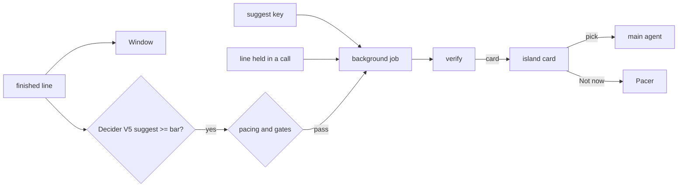

# In-conversation suggester

While the user talks with someone, Heimdall sometimes offers one card on the island, built from the last ten minutes
of talk. The card asks; it never acts. A pick wakes the main agent with the suggestion, the talk it came from, what the
search found and the user's choice.

Read this when: you want to change when a suggestion pass starts, what the pass may search or offer, the pacing, the
card's handoff to the agent, or the feedback log and its label export.
Code: `crates/app/src/pipeline/suggest.rs` (when, the card, the pick), `crates/app/src/suggester.rs` (window, pacing,
the job, `verify`), `crates/app/src/suggester_replay.rs` (replay and export), `crates/app/prompt/suggester.md`.

## What starts a pass

Every finished line joins the window (`suggester::Window`: `WINDOW_MS` ten minutes, `WINDOW_LINES` 60 lines, each line
cut at 400 characters). A pass starts in one of three ways (`pipeline::suggest::Pass`):

1. **Paced.** After each line's send decision, the user's or another speaker's, Decider V5 is asked its suggest
   question on the same conversation (`decide::suggest`, `Pipeline::suggest_ask`). A pass starts at P(yes) of
   `SUGGEST_MIN` (0.7) or more, or `SUGGEST_MIN_CALL` (0.5) while a call or conversation is open
   (`suggest_call_open`). Each answer is a `suggest_decision` evidence record (`outcome`: `no`, `held_addressing`,
   `pass`). V5 is not asked when:
   - the line was sent to the agent, is Heimdall's own audio, or is empty;
   - the user is talking to Heimdall: a line of theirs that woke Heimdall or that it waits on, the `ADDRESSING_MS`
     (20 s) after it, or while Heimdall speaks;
   - a card is up, a pass is running, or the pacer refuses a call;
   - the shipped decider is not V5, or a send decision is waiting (suggest never delays a wake).
2. **Suggest key.** ⌃⌘' (`UiAction::ForceSuggest`) starts a pass now, past the pacing and the addressing hold; an open
   card makes way (logged `replaced`). The pass is told the user asked for a card.
3. **Held in a call.** A line of the user's that the decider sent but the call gate held (`held_in_call`,
   `decide::send::D1Gate::InCall`) starts a pass at once, without V5's question or the call gap, and its card shows past
   the pacing. One pass covers a run of held lines: none starts while a pass runs or a card is up. Journalled as
   `suggest_decision` `held_in_call_pass` or `held_in_call_busy`. If the pass stays silent or fails, the user's own
   words become the card ("Do it" / "Not now", `suggester::held_card`, logged with `held_fallback`), unless they ask for
   nothing or propose contacting someone or an outward action.

Every pass also needs (`suggest_allowed`): Background Tasks ▸ Suggestions on, a running agent, the background gate open,
not a replay, and a usable credential for the Suggestions model (`background_model::task_endpoint(Task::Suggestions)`;
no credential, no card).

## The pass

- One background job (`background_call::ask_tools_blocking`, job label `suggester`) on the Suggestions task's model,
  at effort `low` (`suggester::EFFORT`) and never above it whatever the model's level says
  (`background_call::capped_effort`). Why: the user waits on it mid-conversation.
- The background call's one-hour prompt cache and $0.50 run limit apply ([background-call.md](background-call.md)).
  At most `MAX_ROUNDS` (5) tool rounds and `MAX_SEARCHES` (2) searches; later searches are refused with a note.
- Tools are read-only and never run on a T3 instance (`background_model::tool_task`):
  - `search_files`: Spotlight (`mdfind -onlyin`) under the user's home, at most 12 paths; Library caches, the Trash, `.git`,
    `node_modules`, `target` and Heimdall's data folder are left out (`keep_path`).
  - `search_timeline`: the archive's index, read-only, at most 8 hits.
- `submit_suggestion` ends the run: silence, or one card of one to three questions with two to four options each.
- `suggester::verify` checks the answer in code: well-formed questions and options; no wording that proposes
  contacting anyone (`proposes_contact`); no outward action offered (`acts_outward`: deleting, buying, installing,
  publishing and similar, when the verb opens an option or follows an offer such as "me to" or "shall I"; a look-up
  about a purchase passes); every cited path must come from a search in the same run. A refused answer is logged with
  the reason.

## The card

- Card ids are `suggest:<uuid>` (`CARD_PREFIX`). A card shows for `CARD_MS` (five minutes); unanswered, it leaves and
  is logged `ignored`.
- "Not now" (or "No", "Not this time") dismisses it and wakes nothing.
- Any other answer, typed answers included, is a pick: the agent gets a `suggest-pick:<uuid>` notice (`PICK_PREFIX`,
  classified as an answer in `crates/agent/src/notice.rs`) with the topic, the answers, what the search found, the
  pass's notes and the talk (`suggester::handoff`).
- During a call the card stays on screen only, and the handoff tells the agent to answer on screen and not speak.
- A card that arrives while the user is talking to Heimdall, or that the pacing no longer allows, is dropped and
  logged `silent` with the reason.

## Pacing (`suggester::Pacer`)

- One model call a minute (`CALL_GAP_MS`), silent answers included; no call while a card is up.
- One card every three minutes (`GAP_MS`); a topic is not offered again within two hours (`TOPIC_MS`, word overlap,
  `same_topic`).
- Two dismissals in a row pause suggestions for 15 minutes (`PAUSE_MS`). A pick clears the count.
- Pacing state is in memory: a restart resets it.

## Feedback and labels

- Every decision is appended to `<data>/suggestions/log.jsonl`: `shown`, then `picked`, `dismissed`, `ignored`,
  `replaced` or `feedback`; silent answers are `silent` lines with their reason; failures are `error` lines.
- A typed "bad suggestion", "irrelevant" or "not relevant" (at most six words, `suggester::feedback`) within
  `FEEDBACK_MS` (five minutes) of a card attaches to it, closes an open card, and is not sent to the agent. Any other
  reply is an ordinary message.
- `heimdall --suggest-export [--log PATH] [--out PATH]` writes one label row per card: `suggest_now` true for a pick,
  false for a dismissal or typed feedback, null for an ignored card.

## Replay (lab)

1. Make one timeline file per conversation with the archive CLI (read-only):
   `heimdall-archive timeline --since YYYY-MM-DDTHH:MM --until YYYY-MM-DDTHH:MM --kinds utterance > talk.jsonl`.
2. Run `heimdall --suggest-replay [--triggers-only] OUT_DIR TIMELINE.jsonl...`. It runs the phrase stub
   (`stub_suggest_now`, not Decider V5), the pacing and the job; `--triggers-only` skips the model.
3. Read `OUT_DIR/replay.json` and `OUT_DIR/replay.html`. Nothing is shown or sent. Limits: `BUDGET_USD` ($2.50) and
   `MAX_CALLS` (12) per replay; the model is always `claude-haiku-5-5`. The output holds real talk: keep it out of the
   repository.

## Prompts and tests

- `crates/app/prompt/suggester.md`; the public edition compiles `crates/app/prompt/public/suggester.md` instead, which
  names no one (a test in `crates/app/src/suggester_tests.rs` checks it).
- `cargo test -p app suggest` covers `suggester_tests.rs`, `suggester_replay_tests.rs` and the pipeline tests in
  `pipeline/suggest.rs`. No test reaches a background model.

## See also

- [background-call.md](background-call.md): the background call path, its cache, limit and fallback
- [decision-chain.md](decision-chain.md): the send decision and the call gate a pass follows
- [settings.md](settings.md): Background Tasks ▸ Suggestions and its model
- [islands-capabilities.md](islands-capabilities.md): what an island card can show
