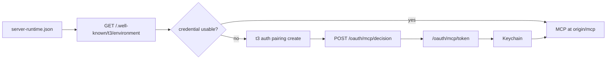
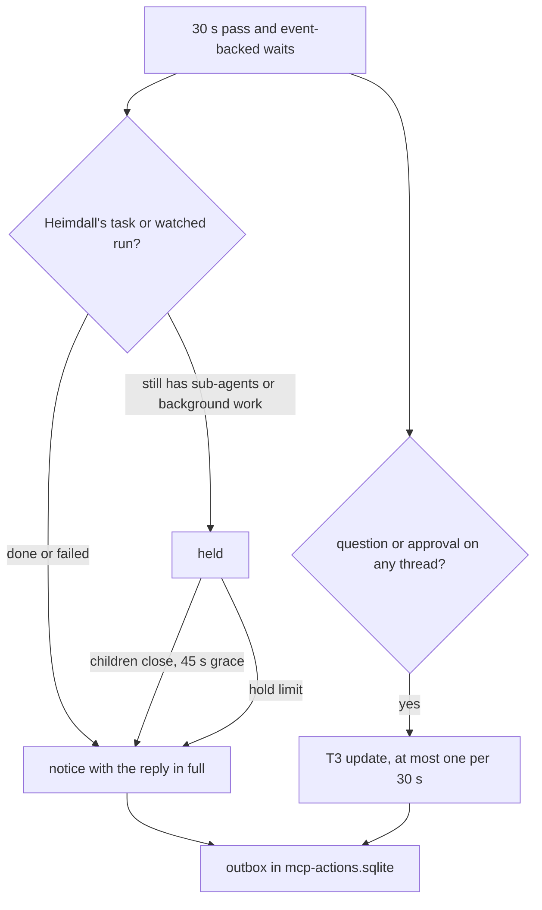

# T3 orchestration

Heimdall drives T3 Code as an outside MCP client: it starts tasks in T3 threads, reads and messages any thread, calls
the rest of T3's orchestrator tools, and wakes its agent when a task is done or a thread needs the user. This page is
the contract of those tools and the rules for following tasks.

Read this when: you want to change a T3 tool, find out why a task's result did or did not wake the agent, debug the T3
connection, change what needs the user's confirmation, or change how `delegate_task` picks a model or a worktree.
Code: `crates/t3/src/` (map in [crates/t3/README.md](../crates/t3/README.md)); the agent's tool schemas and
descriptions are in `crates/agent/src/mcp_contract.rs`; the app's glue is `crates/app/src/mcp_actions.rs`.

Heimdall's agent is a client of T3, not a T3 provider session: it signs in as its own MCP client, passes explicit
project and thread ids, and never borrows a worker's credentials or reads T3's database or signing keys.

## Connection

- Nothing connects until the user allows it (the setup wizard's Connect; `Client`'s `consent`). Until then the client
  never reads T3's files, pairs or calls T3.
- The origin comes from T3's `userdata/server-runtime.json` under `$HOME/.t3` (a hint) and is verified with
  `GET /.well-known/t3/environment` and its `environmentId`.
- MCP is Streamable HTTP at `<origin>/mcp`, protocol `2025-06-18` (`client::PROTOCOL`). A T3 restart re-initialises
  the MCP session with the same bearer.
- With no usable credential (none, expiring within `RENEW_MS` (3 days), or for another environment) Heimdall pairs
  itself: T3's CLI (`$HOME/.t3/bin/t3 auth pairing create`, scopes `orchestration:read`, `orchestration:operate`,
  `settings:write`, `source-control:write`), the code submitted to `POST /oauth/mcp/decision` as a `pairing-code`
  decision with access `full-access`, then exchanged at `/oauth/mcp/token` for the 30-day bearer. No browser and no
  click. A failed pairing waits `PAIR_BACKOFF_MS` (10 min) before the next automatic try.
- The bearer is kept in the Keychain (`client::KEYCHAIN_SERVICE`, account `oauth`; the public edition has its own
  service name). The session shows as "Heimdall" in T3's Settings → Connections.
- A 401 means the user revoked it: the credential is marked revoked, nothing pairs again automatically, and the island
  shows "Connect T3 · click". That click pairs the same way; the browser approval is only the fallback.
- T3 has no refresh grant, so expiry or revocation means pairing again.
- A closed T3 shows one "T3 Code closed" notice per outage and "T3 connected" when it is back. Connection state never
  reaches the agent's outbox, so a closed or unconnected T3 never wakes the agent.

## The agent's T3 tools

The tools use the names T3 gives its own thread agents, one call per action, with plain compact answers
(`crates/t3/src/text.rs`, `threads.rs`). T3's own `delegate_task`, `task_status` and `task_cancel` need a calling
thread inside T3 (the catalog marks them "Needs an agent running inside a T3 thread"), so Heimdall implements them for
its outside client with T3's meaning.

| Tool | Input | Result |
|---|---|---|
| `delegate_task` | `task` (the whole brief), `title`; optional `target` {`model`, `providerInstanceId`, `options`}, `path`, `isolation` (`shared`/`worktree`), `branch` | One line: title, task id (the thread id), model and options, and the job island bound to it. Starts a full-access thread in the deepest registered project containing `path`. A wrong model or option answers with the live choices. |
| `task_status` | optional `taskId` | Without: one line per task, newest first (id, title, state, model). With: its state line and latest reply in full (up to 64 KB, then the `t3_thread_read` call that continues it). |
| `task_cancel` | `taskId`, optional `reason` | Interrupts the running turn (waits up to 10 s) and archives the thread; wakes nothing. Not recursive: the task's sub-agents may finish. |
| `t3_thread_list` | optional `query` (title words), `limit` (10 by default, 50 at most) | One line per thread across all projects, active first: title, state, how long ago, "your task", thread id. Sub-agent threads are left out. |
| `t3_thread_read` | `threadId` or `threadIds` (up to 5); optional `last` (1 to 20; messages 3, activity 10 by default), `view` (`messages`/`activity`), `itemId` and `textOffset`, `details` | State line, then the last messages whole, oldest first, within 48 KB (`orchestrator::RESULT_BYTES`); a larger newest message continues by `itemId`/`textOffset`. `activity`: one line per timeline item with its id. `details` adds runs and settings. |
| `t3_thread_send` | `threadId`, `message`; optional `mode` (`auto`/`steer`/`queue`/`restart`), `confirm` | One line: delivery and state. A queued delivery names its queued run id, which `t3_queue` (`edit` or `cancel`) takes as `queuedRunId`. |
| `t3_tools` | optional `query`, or `tool` for one tool's schema | The rest of T3's live catalog; inside-only tools answer with the Heimdall tool to use. |
| `t3_call` | `tool`, `args`, optional `confirm`, optional `threads` (up to 100, archive only) | Calls any catalog tool. Args are checked against the live input schema; `clientRequestId` is filled with the action id; T3's error text comes back with secret-looking parts redacted; non-idempotent calls are recorded so a replay never repeats them. Thread reads, lists, sends and the model catalog come back in the compact forms. `t3_thread_wait` is capped at 55 s. |

### delegate_task defaults

- No `target`, or no `model`: personal edition, `workers::DEFAULT_TASK_MODEL` (`claude-opus-5-5`) at `DEFAULT_TASK_EFFORT` (`medium`,
  unless an effort is given), on the Claude account with quota left (`workers::default_target`,
  `failover::default_account`). The public edition names no vendor: the user's own T3 providers decide
  (`workers::catalog_default`): the model T3 says the caller runs, else the first enabled full-access provider's
  default model (or its first listed), at that model's own default options. Any model T3 lists is accepted; which
  models a task should use is the prompts' and the user's `my-models` rule.
- No `path`: the folder `workers::default_path` names; a folder no registered T3 project contains is
  `PROJECT_NOT_FOUND`.
- Heimdall puts the default task prompt (`agent::harness::WORKER_PROMPT`, from `crates/agent/prompt/worker.md`) and
  the approvals block (`workers::AVOID_APPROVALS`) above every brief (`Workers::set_brief_preamble`); see
  [skills.md](skills.md).
- Every message Heimdall sends a thread starts with a mark: `workers::STEER_MARK` into its own tasks,
  `MESSAGE_MARK` into other threads, so a task knows its orchestrator is speaking.
- Every task Heimdall starts (`delegate_task`, or a launch or fork through `t3_call`) gets a bound job island before
  the call returns (`Workers::on_task_started`); an output `.html` named in the brief becomes its open button.

### Worktrees

T3 binds a thread only to its project's root, an existing worktree of the project's own repository, or a new worktree
made from it, and it makes a worktree by running git at the project root.

- `isolation: worktree` with `path` in the project's own repository: T3's own worktree from `HEAD`.
- `isolation: worktree` with `path` in another repository (a repository inside a larger project folder): Heimdall makes
  the worktree itself (`git worktree add` from that checkout's `HEAD`, beside the main checkout as `<repo>-<branch>`,
  branch `branch` or `heimdall/<title>-<id>`). The thread runs at the project root, and the brief starts with
  "Working folder: <that worktree> (a new git worktree of …)". A replay reuses the worktree it made; another task given
  the same branch gets `WORKTREE_BRANCH_IN_USE`.
- `isolation: worktree` outside any repository: `ISOLATION_UNAVAILABLE`.
- `shared` with `path` in another repository: the thread runs at the root with "Working folder: …" before the brief;
  that repository is never passed as `worktreePath`.

### Sends that land

- T3 refuses a `steer` into a thread with no running turn. In one of Heimdall's own threads the send goes again at
  once as `auto` (a new turn) under the retry key `<op>-started`. In a thread Heimdall did not start, nothing is sent
  and the answer says to ask the user before starting a turn there.
- T3 refuses any send into an archived thread. One of Heimdall's own archived threads is unarchived and the message
  goes as `auto` under `<op>-unarchived` (`orchestrator::resend_archived`); other threads keep T3's refusal.
- While Heimdall's own earlier message still waits in that thread's queue, a new send (not `steer` or `restart`) joins
  it (`t3_queue` edit; `Workers::join_queued`), so one turn reads both.
- After a task's turn failed on its provider's sign-in, a send while the automatic retry is pending goes through and
  is that retry. A send within `AUTH_COOLDOWN_MS` (10 min) after the retry also failed answers `NOT_SENT` with when it
  may be sent (`t3_call` sends too).

### Crewmates

A crew thread is one of Heimdall's tasks with three differences: it never closes itself, only the crew layer may
send into, stop or archive it (`CREW_THREAD`), and its results go through the crew's record first. See
[crew.md](crew.md).

### Tasks close themselves

A task's run that completed with nothing of it open (no sub-agent or background work, no question or approval) gets
one more line after its reply (`workers::CLOSED`): no `task_cancel` is needed and a message reopens it. Once that
notice is delivered the task is archived (`archive_if_finished`: no active or newer run, no listed question, none of
its background work still running), at once or on a later pass. A failed delivery, a failed run or an interrupted run
leaves it open. `Workers::set_self_close(false)` turns this off (tests).

The answer's tails ("Its reply arrives as a notice when this run ends", "Add details with islands_put on that id") are
said only the first time in a Heimdall process (`Workers::once`).

### Confirmation

These return `CONFIRM_REQUIRED` with an exact question (`orchestrator::named_guard`, `DESTRUCTIVE`):

- always: deleting a project or a scheduled task, changing environment settings;
- on a thread Heimdall did not start: interrupting, stopping a workflow, restarting (`t3_thread_send` mode `restart`),
  archiving, editing, reordering, promoting or cancelling its queue, answering its question, merging it back, handing
  off its worktree, changing its model settings, or any other call T3 marks destructive.

Only the user's click on Yes approves one call; a spoken yes does not. The agent repeats the call with `confirm` set to
the `ask` card's `request_id`. To archive several threads, `t3_call` takes `args {action: "archive"}` and `threads`:
Heimdall's own archive at once, the user's get one question for the whole set (`orchestrator::archive_batch`, at most
`BATCH_MAX`).

Sends, pins, forks and launches stay free. T3's action tools (`t3_queue`, `t3_pending_request`,
`t3_thread_transfer`) are judged per `action` under their operation names (`orchestrator::operation`): their reads
(`list`, `read`, `status`) are free, a fork is free and becomes Heimdall's, a `merge_back` asks unless Heimdall
started both `threadId` and `targetThreadId`, and other writes follow the rules above and keep a replay record.

## Following tasks and waking the agent

The agent is woken for three things only:

- a task Heimdall started that is done or failed, with its reply in full (outbox id
  `terminal:{thread}:{run}:{state}`);
- the end of a run Heimdall sent a message into on another thread (`t3_thread_send`). After that result the thread
  stays followed for the runs T3 starts by itself (a sub-agent or background command finishing), each reported, until
  a run starts with a message (the user's own) or nothing new happens for `TRAIL_MS` (60 min) after the last notice;
- a question or an approval wait on any thread (the observer, at most one "T3 update" per `WAKE_GAP_MS`, 30 s). A
  task's approval wait wakes once per request with the card's text and the `t3-thread://` link that opens the
  thread; the same wait is kept for the task's job island (`Workers::approval_wait`).

Nothing else wakes it: finished runs of other threads, sub-agent and archived threads, Heimdall's own interrupts and
archives, a failed tool call inside a running task, and anything the observer's first pass after a start finds (a
silent baseline). Line ids are `t3:{thread}:{run}:done` or `t3:{thread}:{run}:attention:{request ids|approval}`, so a
run reported twice wakes once. Relay threads (`observer::RELAY_TITLES`) and background-call threads
(`observer::BACKGROUND_TITLE`) are never followed.

### When a task is done

"Done" is T3's own `task_status` rule: a turn that ends while the thread's sub-agents or background commands still run
is `waiting_for_children`, not a result. T3's MCP read does not expose that projection, so each pass reads the thread's
activity:

- **Sub-agents**: `subagent` items still pending, running or waiting. Inherited (forked) items do not count. A
  sub-agent resumed with SendMessage holds the task again. A sub-agent's question or approval is reported as its
  task's.
- **Background commands**: "Command running in background with ID: …" items without their `Command "…" finished`
  notification (or a KillShell or TaskStop of that id). Once a turn has ended, a command counts only while a process
  writes its output file (Claude's "Output is being written to: …", checked with one `lsof` call; a missing file or a
  failed check proves nothing).
- **Monitors**: a Claude `Monitor` counts from its tool item until T3's `Monitor "…" was stopped` (or finished), a
  TaskStop of that id, or its own `timeout_ms` (5 min unless named, 30 at most; a persistent one counts 30 min). A
  Monitor item still without a task id is read again on the next pass, for at most `MONITOR_START_MS` (2 min). Each
  monitor event starts a turn ("Background activity updated"); once a notice has named the task's background work,
  such a turn is progress, unless a sub-agent or command closed since that notice.

Holds and their limits (`crates/t3/src/workers.rs`):

- A held turn is superseded by the next turn. If the children close and no new turn starts within `CLEAR_GRACE_MS`
  (45 s), the held reply is delivered when those 45 s end.
- A sub-agent that closed while the turn ran holds it the same 45 s only when nothing shows the turn took its result
  in (a tool call that finished after the sub-agent closed, followed by a model call, means it did).
- Background commands still running after `BACKGROUND_HOLD_MS` (3 min) no longer hold the turn; the notice names
  them. Once a notice has named every command still running, later turns waiting only on them are progress again, up
  to `SUBAGENT_HOLD_MS` after that notice.
- A turn held for sub-agents is delivered after `SUBAGENT_HOLD_MS` (30 min) anyway, naming what it still waits on.
- A background command nothing can check keeps a cleared task from being archived for at most `UNCHECKED_HOLD_MS`
  (6 h): archiving stops the thread's session and every process it started.
- A held turn's reply rides in the thread's next notice, before the last turn's reply.

### Sign-in failures

A task turn that failed on its provider's sign-in (`text::auth_failure`: an expired OAuth session, an expired token, a
401; only the turn's own first line counts) wakes nothing. `AUTH_RETRY_MS` (5 min) after the first such failure
Heimdall sends the task one `AUTH_RETRY_MESSAGE`, idempotent by the failed run, unless the task has moved on by
itself. Its result arrives as usual with the failed turns' replies before it; a sign-in failure after the retry is
reported, saying the retry failed too. One retry per episode (2 h); any other ending clears it.

### Runs T3 cancelled before they started

T3's thread status is its latest run's, so a queued turn T3 dropped can make a working thread read "cancelled". The
scan, `task_status` and archiving follow the active run, else the newest run that started (`threads::followed_run`).
Exception: a run Heimdall's own message started that T3 dropped before it started is the thread's state, "cancelled",
reported once as "nothing of it ran; send it again". The job island (`crates/app/src/islands/binding.rs`) reads plain
`threads::current_run`.

### T3's leftover approval cards

Heimdall's permission hook answers prompts in Claude threads (see [harness-autonomy.md](harness-autonomy.md)), but T3
never closes the card the hook answered: it stays "waiting" and `pendingRequestCount` stays up until the provider
session closes. T3 gives an MCP client no way to resolve it (`t3_pending_request` `respond` answers questions only),
so Heimdall treats it as stale:

- While a run is live, a card counts as a wait only while its tool call has not run (`text::open_approvals`, by the
  tool call id). More approvals counted than cards already answered is a wait, so an answered card never hides a
  second prompt elsewhere, such as a sub-agent's (`text::approval_wait`). The answer is cached per thread until its
  `updatedAt` or pending count changes.
- Once the run has ended, no approval counts (`threads::live_requests`): `task_status`, thread labels, the observer,
  the islands and archiving ignore it. Open questions are still reported and keep a task open.
- Reading a thread's requests never stands between a finished run and its notice.
- `t3_call` of `t3_pending_request` `list` adds the thread's live approval wait, which T3's list leaves out.

### Restarts and the outbox

- Everything followed lives in `t3-workers.sqlite` (tasks, watched runs, cursors, children, held turns, notices), and
  every notice goes through the outbox in `mcp-actions.sqlite` under a deterministic id. After a restart the same work
  is followed: a run that ended while Heimdall was down is reported by the first pass, the outbox drains at the start
  of every pass (even with T3 closed), and a notice a quit cut short is offered again under the same id.
- The first pass of each app process sends one "Heimdall restarted" notice, one line per followed task or thread with
  its state; a model switch in the same process sends none.
- `Workers::heartbeat` (an app tick; each watcher pass runs the same check) drains the outbox, scans a followed thread
  whose latest run finished with no notice and nothing holding it, and delivers once more, as `{id}:again`, a result
  whose outbox row was dropped for a newer delivery epoch.

## Limits T3 sets

- No MCP tool deletes a thread, changes its runtime permission mode or approves a permission request. Archive is the
  closure; the user resolves approvals in T3.
- A client acts only on threads whose runtime mode does not exceed its grant, so Heimdall needs the `full-access`
  grant; a lower ceiling never silently upgrades. Access is environment-wide, so Heimdall enforces its own ownership
  boundary (`Workers::owns`, `TASK_NOT_OWNED`).
- `t3_thread_interrupt` interrupts one run, not the UI's recursive Stop, so `task_cancel` cannot stop a task's
  sub-agents.
- `t3_thread_launch`, attachment sends, fork, configure and organize take no retry key: Heimdall records a launch
  intent before launching and reconciles a lost response by it, never by launching again. Send and interrupt take
  `clientRequestId`, reused for the same operation only.
- Item text can change while streaming, and `textTruncated` continues by `itemId` and `textOffset` (UTF-16 code
  units), so a final reply is collected whole by id before it is delivered.
- Questions and approvals have no event over MCP: `pendingRequestCount` counts both, `t3_pending_request` `list`
  lists questions only, and no tool reads an approval's details. A positive count with no question ids is reported
  as "waits for an approval".
- `t3_thread_wait` returns at a terminal status; idle threads and terminal runs return at once, so waits are armed
  only for a new run or a timed-out active one. T3's WebSocket feed rejects MCP-client credentials, and `GET /mcp` is
  no event feed, hence the 30 s pass.
- `t3_thread_configure` changes model, options or provider instance. Same-instance changes apply on the next turn; a
  different instance switches provider with T3's own handoff. Heimdall's policy is one model family per thread, and
  configuring a thread it did not start needs the user's click.

## Checks

- `cargo test -p t3` runs the crate's tests against fake T3 servers (`crates/t3/tests/`).
- The ignored lab test `live_readonly_smoke_against_running_t3` (`-- --ignored`) reads a running T3 without changing
  it.

## See also

- [crates/t3/README.md](../crates/t3/README.md): the crate's code map
- [mcp.md](mcp.md): Heimdall's MCP server and the rest of the agent's tools
- [harness-autonomy.md](harness-autonomy.md): the permission hooks and the deny list
- [background-call.md](background-call.md): background jobs that run as T3 threads
- [claude-relay.md](claude-relay.md): the relay thread that acts as the agent
- [agent-window.md](agent-window.md): the island's question card and Connect T3
