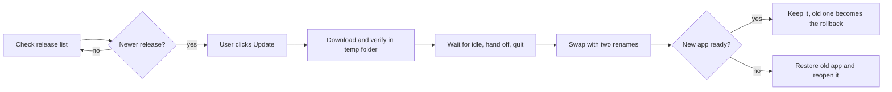

# In-app updates (Heimdall Alpha)

The public edition, Heimdall Alpha, updates itself from GitHub releases of `TobyNoSkillSon/Heimdall`
(`source::REPO`). Each release carries a zip, its checksum file and an Ed25519 signature over that file; the app checks
all of it, swaps the bundle through a helper and rolls back if the new version does not start. The personal edition
has no updater.

Read this when: you want to make a release, change which releases a build is offered, change how a download is
checked, debug a failed or rolled-back update, or roll an update back by hand.
Code: `crates/update` (`heimdall-update`; the helper is `src/bin/install_tool.rs`), `crates/app/src/updates.rs` (the
app side: policy, busy check, menu row), `scripts/package_release.sh`, `scripts/update_keygen.sh`.

## Make a release

1. Build the public edition: `scripts/bundle.sh --edition public` writes `dist/public/Heimdall Alpha.app` with
   `Contents/Helpers/heimdall-install-tool` ([install.md](install.md)).
2. Package it: `HEIMDALL_UPDATE_SIGNING_KEY=<key file> scripts/package_release.sh`. It writes
   `dist/releases/<version>/` (`HEIMDALL_RELEASE_OUTPUT_DIR` overrides) with `Heimdall-Alpha-<version>-arm64.zip`,
   `SHA256SUMS` and `SHA256SUMS.sig`, and prints the cask's `version` and `sha256` lines. It refuses: a key file not
   mode 600, a version that differs from the workspace's, a bundle that is not the public edition, a test fixture, an
   ad-hoc signature, a bundle without models, a missing required executable, an existing output folder, and a
   signature the compiled-in key does not accept. It uploads nothing.
3. Publish by hand: a GitHub release tagged `v<version>` with the three files, marked prerelease while the version has
   a prerelease part (`-alpha.N`). Then put the new version and `sha256` into the cask,
   `packaging/homebrew/heimdall-alpha.rb`, and push it to the tap.

Check: the release page lists exactly the three files, and a build of the previous version offers the update.

## Signing keys

- The release key's public half is `signing::ALPHA_KEY` in `crates/update/src/signing.rs` (key id
  `5c612905cafd1477`). The app trusts only the keys in `signing::TRUSTED_KEYS`. The private half lives outside every
  repository (the file mode 600, in a folder mode 700).
- `scripts/update_keygen.sh <folder>` makes a new pair and prints the Rust constant.
- Rotate a key by shipping the new public key in `TRUSTED_KEYS` one release before it signs anything.
- `SHA256SUMS.sig` is one line: `ed25519 <key id> <base64 signature>`; the key id is the first 16 hex digits of the
  SHA-256 of the public key.

## Which releases are offered

- The app reads `https://api.github.com/repos/<REPO>/releases?per_page=20`. Why the list and not `releases/latest`:
  GitHub's latest skips prereleases, and an alpha build must see newer alphas.
- A release is offered when it is published, not a draft, carries all three files, and is newer by Semantic
  Versioning (`0.1.0-alpha.2 < 0.1.0-beta.1 < 0.1.0`). It counts as a prerelease when GitHub marks it so or its
  version has a prerelease part.
- A prerelease build is offered the newest newer release, prerelease or stable. A stable build is never offered a
  prerelease, so taking a stable release ends the alpha channel.
- `HEIMDALL_UPDATE=0` in the app's environment turns updates off. `HEIMDALL_UPDATE_BASE=<https base>` reads
  `<base>/releases.json` and assets from `<base>/<tag>/<asset>`; `file://` works only in the crate's tests and in
  builds with the `local-releases` feature.

## When it checks and installs

- On only in the public edition and only when running from an app bundle (`updates::enabled_for`).
- Checks at launch when due, then every 24 hours (`state::DAY`); a thread wakes hourly, so a Mac that slept checks
  soon after waking, and a failed check retries within about an hour. One request to the release list; nothing else
  is sent.
- Never while busy: the agent in a run, Heimdall speaking, or the built-in engine loading a model
  (`updates::busy_reason`). A due check waits; Update is refused while busy.
- Nothing downloads until the user clicks Update. A verified download waits up to 15 minutes for idle
  (`IDLE_WAIT`), then hands off and the app quits.
- The status menu row above Support the Developer reads "Check for Updates…", "Update to X…" once one is offered, or
  "Update to X when idle…" while it waits. The personal edition has no row.
- Alerts (an offer, a result) run from a run-loop timer, never inside a main-queue block, and Quit closes an open
  alert. Why: a visible alert must never stop the app quitting for the install tool.

## What the download must pass

In a private `heimdall-update.XXXXXX` temp folder, before anything is stopped or moved (`prepare::Prepare`):

1. `SHA256SUMS.sig` is a valid Ed25519 signature over `SHA256SUMS` by a trusted key.
2. Exactly one `SHA256SUMS` line names the zip, and the zip's SHA-256 matches it.
3. The zip holds only `Heimdall Alpha.app/` entries: no `..`, backslash, `._*` or `__MACOSX`, at most 50,000 entries
   (`release::MAX_ENTRIES`).
4. The bundle is `com.tobynoskillson.heimdall` at exactly the release's version, with every executable in
   `Product::ALPHA.required` (the app, the speakers worker, `heimdall-clip`, `heimdall-emergency`, the install tool)
   and no link leaving the bundle.
5. `codesign --verify --deep --strict` passes, and its designated requirement equals the running app's. Why: the same
   requirement keeps macOS permissions and Keychain access. A build signed with another certificate (any self-built
   app) fails here and changes nothing.
6. `com.apple.quarantine` is removed from the staged copy (the app is not notarised).

Downloads are HTTPS only, redirects included, with no cookies, cache or credentials (`fetch.rs`).

## How the install tool swaps

The app writes a plan, starts `Contents/Helpers/heimdall-install-tool update --plan <plan.json>` and quits. The tool
(`install::Installer`):

1. Waits up to 2 minutes for the app to exit; if it does not, it changes nothing and writes a result.
2. Takes the lock `.heimdall-update/.lock` beside the app (shared by every user of that Applications folder) and
   repairs an interrupted earlier swap.
3. Checks the staged bundle again and refuses: a downgrade (older version, or older build of the same version), a
   destination signed by another identity, a linked destination, or any process still running the destination's
   executable. A refusal after the app exited is reported and the installed app is opened again.
4. Copies the new app to `.heimdall-update/incoming/` beside the destination (same volume) and checks its signature.
5. Swaps with two renames recorded in `.heimdall-update/journal.json`: the installed app to
   `.heimdall-update/previous/`, the new one into place.
6. Opens the new app and waits for its readiness file, `updates/ready.json`, written by the new app's own process at
   the new version. `ready` or `degraded` keeps it. No first status within 120 s (`HEIMDALL_UPDATE_READY_SECONDS`),
   an exit, `failing` for 60 s, or a status still loading after 15 minutes rolls back: the tool stops the new app and
   its workers, moves the previous app back, opens it and writes the reason to `updates/update-result.json`, shown at
   the next launch. A status naming another version counts as `failing`. The timers stand still while the Mac sleeps.
7. On success the replaced version becomes the one rollback, `.heimdall-update/rollback/Heimdall Alpha.app`, replacing
   any older one.

## Recover or roll back by hand

- Startup recovery runs in the app at every launch and in the tool before every update, and is skipped while the lock
  is held or when `.heimdall-update` does not exist. A crash between the two renames moves the previous app back; a
  crash after both keeps the new version and makes the previous one the rollback; a leftover incoming copy is removed.
- `heimdall-install-tool recover --destination <Heimdall Alpha.app> --state <state dir>` runs the same repair.
- `heimdall-install-tool rollback --destination <Heimdall Alpha.app> --state <state dir>` swaps the rollback back in
  and keeps the replaced version as the rollback. It repairs an interrupted update first and refuses while the app
  runs or an update holds the lock.
- The state dir is `$HOME/Library/Application Support/com.tobynoskillson.heimdall/updates/`: the update log, result,
  readiness file and last check. It stays in the pointer folder and does not move with the home folder
  ([home.md](home.md)). Settings, memories, archives, models and skills live in `<home>/.heimdall` and an update
  never touches them.

## Skills after an update

At each agent start `heimdall_update::skills::upgrade` updates the bundled skills the user never edited. An edited
skill stays as it is; the new copy goes to `updates/incoming-skills/<name>/`. Each release gets one notice in
`updates/inbox/<release>.json`, delivered until acknowledged. How skills reach the profile: [skills.md](skills.md).

## Limits

- A power cut in the instant between the two renames leaves no app at the destination until the next run of the
  install tool (`recover`) or a cask reinstall; the previous app waits in `.heimdall-update/previous/`. An atomic
  exchange (`renamex_np` with `RENAME_SWAP`) would close that window.
- If the tool dies while waiting for readiness (logout, shutdown), the next launch keeps the new version unverified,
  with the previous one as the rollback.
- An older build's settings save drops keys it does not know, so a rollback can lose settings the newer build added
  ([install.md](install.md)). A rollback does not roll back data schemas.
- The automated tests use ad-hoc signed fixture apps in temp folders. Two certificates with the same requirement,
  Gatekeeper on a quarantined download, `/Applications` permissions, `open` through LaunchServices, Keychain and
  permission continuity, Launch at Login, a full disk and a real SIGKILL are covered only by the VM script
  `crates/update/tests/vm/upd_vm.sh`.

## See also

- [install.md](install.md): building the public edition and installing by hand
- [editions.md](editions.md): what the public edition contains
- [home.md](home.md): the pointer folder and the data folder
- [skills.md](skills.md): bundled skills and the profile's copies
