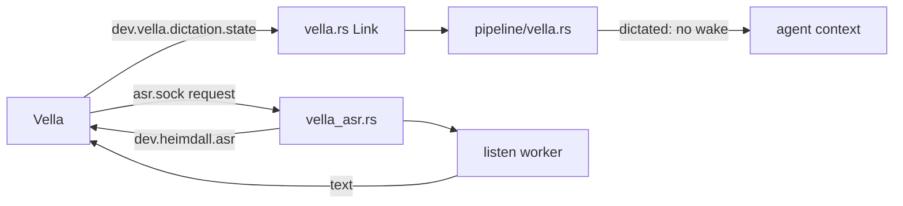

# Vella integration

Vella is a separate dictation app. Heimdall and Vella talk over two local channels: Vella tells Heimdall when the user
dictates, so dictated words never wake the agent, and Vella can borrow the transcription model Heimdall already holds.
Both channels are optional, both editions have them, and nothing leaves the Mac.

Read this when: you want to change how dictated lines are treated, debug why speech during dictation woke (or did not
wake) Heimdall, change the transcription socket's protocol or limits, or test the link without Vella.
Code: `crates/app/src/vella.rs`, `crates/app/src/pipeline/vella.rs`, `crates/app/src/vella_asr.rs`,
`crates/listen/src/worker.rs` (`transcribe_external`).



## Channel 1: dictation state

Vella owns the hotkey and knows whether a press really started recording, so it announces state; Heimdall never taps
keys. Why: a key tap would need Input Monitoring and would drift whenever a press does not toggle.

Vella posts `dev.vella.dictation.state` (`vella::NOTIFICATION`) on the distributed notification center with object
`dev.vella.dictation`. userInfo, parsed by `Notice::parse` (version 1 only; anything else is journalled as ignored):

| key | type | meaning |
|---|---|---|
| `v` | Int | protocol version, `1` |
| `state` | String | `on` while Vella records, else `off` |
| `reason` | String | `start`, `stop`, `heartbeat`, `hello` (launch, keybind change, or reply to Heimdall's query), `quit` |
| `session` | String | UUID of the recording session |
| `pid` | Int | Vella's process id |
| `sent` | Double | Unix seconds when posted |
| `mode` | String | `dictation` or `streaming` |
| `shortcut` | String | the active binding as JSON, Vella's `shortcuts.json` form |
| `shortcutLabel` | String | display form, for example `⌃⌘N · Toggle` |

- At start Heimdall posts `dev.heimdall.vella.query` (`vella::QUERY`, object `dev.heimdall`); Vella answers `hello`.
- While `on`, Vella posts a `heartbeat` every 15 s.
- Dictation counts as on only while a start or heartbeat arrived within `TIMEOUT_NS` (45 s) and Vella's pid is alive.
  A missed `stop` therefore ends dictation within 45 s (`Pipeline::vella_tick`, run on the live loop's settings tick).
- Heimdall stamps each notice on its host clock at receipt, less the posting delay, clamped to `MAX_DELAY_NS` (2 s).
- Every notice except an unchanged heartbeat is journalled as a `vella_dictation` evidence event.
- The island shows Vella's mark while dictation is on.

## Which lines count as dictated

- An utterance on the user's microphone is dictated when dictation intervals cover at least `DICTATED_SHARE` (half)
  of it. It is archived as usual, never sent early, never a spoken command, never decided on and never a wake. The
  agent sees it prefixed `[dictated to Vella] ` (`DICTATED_PREFIX`).
- Triggers are judged per word: a word is dictated when its middle lies inside dictation (`Pipeline::vella_split`).
  Only words outside dictation can name Heimdall, say "send it", stop it or match a spoken command.
- In a mixed line the agent and the decider see each dictated run as `[dictated to Vella: …]`; the archive keeps the
  words as said.
- Dictated words never barge in or stop Heimdall when it talks over them.

## Channel 2: the transcription socket

Heimdall serves its loaded Parakeet Ultra over a Unix socket so Vella need not load a second copy. The audio never
reaches VAD, Smart Turn, the archive, the decider or the agent.

Announcement: Heimdall posts `dev.heimdall.asr` (object `dev.heimdall`) when the listen model becomes ready, when it
goes, and in reply to Vella's `dev.vella.asr.query`. userInfo: `v` 1, `state` (`ready` or `gone`), `socket` (absolute
path), `model` (`parakeet-v3-ultra`, `vella_asr::MODEL`), `pid`, `sent`, `app` (the edition's app ID).

Socket place (`vella_asr::socket_dir`): a fixed folder per edition, never the movable data folder, so the two editions
never answer for each other.

| edition | app ID | socket |
|---|---|---|
| personal | `dev.heimdall.app` | `Library/Application Support/Heimdall/asr.sock` in the user's home (after a home move, the link left there) |
| public | `com.tobynoskillson.heimdall` | `Library/Application Support/com.tobynoskillson.heimdall/asr.sock` in the user's home, beside `home.json` |

- A run on its own `--data` folder keeps the socket in that folder, so a lab run never takes the installed app's
  socket.
- The socket is mode 0600. macOS limits socket paths to 104 bytes; the public path fits user names up to 31
  characters. If the socket cannot start, the error is logged and `VellaAsr::sync` retries every 30 s (`RETRY`).

Protocol, one connection per request. Request: one JSON line (within 4096 bytes and 2 s), then raw audio:

```
{"v":1,"op":"transcribe","model":"parakeet-v3-ultra","rate":16000,"samples":N,"format":"f32le"}\n
<N x 4 bytes, mono 16 kHz little-endian float32>
```

`{"v":1,"op":"status"}\n` answers `{"v":1,"ok":true,"state":"ready","model":"parakeet-v3-ultra","busy":false}`.

Response: one JSON line, then the connection closes:

```
{"v":1,"ok":true,"text":"…","queue_ms":3,"decode_ms":120,"audio_ms":8400,"model_ms":110,"windows":1}
{"v":1,"ok":false,"error":"busy|unavailable|too_long|bad_request|model_mismatch"}
```

Limits:

- At most `EXTERNAL_MAX_SAMPLES` (9,600,000 samples, ten minutes) per request; more is `too_long`.
- `EXTERNAL_SLOTS` (2): one request decoding and one waiting; more is `busy`. At most four connections at once.
- A stalled read is dropped after 10 s; a write times out after 5 s.
- A request is decoded in the engine's 15 s windows (`listen::long::WINDOW_SAMPLES`), one window per scheduling turn,
  between live batches. Why: decoding a long request at once would overflow the live per-source queues.

## Vella's side

Vella's own code holds these rules; they are listed so the protocol's other end is clear. Vella trusts a `ready` only
when the socket is one of the two edition paths above, `app` matches, the socket is the user's, mode 0600 and not a
link, and the peer runs as the user with the announced pid. It offers "Parakeet v3 Ultra · from Heimdall" as a model
row, sends one request per finished dictation, and on a connect failure, `ok:false` or no reply within 5 s plus a
tenth of the audio length, falls back to its own model if downloaded and marks Heimdall unavailable until the next
`ready`.

## Test the link without Vella

1. Dictation state: `cargo run -p app --bin heimdall-vella-link-lab -- [SECONDS]` (default 60, at most 600) installs
   the observer, posts the query and prints each notice from a running Vella and the link's state after it.
2. Socket: `cargo run --release -p app --bin heimdall-vella-asr-lab -- --data-dir <scratch dir> --probe <file.wav>
   --exit-after-probe` loads only the listen model, serves the socket in that folder and decodes the WAV through it.
   Add `--no-announce` to keep a running Vella from borrowing it.
3. Unit tests: `cargo test -p app vella` covers `vella.rs`, `vella_asr.rs` and
   `crates/app/src/pipeline/tests/vella_tests.rs`.

## See also

- [setup.md](setup.md): the Setup window's Vella row and its install button
- [decision-chain.md](decision-chain.md): what a non-dictated line goes through
- [listen-vocabulary.md](listen-vocabulary.md): the listen model and its vocabulary
- [capture.md](capture.md): the microphone sources
