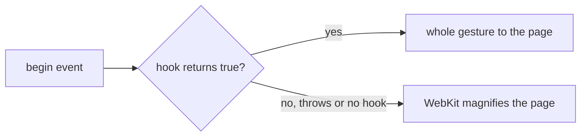

# The floating viewer

The viewer is a floating island that shows one file large in the middle of the screen: a report, a page, a picture,
a PDF, a recording. An HTML page in it can ask for its own size, take the trackpad pinch and send the user's choices
back to the agent.

Read this when: you want to open a file or report in the viewer, make a page open at a given size, let a page zoom its
own content on a pinch, have a page send a choice back or save picks, or check the viewer's rendering.
Code: `crates/app/src/islands/tools.rs` (`view`), `crates/islands/src/mac/viewer.rs`,
`crates/islands/src/model/viewer_kind.rs`, `crates/islands/src/model/viewer_size.rs`,
`crates/islands/src/model/page_pinch.rs`, `crates/islands/src/model/zoom.rs`, `crates/islands/src/model/share.rs`.

## Open a file

From the agent, call `islands_view` (schema in `crates/agent/src/mcp_contract.rs`):

| Argument | Type | Rule |
|---|---|---|
| `path` | string, required | an absolute path to a file that exists; anything else is refused |
| `title` | string, 1–40 characters | checked by the island title rules ([island-style.md](../islands/docs/island-style.md)); default: the file name without its extension |
| `actions` | 1–4 `{label, action}` | buttons on top of the viewer; a click comes back as a notice |

The island's id is `view-<file name>` (made safe by `files::safe_id`); pass it to `islands_remove` to close it. Calling
`islands_view` again on the same path reuses the island and stamps `updated`, so the helper reads the file anew.

From a shell, the islands CLI does the same (a relative path or `~` is resolved; an `--action` with no `=` uses its
label's slug as the action):

```
islands view <path> [--id ID] [--title T] [--action "Label=action"]...
```

What the viewer does:

- It opens expanded, centred on the display that holds the pointer, or the display the `islands_display` setting locks
  ([settings.md](settings.md)).
- It is never bound to a T3 thread: it stays up until the user closes it (its X; Esc or a click on the title row
  minimises it), so a job island that leaves takes no viewer with it.
- It watches its file and the file's folder (a save by rename is seen; events coalesce over 150 ms) and draws the file
  again, keeping the scroll position.
- Closing it pauses audio and video; removing the island stops them.
- ⌘C copies the selection and ⌘A selects all (the helper has no Edit menu, so the viewer sends them itself,
  `mac/viewer_edit.rs`). "Search With Google" in a context menu opens the default browser, not Safari.

## What each kind of file shows

The renderer is picked from the extension, then the UTType, then a UTF-8 sniff (`model/viewer_kind.rs`). Widths are the
widest the island gets by default (`FileViewer::max_width`):

| Kind | Shown as | Widest by default |
|---|---|---|
| Markdown | rendered: headings, lists, task boxes, quotes, code blocks, tables | 50 % of the display, 420–760 pt |
| Text and code | monospaced, coloured by language | 50 %, 420–760 pt |
| Image | fitted to the width at its own resolution; a tall one scrolls | 50 %, 420–760 pt |
| PDF | every page, scrolling; the first page fits whole | 56 %, 480–920 pt |
| HTML, SVG | WebKit, read access to the file's own folder | 56 %, 480–920 pt |
| Video | the system player with inline controls | 56 %, 480–920 pt |
| Audio | play and pause, a waveform, click or drag to scrub | 460 pt |
| Anything else | Quick Look | 56 %, 480–920 pt |
| A missing file | "Not found" | 320 pt |

- Without a size request a viewer is at most 78 % of the display tall.
- Markdown and text show the first 200,000 bytes (`TEXT_READ_LIMIT`), then a "file truncated" line. Text over
  150,000 bytes (`SYNC_TEXT_LIMIT`), PDFs and waveforms load off the main thread; the island resizes when the real
  height arrives.

### What an HTML page may load

- Every network load is blocked (`OFFLINE_RULES`: http, https, ws, wss, ftp). A navigation to anything but a
  `file://` URL or `about:blank` is cancelled; a web link the user clicks opens in the default browser instead.
- Pages under a trusted folder may also load HTTPS pictures and video: the islands folder's `docs/` and the folders in
  `FLOATING_ISLANDS_WEB_ROOTS`, which Heimdall sets to its home's `Reports`, `Assistant/Research` and `Assistant/Plans`
  (`crates/app/src/islands/supervisor.rs` `REPORT_DIRS`). The helper refuses a root that is `/`, the home folder or
  above it, or a Downloads or temporary folder (`trusted_root`).
- Why: a downloaded page must not be able to read its folder and send it out.

## Make a page open at a given size

1. Put the viewer meta in the page's `<head>`, within its first 64 KB (`ASK_SCAN`):
   ```html
   <meta name="heimdall-viewer" content="width=1500, height=1000">
   ```
2. Give the numbers in CSS px at zoom 1, which equal points. They size the page's own area (the web view), not the
   island's 48 pt title row (`look::BODY_TOP`), its 16 pt margins or its action rows.
3. Open the page with `islands_view` or `islands view`.
4. Check it offscreen at real size (lab build, see [Check it](#check-it)):
   `VIEWER_SHOTS_PAGE=/abs/page.html FloatingIslands --viewer-shots <out> islands/lab/fixtures` writes
   `viewer-page.png`.

The rules (`model/viewer_size.rs`):

- Either key may be left out: `width=1500` alone sets the width and keeps the default height.
- Only the first `<meta name="heimdall-viewer">` counts, and only HTML pages are read. Names and keys are case-blind;
  quotes may be single, double or none; pairs part at commas, semicolons or spaces; `width = 1500` reads as
  `width=1500`; a `px` or `pt` suffix is allowed.
- A number that is not finite, under 1 or over 10,000 (`ASK_MAX`) counts as not given.
- The viewer opens at the asked size up to the display's room: the display width less 16 pt, and the height under the
  menu bar and the notch row, 8 pt in (`viewer_room`). A page asking more gets the room.
- The island is never smaller than 320 × 144 pt: 320 wide, and the title row, margins, action rows and 80 pt of
  content tall (`viewer_min`).
- A page that asks a height gets it whatever its body measures.
- It is placed centred, 20 pt above the middle; one too tall for that is pulled down under the menu bar and kept 8 pt
  in from the sides and the bottom (`centred_origin`).

Use it for pages that read only at width, such as two documents side by side.

## Sizes the user gives

The viewer resizes like a window: a drag on a side, the bottom or a corner moves that edge (grip `GRIP` 8 pt, the top
edge `TOP_GRIP` 5 pt, corners `CORNER` 18 pt). The top-right corner holds the close button, so it resizes sideways only;
the title row still carries the island. Text rewraps and pictures, pages and PDFs refit while it moves.

The size is kept per file in `viewer-size.json` in the islands data folder (200 files, `viewer_size::KEEP`) and fitted
to the display it opens on next. For a page with a viewer meta, what it asked at the time of the drag is kept too
(`askedWidth`, `askedHeight`). The user's size wins while the page asks the same; a page that asks something new, or a
drag made before the page asked anything, opens at the page's size (`hand_size_stands`).

## Zoom

- Pinch, ⌘+ / ⌘− / ⌘0 (once the viewer has the keyboard after a click), and ⌘ with a two-finger scroll or a mouse
  wheel zoom about the pointer. Two fingers pan when zoomed.
- ⌘+ and ⌘− walk browser steps: 0.5, 0.67, 0.75, 0.8, 0.9, 1, 1.1, 1.25, 1.5, 1.75, 2, 2.5, 3, 4 (`zoom::STEPS`).
- Markdown, text, PDF and HTML zoom from 0.5 to 4 (`zoom::MIN`, `zoom::MAX`). A picture zooms in to 4× and out to the
  whole picture, never below 0.1 (`PICTURE_FLOOR`); a double-click on a picture zooms to 2× where clicked and back to
  the fit. In text, PDFs and pages a double-click selects a word.
- Audio, video and Quick Look files do not zoom.
- The zoom is kept per file in `viewer-zoom.json` in the islands data folder (200 files, `zoom::KEEP`).

## Let a page take the pinch

By default a trackpad pinch magnifies the whole page (WebKit's magnification; the page gets no event) and ⌘+ / ⌘−
change its page zoom. A page that zooms something itself (a map, one panel of several) can take the pinch:

1. Add `pinch=page` to the viewer meta; the size keys stay optional:
   ```html
   <meta name="heimdall-viewer" content="width=1500, height=1000, pinch=page">
   ```
2. Define `window.heimdallPinch(e)` before the user can pinch:
   ```js
   let zoom = 1;
   window.heimdallPinch = (e) => {
     if (e.phase === "begin") return overMyPanel(e.x, e.y);   // true: this whole gesture is the page's
     if (e.phase === "change") setZoom(zoom *= e.scale, e.x, e.y);
     if (e.phase === "double-tap") { setZoom(zoom = 1); return true; }
   };
   ```
3. Check it with `--viewer-pinch-shots` (see [Check it](#check-it)).



The contract (`model/page_pinch.rs`):

- For each magnify event the viewer calls the hook with `{phase, scale, x, y}`. A page without `pinch=page` is never
  called.
- `phase` is `"begin"`, `"change"`, `"end"` or `"double-tap"` (two fingers tapped twice).
- `scale` is that event's own factor, `1 + magnification`, never below 0.05 (`MIN_FACTOR`): multiply your zoom by it.
  Chromium gives a page the same factor per pinch update as a ctrl+wheel event (`exp(-deltaY / 100)`), so one handler
  zooms alike in both.
- `x`, `y` are the pointer in the page's CSS px (`clientX`, `clientY`).
- The answer to `"begin"` routes the whole gesture. Exactly `true` makes every event of it the page's, wherever the
  pointer goes. Anything else, a throw or no hook, and that gesture magnifies the whole page.
- A `"double-tap"` that does not return `true` gets the viewer's own smart zoom.
- The call is asynchronous. Until the page answers a begin, the viewer holds the gesture's events (at most 120,
  `MAX_HELD`, about a second), then hands them to the page as one change at the last point, or replays them to WebKit
  in order. Nothing is lost or doubled.
- A page's pinch never changes the page zoom, ⌘+ / ⌘− or the zoom kept per file.
- A page in a frame from another file origin cannot be called directly: the top page's hook passes the event on with
  `postMessage`.

## Send a choice back from a page

An HTML page in the viewer has `window.heimdall.send(action, value, label)`, defined before its scripts run; a
`heimdall-ready` event on `document` and `window` says it is there. A page may also call
`window.webkit.messageHandlers.heimdall.postMessage({action, value, label})`.

- Each message writes the response `{island: <viewer id>, kind: "report", action, value, label}`, which reaches the
  agent as a notice.
- `action: "save"` with `value: {file, data}` first writes `data` as pretty JSON to `file` beside the page (temp file
  and rename), when `file` is a bare `*.json` name of at most 128 characters: no folders, no hidden file, no `..`
  (`model/onesys.rs` `save_name_ok`). The response's value then carries `saved` (the path) or `refused`. A comparison
  page's picks persist this way.

## Proposed actions and the drag handle

- `actions` (or `--action`) are buttons on top of the open viewer, at most three a row, the first one white. A click
  asks "Sure?" first ("Later" goes at once), then writes `{island, kind: "button", action}` and shows the choice for
  1.6 s; the buttons stay for another choice.
- An open viewer of a file that exists shows the file's Finder icon in its title row. Dragged, it is a real file drag
  into chats, Mail, Finder or browser uploads; clicked, the file goes on the clipboard (a green check for 1.2 s).
- An HTML page that loads files from its own folder goes as one self-contained copy with those files inlined as data
  URIs (`model/share.rs`: 64 MB a file `MAX_ASSET`, 160 MB in all `MAX_TOTAL`), in a fresh folder under
  `$TMPDIR/FloatingIslands-shares`; copies older than a day (`KEEP`) are swept. Files outside the page's folder, hidden
  files and files of the wrong kind for their element are never inlined; a page directly in the home folder or at the
  root is not bundled.

## Check it

The harness flags exist only in the lab build of the helper:

```
nice -n 19 cargo build --release -p islands --features lab -j 2
```

- `FloatingIslands --viewer-shots <out> islands/lab/fixtures`: offscreen renders of every kind at real size, no window
  shown and no lab folder needed. It includes `html-asks-wide` (fixture `wide.html`), the report bridge (fixture
  `report-bridge.html`, `viewer-bridge` lines) and a live-refresh check (`viewer-refresh` lines) in `report.txt`.
  `VIEWER_SHOTS_PAGE=/abs/page.html` adds one real page as `viewer-page.png`.
- `FLOATING_ISLANDS_DIR=<lab dir> FloatingIslands --viewer-pinch-shots <out> <page.html> <sequences.json>`: magnify
  gestures made in code go through the real web view; `islands/lab/pinch_parity.py` compares each step against the same
  page in Chromium. It also checks that a page with no meta, a throwing hook or no hook still magnifies whole.
- `islands/lab/viewer_real.sh <out>`: the fixtures through `islands view` in real windows, each captured alone.
- `islands/lab/share_check.sh <out>`: the drag handle's copy and a real drag session, offscreen.
- `cargo test -p islands --test viewer --test viewer_size --test page_pinch --test zoom --test share`: the viewer,
  size, pinch routing, zoom and share models.

## See also

- [islands-capabilities.md](islands-capabilities.md): job islands, `islands_put` fields and parts
- [one-system.md](one-system.md): the plan lists and the job reports that open in the viewer
- [settings.md](settings.md): `islands_display` and the other island settings
- [islands/README.md](../islands/README.md): the islands helper, its files and CLI
- [islands/docs/model-html.md](../islands/docs/model-html.md): HTML drawn inside a job island (not the viewer)
